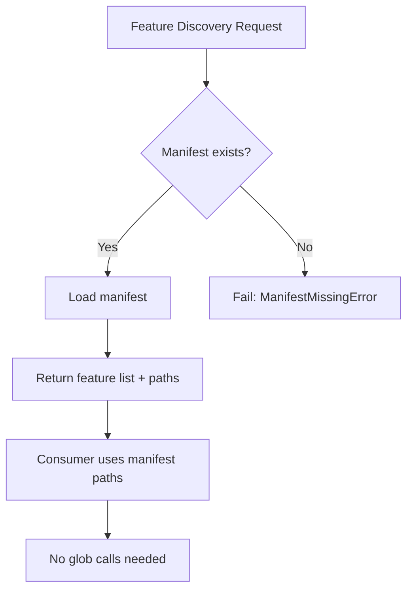

# PRD: Version Material File Map Contract

**Feature**: `version-material-file-map-contract`
**Version**: `v1.4.12`
**Status**: `frozen`
**Date**: `2026-05-31`
**Language**: `en`

## Overview

Beacon does not have a canonical version-level feature list. Every module that needs to know "which features exist in this version" independently scans directories with glob patterns. This contract introduces a manifest-based approach where `version-features.json` is the single source of truth for feature discovery, and all glob-based discovery is replaced by manifest reads.

## Outline

## Context

- Global boundaries: `docs/beacon/global-boundaries.md`
- Source-anchored evidence: `docs/beacon/v1.4.12/research/version-material-file-map-contract.md`
- Source architecture: `docs/beacon/v1.4.12/source-architecture/version-material-file-map-contract.md`

## Problem

Feature discovery in Beacon relies on glob patterns scattered across multiple modules (`material_sync.py`, `material_audit.py`, `release.py`, `design.py`, `implement/commands.py`). Different modules may see different feature sets. No canonical manifest exists to answer "which features does this version have?"

## Goals

- AC-001: A single `version-features.json` manifest serves as the canonical source of truth for feature discovery and path resolution within a version.
- AC-002: All glob-based feature discovery is replaced by manifest reads. No `_build_legacy_manifest_from_glob` fallback exists.
- AC-003: `beacon manifest add-feature` registers a feature with all its truth and evidence paths in the manifest.
- AC-004: `beacon manifest verify --strict` checks that every path in the manifest exists on disk.
- AC-005: `build_requirement_package_gate` reports `manifest_truth_file_missing` when a truth file referenced in the manifest does not exist.

## Design Principles

- Single source of truth: `version-features.json` is the canonical manifest; glob discovery is eliminated.
- No compat fallback: v1.4.12+ does not serve v1.4.11 or earlier directory structures through a glob fallback.
- Fail closed: if the manifest does not exist for v1.4.12+, `ManifestMissingError` is raised.
- Explicit registration: features are added and removed through `beacon manifest add-feature` / `remove-feature`, not discovered by accident.

## Scope

### In Scope

- `beacon/commands/manifest.py` CLI module
- `beacon/utils/manifest.py` core manifest logic (load, save, validate, compute_feature_paths)
- Migration of all glob consumers to manifest reads
- `beacon manifest verify --strict` consistency checks
- `beacon manifest sync` for initial population and emergency repair

### Out of Scope

- Format validation of truth files (belongs to unified-truth-template-cli-contract)
- Modification of truth file content
- v1.4.11 or earlier version compatibility
- `.beacon/state/` or runtime-ledger projection changes
- Skill discovery or adapter changes

## Functional Requirements

| FR ID | Related AC | Requirement |
|-------|-----------|-------------|
| FR-001 | AC-001 | `version-features.json` stores features array, each with slug, status, language, truth_paths, evidence_paths |
| FR-002 | AC-001 | `version-features.json` stores version_level_paths for research, execution, release, change, design directories |
| FR-003 | AC-002 | `load_manifest_or_fail` raises `ManifestMissingError` when manifest does not exist for v1.4.12+ |
| FR-004 | AC-002 | `_discover_features` reads `load_manifest_or_fail` instead of `glob(user-story/*.md)` |
| FR-005 | AC-002 | `_feature_names` reads `load_manifest_or_fail` instead of glob across three directories |
| FR-006 | AC-002 | `build_material_audit` reads manifest paths instead of glob for research, release, execution |
| FR-007 | AC-002 | `release.py` reads manifest paths instead of glob patterns |
| FR-008 | AC-002 | `implement/commands.py` reads manifest instead of `glob(*/state.json)` |
| FR-009 | AC-002 | `design.py` reads manifest design paths instead of `glob(*.md)` |
| FR-010 | AC-003 | `beacon manifest add-feature` computes all fixed paths and writes to manifest |
| FR-011 | AC-003 | `beacon manifest add-feature` writes transaction record to `.beacon/transactions/manifest-<txid>.json` |
| FR-012 | AC-004 | `beacon manifest verify --strict` checks every path in manifest exists on disk |
| FR-013 | AC-005 | `build_requirement_package_gate` returns `blocked` with reason `manifest_truth_file_missing` when truth file missing |

## Source Contract

- `beacon/utils/material_sync.py:18-22` — `_discover_features` migration
- `beacon/utils/material_audit.py:77-85` — `_feature_names` migration
- `beacon/utils/material_audit.py:201-250` — `build_material_audit` migration
- `beacon/utils/docs_structure_contract.py:110-117` — release_root glob migration
- `beacon/commands/release.py:244,261` — release file discovery migration
- `beacon/commands/implement/commands.py:4836` — state.json discovery migration
- `beacon/commands/design.py:256` — design file discovery migration
- `beacon/utils/branch_governance.py:1-230` — fnmatch rule migration

## State Axes

| Axis | States | Meaning |
|------|--------|---------|
| manifest_state | absent, created, synced, verified | Manifest lifecycle states |
| feature_status | template, frozen, released | Feature lifecycle within manifest |
| feature_discovery_mode | manifest_only | v1.4.12+ only supports manifest-based discovery |

## Acceptance Criteria

- AC-001: Manifest is the single source of truth for feature discovery within a version.
- AC-002: Zero glob calls remain in v1.4.12+ code paths for feature discovery.
- AC-003: `beacon manifest add-feature` registers a feature with all truth and evidence paths.
- AC-004: `beacon manifest verify --strict` confirms every manifest path exists on disk.
- AC-005: `build_requirement_package_gate` blocks on missing truth file with `manifest_truth_file_missing`.

## Non-Goals

- Format validation of truth files (belongs to unified-truth-template-cli-contract).
- Backward compatibility with v1.4.11 or earlier glob-based discovery.
- Migration of existing truth file content.
- Skill discovery or adapter changes.

## Success Metrics

- `beacon manifest verify --strict` exits 0 for a properly populated manifest.
- `beacon doctor verify-materials --strict` makes zero glob calls for feature discovery.
- Deleting a truth file causes `build_requirement_package_gate` to return `blocked` with `manifest_truth_file_missing`.
- Empty version `beacon manifest sync` produces a valid manifest with zero features.
