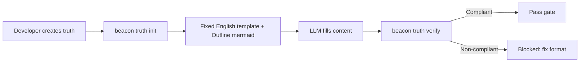

# User Story: Unified Truth Template CLI Contract

**Feature**: `unified-truth-template-cli-contract`
**Version**: `v1.4.12`
**Status**: `frozen`
**Date**: `2026-05-31`
**Language**: `en`

## Story

As a Beacon developer, I want truth documents to follow a fixed English template with mandatory mermaid Outline diagrams, so that format compliance is machine-verifiable and readers get a visual outline before detailed content.

## Outline



## Acceptance Criteria

| AC ID | Theme | Description |
|-------|-------|-------------|
| AC-001 | template-format | `beacon truth init` generates documents with fixed English section titles, no numbering, and mandatory Outline mermaid blocks |
| AC-002 | verify-enforcement | `beacon truth verify --strict` enforces format: mandatory sections, no numbering, table columns, Language consistency, mermaid presence |
| AC-003 | immutable-structure | Section titles and table column names are pure English, CLI-controlled, not LLM-configurable |
| AC-004 | language-param | `--lang en|zh` writes Language front matter field; content language heuristic checks consistency |
| AC-005 | manifest-integration | `beacon truth init all` integrates with `beacon manifest add-feature` |
| AC-006 | refreeze-only | No `migrate-truth-format` command; format upgrades go through `beacon change --refreeze-chain` |
| AC-007 | old-entry-adaptation | `beacon prd create` and `prd_bootstrap.py` use new template for v1.4.12+ |
| AC-008 | prd-outline | PRD has `## Outline` with mermaid block immediately after `## Overview` |
| AC-009 | us-outline | User Story has `## Outline` with mermaid block immediately after `## Story` |
| AC-010 | tc-outline | Test Case has `## Outline` with mermaid block before `## Coverage Matrix` |

## State Axis Coverage

| AC ID | State Axis | Transition | Covered |
|-------|-----------|------------|---------|
| AC-001 | template_state | absent → template_created | Yes |
| AC-001 | template_state | template_created → content_filled | Yes |
| AC-002 | format_compliance | unverified → compliant | Yes |
| AC-002 | format_compliance | unverified → non_compliant | Yes |
| AC-004 | content_language | en → zh | Yes |

## Test Story Map

| Test ID | Covers | Scenario |
|---------|--------|----------|
| TC-001 | AC-001 | `beacon truth init prd --feature test` produces English section titles, no numbering, Outline mermaid |
| TC-002 | AC-001 | `beacon truth init prd --feature test --lang zh` produces English titles but `**Language**: zh` |
| TC-003 | AC-002 | `beacon truth verify --strict` passes for compliant file |
| TC-004 | AC-002 | Verify rejects file with numbering prefix `## 1. Problem` |
| TC-005 | AC-002 | Verify rejects file missing `## Outline` section |
| TC-006 | AC-002 | Verify rejects Outline section without ` ```mermaid ` block |
| TC-007 | AC-003 | Template section titles are English strings in render functions |
| TC-008 | AC-004 | `--lang zh` produces `**Language**: zh` in front matter |
| TC-009 | AC-004 | En content in zh template produces `language_mismatch` warning |
| TC-010 | AC-005 | `beacon truth init all` calls manifest add-feature |
| TC-011 | AC-006 | No `migrate-truth-format` subcommand exists |
| TC-012 | AC-007 | `beacon prd create` uses `truth_template.render_prd_template()` for v1.4.12+ |
| TC-013 | AC-008 | PRD template has `## Outline` after `## Overview` |
| TC-014 | AC-009 | User Story template has `## Outline` after `## Story` |
| TC-015 | AC-010 | Test Case template has `## Outline` before `## Coverage Matrix` |

## References
- Research: `docs/beacon/v1.4.12/research/unified-truth-template-cli-contract.md`
- PRD: `docs/beacon/v1.4.12/prd/unified-truth-template-cli-contract.md`
- Test cases: `docs/beacon/v1.4.12/qa/test-cases/unified-truth-template-cli-contract.md`
