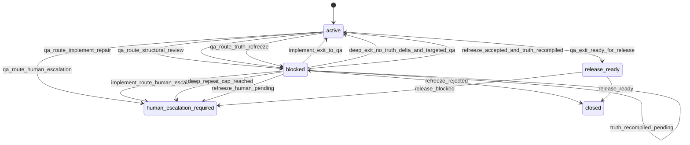
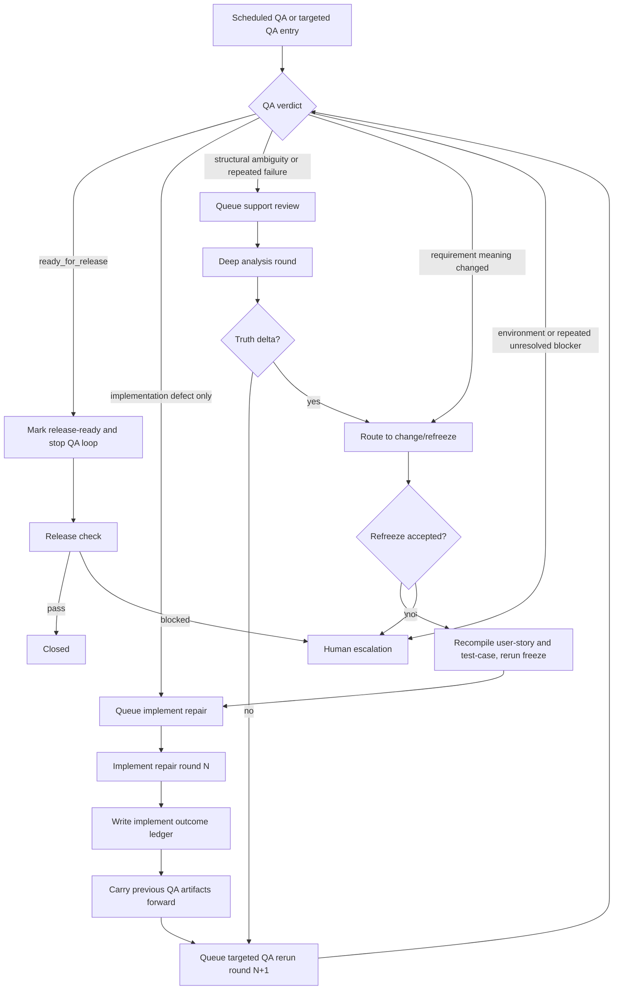

# Beacon v1.4.7 Research: Agent Skills, Gstack, Lifecycle Comparison, and Meta-Protocol Direction

> Date: 2026-05-14
> Scope: Beacon `v1.4.6` current runtime release line vs `addyosmani/agent-skills` and `garrytan/gstack`
> Status: Research only
> Source refs:
> - `docs/brainstorms/2026-05-13-beacon-brainstorm-beacon-v1.4.6-evolution-brainstorm-absorb-addyosmani-agent-skills-engineering-ph.md`
> - `/Users/apple/Developer/Personal/oss-sync/agents/agent-skills/addyosmani-agent-skills/README.md`
> - `/Users/apple/Developer/Personal/oss-sync/agents/agent-skills/addyosmani-agent-skills/docs/skill-anatomy.md`
> - `/Users/apple/Developer/Personal/oss-sync/agents/agent-skills/addyosmani-agent-skills/skills/using-agent-skills/SKILL.md`
> - `/Users/apple/Developer/Personal/oss-sync/agents/agent-skills/addyosmani-agent-skills/skills/spec-driven-development/SKILL.md`
> - `/Users/apple/Developer/Personal/oss-sync/agents/agent-skills/addyosmani-agent-skills/skills/incremental-implementation/SKILL.md`
> - `/Users/apple/Developer/Personal/oss-sync/agents/agent-skills/addyosmani-agent-skills/skills/code-review-and-quality/SKILL.md`
> - `/Users/apple/Developer/Personal/oss-sync/agents/agent-skills/gstack/README.md`
> - `/Users/apple/Developer/Personal/oss-sync/index/analysis/garrytan-gstack.md`
> - `/Users/apple/Developer/Personal/oss-sync/index/learning/garrytan-gstack.zh-CN.md`
> - `/Users/apple/Developer/Personal/oss-sync/agents/agent-skills/gstack/docs/skills.md`
> - `/Users/apple/Developer/Personal/oss-sync/agents/agent-skills/gstack/docs/ADDING_A_HOST.md`
> - `/Users/apple/Developer/Personal/oss-sync/agents/agent-skills/gstack/docs/OPENCLAW.md`
> - `/Users/apple/Developer/Personal/oss-sync/agents/agent-skills/gstack/docs/REMOTE_BROWSER_ACCESS.md`
> - `skills/beacon/SKILL.md`
> - `skills/beacon/using-beacon/SKILL.md`
> - `skills/beacon/beacon-prd/SKILL.md`
> - `skills/beacon/beacon-implement/SKILL.md`
> - `skills/beacon/beacon-qa/SKILL.md`
> - `skills/beacon/beacon-release/SKILL.md`
> - `docs/beacon/global-boundaries.md`
> - `docs/beacon/v1.4.6/SUMMARY.md`
> - `docs/beacon/v1.4.6/prd/beacon-v1.4.6-automation-jobs-feedback-loop-and-queue-governance.md`
> - `docs/beacon/v1.4.6/execution/automation-jobs-runbook.md`
> - `beacon/utils/automation_feedback.py`
> - `beacon/utils/automation_queue.py`
> - `beacon/utils/qa_feature.py`

---

## 1. Research Goal

This note evaluates how Beacon should evolve after `v1.4.6` by comparing its current lifecycle and skill system against two influential open-source references:

- `addyosmani/agent-skills`
- `garrytan/gstack`

The question is not whether Beacon should copy that repository.

The real questions are:

> Which parts of these open-source systems strengthen Beacon's engineering surface without breaking Beacon's core identity as an evidence-first, truth-governed, release-gated workflow kernel?

---

## 2. Current High-Level Judgment

Current alignment between Beacon `v1.4.6` and the external references is best described as:

- structurally aligned on **skill anatomy**
- philosophically adjacent on **anti-rationalization** and **workflow discipline**
- intentionally different on **truth, gate, and release governance**
- still incomplete on **horizontal engineering skill breadth**
- still underdeveloped on **role-packaged engineering acceleration** compared with `gstack`

Practical judgment:

> Beacon `v1.4.6` has already absorbed the most valuable structural ideas from `agent-skills`, but it has not yet absorbed enough horizontal engineering skills or role-packaged acceleration patterns to feel like a complete engineering operating system.

### 2.1 Converged Brainstorm Verdict

This research can be reduced to one practical framing:

```text
agent-skills = engineering skill library
gstack       = specialist software factory
Beacon       = truth/evidence/governance kernel
```

Each system is solving a different primary problem:

- `agent-skills` optimizes for broad engineering skill coverage and simple phase-based discovery
- `gstack` optimizes for operator-perceived power, specialist packaging, and shipping velocity
- Beacon optimizes for requirement truth, anti-drift execution, audited QA, and release closure

The correct `v1.4.7` question is therefore not:

> How can Beacon become more like those systems?

It is:

> How can Beacon absorb their strongest engineering advantages while preserving Beacon's kernel identity?

### 2.2 Capability Trait Matrix

| Dimension | `agent-skills` | `gstack` | Beacon `v1.4.6` |
|---|---|---|---|
| Primary identity | Engineering skill library | Specialist software factory | Governed workflow kernel |
| Public shape | phase-oriented skill set | large specialist command surface | compact main chain + support surfaces |
| Requirement truth | light | light-medium | strong |
| Execution discipline | medium | strong | strong |
| QA/release governance | medium | medium | strongest |
| Human discoverability | high | very high | medium |
| Role packaging | low-medium | very high | medium |
| Host portability story | high | very high | medium-high |
| Anti-drift / canonical truth | low | low-medium | very high |
| Auditable memory / learning | low | medium | high |

### 2.3 Lifecycle Delta in One View

```text
agent-skills
define → plan → build → verify → review → ship

gstack
think → plan → build → review → test → ship → reflect

Beacon
prd → user-story → test-case → implement → qa → release
```

Interpretation:

- `agent-skills` is a broad engineering phase map
- `gstack` is a role-heavy operator sprint map
- Beacon is a truth-to-release closure map

Beacon should preserve its own map.
It should only add better translation layers and stronger support capabilities around it.

### 2.4 Root-Preservation Rule

For `v1.4.7`, Beacon should preserve these non-negotiables:

1. the main chain remains compact
2. support surfaces do not become lifecycle stages
3. truth stays canonical and versioned
4. QA and release stay evidence-backed and fail-closed
5. learning stays advisory, replayable, and auditable
6. skills default to philosophy + minimum tools + necessary facts, not rigid scripts

Any evolution idea that weakens one of these should be rejected even if it improves discoverability or short-term ergonomics.

### 2.5 Enhancement Rule

Under those constraints, Beacon should strengthen itself in four ways:

1. **be easier to enter**
   - stronger meta-protocol
   - clearer host routing
   - better lifecycle translation for outside users
2. **feel more complete**
   - more horizontal engineering support skills
   - more visible specialist overlays
3. **be easier to read**
   - lightweight references
   - clearer route explainability
   - more human-readable learning projections
4. **stay hard at the core**
   - no truth/gate dilution
   - no support-surface overreach
   - no expansion of the public main chain

---

## 3. Lifecycle Comparison

### 3.1 `agent-skills` lifecycle model

`agent-skills` presents a broad engineering lifecycle:

```text
define
→ plan
→ build
→ verify
→ review
→ ship
```

It is strong at:

- broad engineering discoverability
- cross-cutting engineering guidance
- direct skill invocation by development phase
- simple host adoption

### 3.2 `gstack` lifecycle model

`gstack` presents itself less as a compact skill library and more as a full software-factory command surface:

```text
think
→ plan
→ build
→ review
→ test
→ ship
→ reflect
```

But the more important framing is not phase naming.

It is a specialist-role system:

- office-hours
- CEO review
- eng review
- design review
- devex review
- review
- QA
- security
- release
- retro
- browser and session tools

It is strong at:

- role-packaged specialist entrypoints
- command-driven orchestration
- fast multi-host installation
- practical browser/session tooling
- making one operator feel like they have a virtual team

### 3.3 Beacon lifecycle model

Beacon's public main chain remains:

```text
prd
→ user-story
→ test-case
→ implement
→ qa
→ release
```

With `prototype` as a conditional insertion layer and `brainstorm / deep / ceo-review / design-review / help / status / doctor / archive` as support surfaces.

Beacon is strong at:

- requirement truth closure
- evidence-backed implementation and QA handoff
- audited release gating
- anti-drift delivery governance

### 3.4 Net comparison

`agent-skills` is better as a **general engineering phase model**.

`gstack` is better as a **high-energy specialist-role operating kit**.

Beacon is better as a **truth/evidence/governance closure model**.

That difference is real and should remain real.

Beacon should not erase it by becoming either:

- a generic phase-only workflow pack
- or a command-bloated specialist catalog

---

## 4. Where Beacon Already Aligns Well

### 4.1 Skill anatomy

Beacon `v1.4.6` has already converged toward a strong common skill skeleton:

- `Overview`
- `When to Use`
- `Common Rationalizations`
- `Red Flags`
- `Verification`
- `Inputs Contract`
- `Decision Protocol`
- `Anti-Inertia Notes`
- `Learning Notes`
- `Backstop CLI`
- `Examples`

This is a stronger and more governance-aware adaptation of the `agent-skills` anatomy pattern.

### 4.2 Anti-rationalization discipline

`agent-skills` is unusually strong at encoding agent excuses and rebuttals.

Beacon `v1.4.6` has already adopted this pattern into key public skills.

This is one of the most successful absorptions from external skill ecosystems.

### 4.3 Stage routing discipline

`agent-skills` uses `using-agent-skills` to route by development phase.

Beacon uses:

- `beacon` as human-facing wrapper
- `using-beacon` as router
- concrete surface skills for truth, execution, QA, and release

This is directionally correct and already host-usable.

### 4.4 Host-surface projection engineering

Beacon is ahead of `agent-skills` in one important dimension:

- multi-host projection into `.agents`, `.cursor`, `.trae`, `.windsurf`
- version-surface governance
- package/runtime/docs alignment

`agent-skills` is more portable as a repo.
Beacon is more governed as a runtime line.

### 4.5 Support-surface discipline vs `gstack`

Compared with `gstack`, Beacon is much more disciplined about one important thing:

- not every useful capability becomes a public lifecycle step
- support surfaces stay explicitly non-truth and non-gate by default
- route-back semantics are clearer

This makes Beacon slower to feel powerful, but safer against lifecycle sprawl.

---

## 5. Where Beacon Is Stronger Than `agent-skills`

These are not gaps. They are Beacon's differentiators and should remain intact.

### 5.1 Requirement truth closure

Beacon's:

```text
prd
→ user-story
→ test-case
→ acceptance
```

closure model is much stricter than the external pack's phase framing.

### 5.2 Gate and release governance

Beacon has:

- layered QA proof
- release blockers
- version truth
- promotion mechanics
- evidence manifests
- machine-readable state and transaction projections

`agent-skills` does not attempt this level of audited delivery closure.

### 5.3 Anti-drift delivery model

Beacon's canonical truth, projection, transaction consistency, and release proof chain are part of its product identity.

These are not optional add-ons.

### 5.4 Support-surface constitution

Beacon has become much clearer that support surfaces are:

- not truth sources
- not gate sources
- not new lifecycle stages

That boundary discipline is stronger than most open workflow skill packs.

---

## 6. Where Beacon Still Lags

### 6.1 Meta-skill clarity

`using-agent-skills` feels like a real meta-skill.

Beacon has both:

- `skills/beacon/SKILL.md`
- `skills/beacon/using-beacon/SKILL.md`

but the split is still not fully sharpened.

Current state:

- `beacon` is part wrapper, part routing constitution, part version anchor
- `using-beacon` is a router, but not yet a full host-first operating protocol

Needed direction:

- `beacon` should become the compact meta-protocol
- `using-beacon` should become the host-native route constitution

### 6.2 Horizontal engineering skill breadth

`agent-skills` covers many common engineering support functions that Beacon still lacks as first-class, reusable support skills.

Most notable missing families:

- context engineering
- source-driven development
- doubt-driven review
- security review
- performance review
- documentation/ADR discipline
- debug/recovery as a reusable cross-project support surface

### 6.3 Lightweight reference layer

Beacon's machine surface is strong.
Its thin human-friendly reference layer is still underbuilt.

`agent-skills` benefits from short checklists and reference docs that can be loaded on demand.

Beacon needs the equivalent without inflating the main skill files or turning references into duplicated truth.

### 6.4 Cross-project engineering portability

Beacon is very strong for:

- requirement freeze
- anti-drift delivery
- high-assurance QA/release closure

It is still less complete as a generic engineering operating kit for projects that need:

- architecture reviews
- official-doc-grounded implementation
- security/performance/documentation guidance
- context packaging guidance

without necessarily entering Beacon's full truth chain.

### 6.5 Role-packaged acceleration compared with `gstack`

`gstack` feels powerful because it packages expertise into memorable public roles and slash commands:

- CEO
- eng manager
- designer
- DX lead
- reviewer
- QA lead
- CSO
- release engineer

Beacon has parts of this in support surfaces such as:

- `beacon-ceo-review`
- `beacon-design-review`
- `beacon-help`
- `beacon-status`
- `beacon-doctor`
- `beacon-real-project-validation`

but the overall system still feels more like a governed kernel than an operator-visible virtual team.

That is acceptable, but it means Beacon currently loses on:

- first-session emotional clarity
- operator-perceived capability breadth
- direct discoverability of specialized engineering help

---

## 7. What Beacon Should Not Copy

Beacon must keep its own philosophy line.

It should not mechanically copy `agent-skills` in the following areas.

### 7.1 Do not turn support skills into new stages

Beacon's global boundary is already correct:

> support surfaces can strengthen judgment, but they must not expand the main chain

### 7.2 Do not regress into full operation scripts by default

Beacon's adopted skill philosophy is:

```text
strategy philosophy
→ minimum complete tools
→ necessary facts
```

This must remain the default.

Only strong gate and fail-closed surfaces should carry stronger procedural constraints.

### 7.3 Do not import external skill packs as runtime prerequisites

`agent-skills` is useful as a reference source, not as Beacon's default dependency plane.

The same is true for `gstack`:

- useful as a methodology and surface-design reference
- not suitable as Beacon's default runtime dependency model

### 7.4 Do not let learning become truth or gate

Beacon's memory and learning system must stay:

- replayable
- auditable
- advisory

not truth-defining.

### 7.5 Do not copy `gstack` command sprawl directly

`gstack` derives power from a large public command catalog.

Beacon should not adopt that pattern wholesale.

Reasons:

- it would overload the human surface
- it would weaken the 6-stage main chain boundary
- it would push support capabilities toward becoming de facto public stages
- it would blur which surfaces are truth, execution, verification, or gate

Beacon should learn from `gstack`'s packaging energy, not from its total public surface area.

---

## 8. Recommended v1.4.7 Direction

### 8.1 Theme

Recommended `v1.4.7` theme:

> meta-protocol hardening + horizontal engineering support skills + lightweight references

This keeps Beacon's main chain stable while making the overall system more complete and more reusable outside pure requirement-freeze scenarios.

### 8.2 Stream A: converge `beacon` into a true meta-protocol

`skills/beacon/SKILL.md` should be reduced to the irreducible operating constitution:

- how to classify the current decision surface
- which principles always hold
- when to route back
- when support surfaces remain advisory only

It should stop feeling like a broad wrapper page and start feeling like a compact protocol.

### 8.3 Stream B: strengthen `using-beacon` into host-native route constitution

`using-beacon` should become the explicit host-side route selector:

- truth vs execution vs verification vs gate vs support
- route reasoning
- support-surface fallback handling
- explicit return-to-`change` behavior when support outputs alter accepted scope

Suggested division of responsibility:

- `beacon` = meta-protocol
- `using-beacon` = route constitution

### 8.4 Stream C: add horizontal support skill family

High-value candidates:

- `beacon-context-engineering`
- `beacon-source-driven`
- `beacon-doubt-review`
- `beacon-security-review`
- `beacon-performance-review`
- `beacon-documentation-adr`
- `beacon-debug-recovery`

All of these should remain support skills, not public lifecycle stages.

Their job is to:

- challenge
- verify
- explain
- strengthen

not to author canonical truth or release verdicts by themselves.

These skills are the correct place to absorb the most reusable parts of both external references:

- `agent-skills` contributes reusable engineering disciplines
- `gstack` contributes stronger operator-facing packaging and role clarity

### 8.5 Stream D: add lightweight reference pages

Suggested thin references:

- `requirement-closure-checklist.md`
- `research-closure-checklist.md`
- `business-flow-checklist.md`
- `state-machine-checklist.md`
- `freeze-readiness-checklist.md`
- `qa-layer-checklist.md`
- `release-blocker-taxonomy.md`
- `support-surface-routing-cheatsheet.md`

Rules:

- reference pages are not canonical truth
- they are loaded on demand
- they improve human readability and reuse
- they must not duplicate versioned requirement sources

### 8.6 Stream E: add lifecycle mapping, not lifecycle expansion

Beacon should explicitly document a mapping from external engineering phase models into its own model.

For example:

```text
idea/spec/plan
→ brainstorm/prd/user-story/test-case

build
→ implement

verify/review
→ qa + support review skills

ship
→ release
```

This helps absorb external skill ecosystems without changing Beacon's main chain.

### 8.7 Stream F: borrow `gstack`'s specialist energy without copying its surface count

What to borrow:

- clear specialist framing
- memorable operator intent
- strong "who is helping me now?" packaging
- host installation portability
- browser/session support as explicit capability layers

What not to borrow:

- unchecked command multiplication
- treating every specialist as a public first-class main workflow entry
- mixing product ideation, coding, QA, deployment, and retros into one equally weighted flat catalog

Beacon should expose fewer public names, but each one should feel more intentional.

That suggests a pattern like:

- keep public surfaces compact
- let a few support skills own internal specialist modes
- use light references and role overlays instead of multiplying top-level commands

---

## 9. `gstack`-Specific Borrowing Map

### 9.1 What `gstack` is uniquely good at

`gstack` is not just a skill repo.

It is a practical operator environment for solo or small-team high-throughput building:

- many named specialist roles
- strong quick-start ergonomics
- explicit install flow for many hosts
- browser/session tooling
- review/QA/release as tangible operator rituals
- visible "software factory" framing

The most reusable lessons for Beacon are not its exact commands.

They are its packaging choices.

### 9.2 Best borrowing candidates for Beacon

1. **Host portability as a first-class concern**
   - `gstack` treats multi-host installation and agent support as core product surface.
   - Beacon already projects into multiple hosts, but the story is more infrastructural than operator-readable.
   - Borrowing direction: make Beacon's host model easier to explain and easier to discover from `using-beacon`.

2. **Specialist framing for support skills**
   - `gstack` makes each command feel like a specific specialist.
   - Borrowing direction: support skills such as `ceo-review`, `design-review`, future `security-review`, `performance-review`, and `doubt-review` should feel like crisp specialist overlays, not generic helper prompts.

3. **Session/browser/tool reality**
   - `gstack` invests heavily in practical browser access, cookies, session continuity, and remote-host support.
   - Borrowing direction: Beacon should continue strengthening browser/session admission and operator-facing explanation inside `qa`, `doctor`, and future support references, without turning browser tooling into a new lifecycle.

4. **Operator-visible workflow confidence**
   - `gstack` excels at making the user feel that the system has a complete bench of helpers.
   - Borrowing direction: Beacon should raise perceived completeness through support skill family + references, not through lifecycle expansion.

5. **Retrospective and learning surfaces**
   - `gstack` includes `learn` and `retro` as explicit improvement loops.
   - Beacon already has governed learning, but it is more infrastructure-heavy than operator-facing.
   - Borrowing direction: keep Beacon learning auditable, but improve human readability of what Beacon learned and how it affects route suggestions.

### 9.3 Things Beacon should explicitly avoid copying from `gstack`

- giant flat public command lists
- operator dependence on remembering dozens of command names
- weak distinction between advisory surfaces and authoritative surfaces
- treating specialist roles as equivalent to truth or release stages

### 9.4 Net takeaway from `gstack`

Concise verdict:

> `gstack` demonstrates how much perceived power comes from role-packaged specialist surfaces, host portability, and practical operator tooling. Beacon should borrow that packaging discipline, but retain its smaller public chain, stronger truth boundaries, and explicit truth/gate separation.

---

## 10. Smallest Useful v1.4.7 Slice

The smallest version of this evolution that is still worth shipping:

1. Rewrite `skills/beacon/SKILL.md` as a clearer meta-protocol
2. Tighten `skills/beacon/using-beacon/SKILL.md` as route constitution
3. Add 3 support skills first:
   - `beacon-context-engineering`
   - `beacon-source-driven`
   - `beacon-doubt-review`
4. Add 6 lightweight reference pages
5. Wire key main skills to those references:
   - `beacon-prd`
   - `beacon-implement`
   - `beacon-qa`
   - `beacon-release`
   - `using-beacon`

This would materially improve Beacon's engineering completeness without expanding the lifecycle or weakening truth governance.

---

## 11. Automation Closure-Loop Direction

### 11.1 Why this matters

Beacon `v1.4.6` already freezes a useful automation/jobs feedback loop:

- scheduled QA
- queue validation
- gated implement queue refill
- summary artifact generation

But in real-project usage this is still too QA-centered.

The current system is closer to:

```text
nightly qa
→ refresh ledger
→ update queue
→ maybe refill implement queue
```

What real projects actually need is stronger:

```text
qa
→ implement
→ qa
→ deep
→ change/refreeze
→ implement
→ qa
→ release
```

with one hard constraint:

> automation may iterate evidence, repair, and closure quality, but it must not silently expand or rewrite requirement truth.

### 11.2 CEO verdict

CEO review verdict for this direction:

- `reframe`
- bounded `expand`

Interpretation:

- do **not** expand Beacon automation into a scheduler-owned pseudo lifecycle
- do **not** let nightly QA become endless generic rerun noise
- do expand automation from a **QA feedback loop** into a **truth-preserving closure-state routing loop**

The correct product framing is:

> Beacon automation should become a closure router that preserves frozen truth while iteratively improving implementation quality, QA coverage, scenario depth, and release readiness.

### 11.2.1 What `ceo-review` should challenge by default

This research exposes a broader product-system lesson:

`ceo-review` should not default to a polite confirmation pass.
It should default to an adversarial boundary and downside challenge.

Why:

- Beacon planning lines often become over-linear on paper
- automation proposals naturally bias toward "continuous improvement" optimism
- support surfaces can silently drift into shadow stages if nobody actively challenges the shape
- truth freeze failure rarely starts as an explicit rewrite; it usually starts as a convenience shortcut that "still seems aligned"

Therefore the default `ceo-review` posture should be:

- challenge where the proposal is **too smooth**
- expose **buried landmines**
- test whether the design bends **truth freeze**, **stage boundaries**, or **gate ownership**
- assume real execution will include variance, queue races, stale evidence, operator fatigue, and pressure to shortcut

This does **not** mean turning `ceo-review` into a long operation script.

It means the skill should encode a stronger review constitution:

- default challenge lenses
- stronger rationalization rebuttals
- explicit sensitivity to "support surface becomes stage" failure
- explicit sensitivity to "local pass signal mistaken for closure" failure

Practical implication for `v1.4.7`:

> `ceo-review` should become Beacon's default anti-overconfidence and anti-boundary-erosion review surface, while still remaining advisory-only and route-back based.

### 11.3 Non-negotiable boundaries

This automation evolution must keep Beacon's global boundaries intact:

1. support surfaces still do not become public lifecycle stages
2. automation may not auto-rewrite PRD / user-story / test-case truth
3. new scenario discovery is machine-side first, not automatic truth writeback
4. any discovery that changes requirement meaning must route to `change/refreeze`
5. every automatic stage must have an explicit terminal signal

### 11.4 Product direction: from feedback loop to closure-state routing loop

The current `v1.4.6` loop is best understood as:

- QA emits feedback
- queue updates candidate lists
- implement can consume repair-needed items

The next useful evolution is:

- QA emits closure-state and route intent
- implement emits repair outcome and closure delta
- deep emits structural challenge and truth-delta judgment
- change/refreeze remains the only path that can revise canonical truth
- release consumes the fully converged closure state

### 11.5 Proposed routing model

This direction should not collapse state, route, and terminal signal into one flat enum.

That design looks compact on paper, but in implementation it creates state explosion and hides who owns the next move.

The safer model is a 3-layer machine contract:

#### A. Closure state

- `active`
- `blocked`
- `release_ready`
- `closed`
- `human_escalation_required`

#### B. Next route

- `qa`
- `implement`
- `support_review`
- `change_refreeze`
- `release`
- `human`

#### C. Route executor

- `qa`
- `implement`
- `deep`
- `change`
- `release`
- `human`

Interpretation:

- `deep` is a support executor, not a lifecycle stage
- `change/refreeze` is the only truth-revision route
- `support_review` is the machine-side route label; `deep` is one concrete executor for that route

This preserves Beacon's main-chain compactness while still allowing automation to route repeated work intelligently.

### 11.6 Proposed terminal signals by stage

Each automated stage needs explicit stop signals.

#### QA terminal signals

- `qa_exit_ready_for_release`
- `qa_route_implement_repair`
- `qa_route_structural_review`
- `qa_route_truth_refreeze`
- `qa_route_human_escalation`

#### Implement terminal signals

- `implement_exit_to_qa`
- `implement_route_structural_review`
- `implement_route_truth_refreeze`
- `implement_route_human_escalation`

#### Support review / deep terminal signals

- `deep_exit_no_truth_delta`
- `deep_route_implement`
- `deep_route_truth_refreeze`
- `deep_repeat_cap_reached`

#### Change / refreeze terminal signals

- `refreeze_accepted`
- `refreeze_rejected`
- `refreeze_human_pending`
- `truth_recompiled_pending`

#### Release terminal signals

- `release_ready`
- `release_blocked`

#### Global stop guards

- repeated same failure signature over max rounds -> `human_escalation_required`
- `ready_for_release` + unchanged truth hash + unchanged implementation evidence hash -> no QA re-entry
- no-progress across bounded rounds -> `human_escalation_required`
- no feature may hold more than one active execution lease at a time

### 11.7 Automation state machine



Important correction:

- `refreeze accepted` must **not** route directly to `implement`
- it must first pass through truth recompilation:
  - updated `user-story`
  - updated `test-case`
  - `requirement_clarity`
  - `freeze`

Only then may the loop re-enter `implement`.

### 11.8 Operator flowchart



### 11.9 Multi-round QA / repair model

Important clarification:

- the initial failing QA observation is **not** yet counted as a repair round
- **Round 1 starts after the first accepted repair action**
- every later round continues from the previous round's still-active closure issues and accepted repair evidence

Suggested round semantics:

- `Round 0`
  - first QA observation
  - emits stop reasons, targeted rerun hints, repair route, and notification
- `Round 1`
  - first repair attempt after Round 0
  - must include Round 0 QA artifacts as inherited closure input
- `Round 2`
  - second repair attempt after QA or deep says closure is still incomplete
  - must include Round 1 implement outcome + prior QA evidence + any new scenario discovery
- `Round N`
  - continues until terminal signal or max-round guard fires

Required inherited payload per round should be reduced to an **active issue register**, not the entire prior artifact bundle:

- unresolved stop reasons
- accepted fixes
- targeted rerun hints still in force
- latest implement outcome ref
- latest deep verdict ref if any
- cumulative non-promoted scenario discoveries
- current truth hash
- current implementation evidence hash
- previous round summary ref

This distinction matters.

If automation tries to inherit every prior artifact wholesale, the loop becomes context-heavy, stale, and hard to audit.

If it inherits only the active issue register, the loop stays explainable and convergent.

### 11.10 Scenario discovery and truth preservation

Beacon should support deeper business closure discovery during repeated QA/deep rounds, but the discovery must be split into two classes.

#### Class A: closure supplement only

Examples:

- more edge scenarios under existing acceptance
- richer state coverage under an existing state machine
- additional replay hints
- new targeted rerun clusters

These should:

- enrich machine-side closure supplements
- improve future QA depth
- improve targeted rerun precision
- optionally enrich human-readable review notes

These should **not** automatically change canonical `user-story` or `test-case`.

They also must not become shadow truth.

That means:

- implement and QA may use them for replay precision and closure depth
- but release or acceptance cannot treat them as canonical promise unless they are promoted through `change/refreeze`

#### Class B: requirement-meaning change

Examples:

- a new business rule
- a new actor responsibility
- a new state or transition
- a new decision-priority ordering
- a new contractual acceptance obligation

These must:

- stop automatic loop progression
- route to `change/refreeze`
- require explicit acceptance before re-entering implement/QA

### 11.11 Notification model

Each round should emit an operator-visible notification artifact.

Minimum notification payload:

- `feature`
- `round_number`
- `previous_round_ref`
- `current_closure_state`
- `terminal_signal`
- `next_route`
- `truth_hash`
- `implementation_evidence_hash`
- `new_scenarios_discovered_count`
- `scenario_promotion_required`
- `stop_reasons`
- `recommended_command`
- `dedupe_key`
- `queue_revision`
- `feature_execution_lease_id`

Human-facing notification line should answer only:

- what changed
- what state the feature is now in
- what the next route is
- whether human action is required

Minimum machine-side delivery guarantees:

- notifications must be monotonic by round number
- duplicated sends for the same `dedupe_key` must be suppressible
- every round write must carry queue revision / execution lease metadata

### 11.12 Suggested user-story additions for this direction

1. As an operator, I want a feature to exit the QA loop automatically once it is truly release-ready and no relevant truth or implementation evidence has changed.
2. As an operator, I want QA-detected implementation defects to route into a governed implement-repair round instead of remaining as endless generic QA reruns.
3. As an operator, I want structurally ambiguous or repeatedly failing features to route into `deep` rather than blindly re-entering implement.
4. As an operator, I want new scenario discoveries to accumulate as closure supplements without silently rewriting canonical truth.
5. As an operator, I want any discovery that changes requirement meaning to stop automation and route into `change/refreeze`.
6. As an operator, I want every automatic round to inherit the previous round's QA delivery and repair evidence so the loop converges instead of restarting from zero.
7. As an operator, I want every stage to publish a terminal signal and a next-route notification so the automation loop remains explainable.

### 11.13 Suggested test-case additions for this direction

1. QA `ready_for_release` + unchanged truth/evidence hash -> feature exits QA queue
2. QA `stop_for_repair` + repair action `implement` -> feature enters implement repair queue
3. QA repeated structural failure -> feature routes to deep queue
4. Deep no-truth-delta verdict -> feature routes to targeted QA rerun or implement, not change
5. Deep truth-delta verdict -> feature enters `truth_refreeze_required`
6. Refreeze accepted -> feature can re-enter implement/qa
7. Refreeze rejected or max rounds reached -> feature enters `human_escalation_required`
8. New scenario discovery under existing truth -> closure supplement only, no canonical writeback
9. New scenario discovery that changes requirement meaning -> automatic loop stops and routes to `change/refreeze`

### 11.14 Net research verdict for automation

Beacon should not keep automation at the level of:

- nightly QA runner
- queue refill helper

It should evolve toward:

> a truth-preserving closure-state routing loop with bounded rounds, explicit terminal signals, cumulative QA inheritance, and machine-first scenario discovery.

This is a good `v1.4.7+` research direction because it strengthens Beacon's real-project delivery power without weakening:

- truth boundaries
- gate discipline
- lifecycle compactness
- support-surface constitution

### 11.15 Research Risks and Breakthrough Plan

This direction is promising, but it is **not** freeze-ready until the following six risks are explicitly resolved.

#### Risk 1: `refreeze -> implement` shortcut breaks truth recompilation

Failure mode:

- truth changes
- automation jumps straight back into implement
- `user-story` / `test-case` remain stale
- QA then validates against mixed truth

Breakthrough:

- introduce `truth_recompiled_pending`
- require:
  - `change/refreeze`
  - regenerated `user-story`
  - regenerated `test-case`
  - `requirement_clarity`
  - `freeze`
- only then allow re-entry into implement

#### Risk 2: `deep` silently becomes a new lifecycle stage

Failure mode:

- the public main chain still claims 6 stages
- but operator reality becomes 7 or 8 stages because `deep` is now a mandatory named phase

Breakthrough:

- never model `deep` as a stage name
- model `support_review` as the route
- let `deep` remain a support executor for structural challenge

#### Risk 3: state, route, and terminal signal are mixed into one unstable machine

Failure mode:

- queue contract becomes hard to implement
- transitions become ambiguous
- tests become combinatorial

Breakthrough:

- split the model into:
  - `closure_state`
  - `next_route`
  - `terminal_signal`
- keep each axis small and independently testable

#### Risk 4: scenario discovery becomes shadow truth

Failure mode:

- machine-side discoveries start influencing acceptance or release
- but canonical requirement truth was never updated

Breakthrough:

- freeze a two-class discovery contract:
  - `closure_supplement`
  - `promotion_candidate`
- add `requirement_meaning_delta=true|false`
- only `true` may route to `change/refreeze`

#### Risk 5: round inheritance is too broad and causes context blow-up

Failure mode:

- every new round drags full prior artifacts
- stale evidence remains active
- automation gets heavier and noisier each round

Breakthrough:

- inherit only the active issue register
- link to prior artifacts by ref
- never inline the whole prior round package into the new round contract

#### Risk 6: real projects will hit concurrency races and queue corruption

Failure mode:

- two schedulers run the same feature
- QA and implement both mutate queue state
- notification order drifts
- round numbers fork

Breakthrough:

- add feature-level execution lease
- add queue revision / compare-and-swap semantics
- require single-flight per feature
- reject stale writers
- require notification dedupe keys

#### Net breakthrough plan

Do not implement this as one giant automation upgrade.

Break it into four narrow slices:

1. **Model hardening**
   - split state / route / terminal signal
   - define authoritative QA exit predicate
   - define no-progress / round-cap guards
2. **Route hardening**
   - keep `deep` as support executor
   - add truth recompilation gate after refreeze
   - formalize scenario discovery classes
3. **Concurrency hardening**
   - leases
   - queue revisions
   - single-flight guarantees
   - notification dedupe
4. **Lifecycle reintegration**
   - re-enter implement only after truth recompilation
   - re-enter QA only with active issue register + targeted rerun intent
   - release only from authoritative release-ready predicate

If Beacon does not solve these six risks explicitly, this direction will degrade from:

- truth-preserving closure loop

into:

- noisy scheduler with pseudo-stages and hidden shadow truth

That is the main trap to avoid.

---

## 13. Final Research Verdict

Beacon should not try to become `agent-skills`.

Beacon should also not try to become `gstack`.

Beacon should remain:

- evidence-first
- truth-governed
- anti-drift
- release-auditable

But Beacon should evolve by absorbing the missing strengths from `agent-skills`:

- better meta-skill clarity
- broader horizontal engineering support skills
- lightweight reusable references
- cleaner lifecycle mapping for host operators

And it should evolve by absorbing selective strengths from `gstack`:

- stronger specialist packaging for support skills
- clearer multi-host/operator story
- more visible browser/session/tooling capability surfaces
- more legible human-facing learning and retrospection overlays

Concise verdict:

> `agent-skills` behaves like a high-quality engineering skills library. `gstack` behaves like a high-energy specialist software factory. Beacon `v1.4.6` behaves like a governed workflow kernel. `v1.4.7` should preserve Beacon's kernel identity while filling the horizontal engineering skill gaps and support-surface packaging gaps that make those external systems feel more complete.
