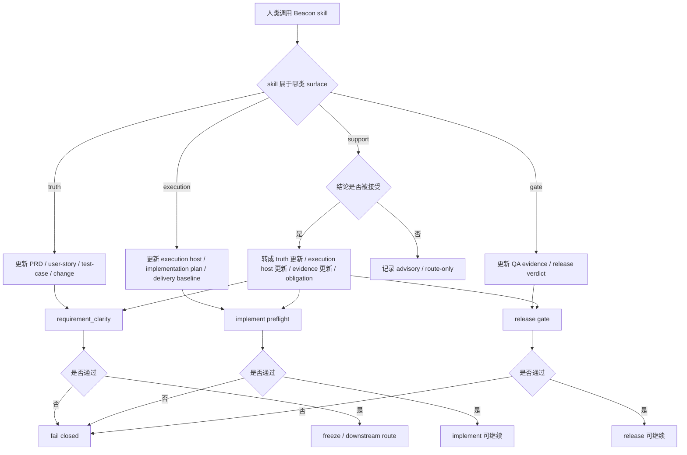
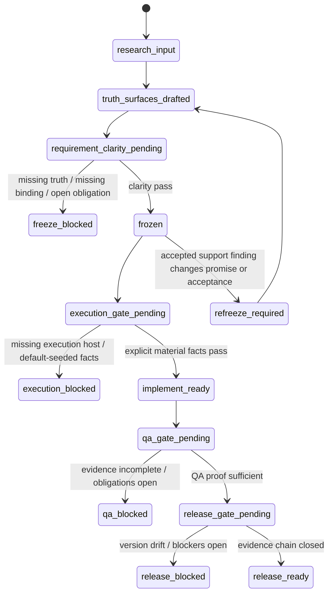

# Beacon 调研闭环：物料强 Gate 与人类面子 Skill 原子写回契约

> 日期：2026-05-21
> 版本：`v1.4.8`
> 状态：`freeze-input`
> 来源调研：
> - `docs/beacon/v1.4.8/research/beacon-v1.4.8-execution-material-rigor-and-version-governance-analysis.md`
> - `docs/beacon/v1.4.8/research/beacon-v1.4.8-human-subskill-material-closure-and-gate-contract.md`

---

## 1. 调研目标

本文件把两份 `v1.4.8` 调研收敛为正式冻结输入：

- 恢复 Beacon execution material 的强 gate 门禁
- 让人类面子 skill 调用必须按职责更新材料、打开义务，或明确只读 route-only
- 取消关键 delivery facts 的默认静默通过
- 让每个被调用 skill 都有可验证的 material effect

本文不是替代两份来源调研，而是把它们合并成后续 `change -> prd -> user-story -> test-case -> requirement_clarity -> freeze` 的单一 feature 级研究入口。

## 2. 架构

冻结后的能力应形成三层结构：

1. 执行材料契约层
   - 定义 `execution/index.md`、`architecture-blueprint.md`、`service-slice-map.md`、`git-workflow-*`、`technical-review-contract-*` 等执行 host 材料的最低存在与字段要求。
2. 子 skill 材料闭环层
   - 定义每个人类面 skill 的 `material_effect`、目标材料面、只读边界、写回义务和 fail-closed 条件。
3. Gate 消费层
   - `implement`、`qa`、`release`、`doctor verify-context --strict`、`material audit` 必须消费这些材料状态并在缺失时阻断。

关键架构判断：

- support surface 不直接写 canonical truth
- toolkit surface 一旦改变项目事实，必须写入 canonical metadata / execution transaction path
- execution-bound feature 不允许从默认 branch / service / worktree 假设进入 implement
- side dossier 不能替代 canonical execution host

## 3. 业务流程

业务闭环只表达材料和门禁，不表达实现细节。

## 4. 状态机

稳定状态只表达版本级 closure，不表达页面交互状态。

## 5. 决策优先级

1. Frozen truth 高于 support finding。
2. 显式冻结事实高于 default seed。
3. Canonical execution host 高于 side dossier。
4. Open obligation 高于局部 green signal。
5. Requirement clarity gate 高于 implement convenience。
6. QA evidence chain 高于单层通过。
7. Release gate 高于 status board。

## 6. Truth Bindings

本调研闭环绑定以下来源：

- PRD 输入：
  - `docs/beacon/v1.4.8/research/beacon-v1.4.8-execution-material-rigor-and-version-governance-analysis.md`
  - `docs/beacon/v1.4.8/research/beacon-v1.4.8-human-subskill-material-closure-and-gate-contract.md`
- User-story 输入：
  - 子 skill 闭环矩阵
  - branch governance closure contract
  - support finding adoption contract
- Test-case 输入：
  - execution host gate
  - support adoption gate
  - evidence / release gate
  - no silent pass rules

## 7. 冻结结论

该 feature 可以进入正式冻结链。

后续 PRD、user-story、test-case 必须至少覆盖：

- execution host required files 与 required sections
- branch / service / worktree explicit fact gate
- per-subskill material effect registry
- support finding adoption contract
- accepted finding -> material update / obligation
- no silent default seed
- implement / QA / release 对缺失材料 fail closed
