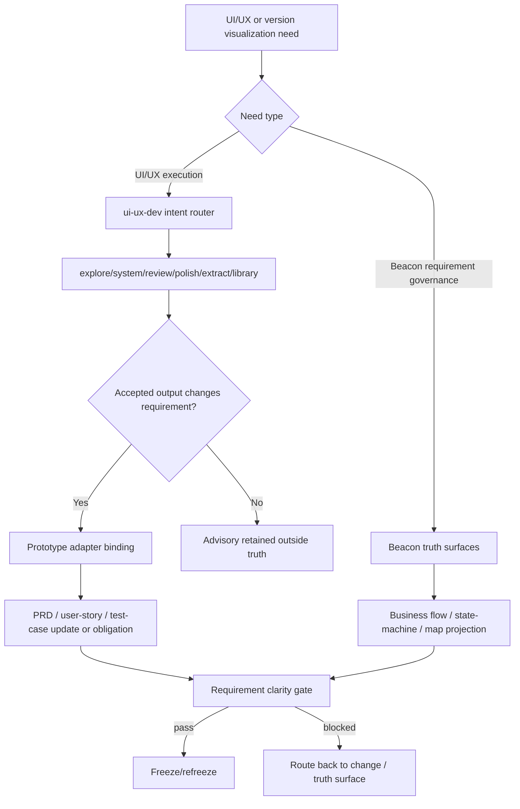
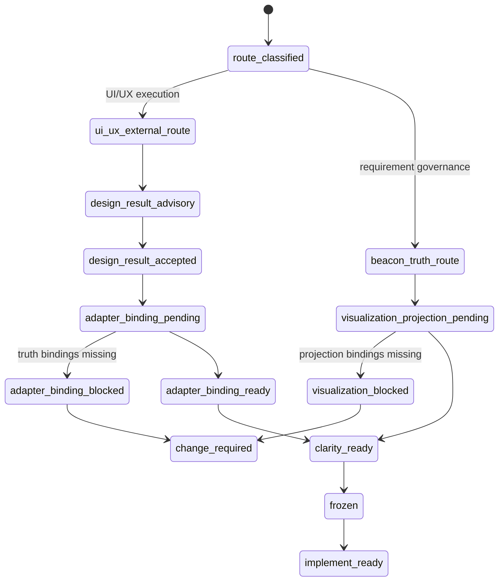

# PRD: UI/UX 外部化、Prototype Adapter 与版本级需求可视化契约

**Feature**: `ui-ux-externalization-prototype-adapter-and-version-visualization-contract`
**Version**: `v1.4.9`
**Date**: `2026-05-21`
**Status**: `frozen`
**Track**: `ui-ux-externalization + prototype-adapter + version-requirement-visualization`
**Scenario**: `beacon_should_govern_design_results_without_owning_ui_ux_execution`

## Context

- Global boundaries: `docs/beacon/global-boundaries.md`
- Research: `docs/beacon/v1.4.9/research/ui-ux-externalization-prototype-adapter-and-version-visualization-contract.md`
- Source architecture: `docs/beacon/v1.4.9/source-architecture/ui-ux-externalization-prototype-adapter-and-version-visualization-contract.md`
- Prior research:
  - `docs/beacon/v1.4.7/research/beacon-vnext-ui-ux-externalization-and-version-requirement-visualization-analysis.md`
  - `docs/beacon/v1.4.8/research/beacon-vnext-business-flow-and-state-machine-document-design.md`
- External UI/UX surface:
  - `/Users/apple/Developer/Personal/products/justin-mc-lai-skills/skills/ui-ux-dev/SKILL.md`

## 1. 问题

Beacon 当前仍显性暴露 `prototype` 作为 requirement-driven wireframe freeze 生成面，也存在 design review support surface。

这带来三个问题：

1. Beacon 与 `ui-ux-dev` 在 UI/UX execution 上重复。
2. `prototype` 代码和 gate 语义过重，容易把 Beacon 拉向设计生成工具箱。
3. Beacon 对整版需求的人类可读 projection 仍不足，缺少 business flow、state-machine 和三件套映射图。

## 2. 目标

1. 冻结 UI/UX execution 不再由 Beacon 内建能力承担。
2. 冻结 `ui-ux-dev` 为 UI/UX execution 的人类面入口。
3. 冻结 `prototype` 的新定位：design-result adapter。
4. 冻结 `beacon-design-review` 的新定位：route / governance support。
5. 冻结版本级 business flow projection。
6. 冻结版本级 state-machine projection。
7. 冻结版本级 PRD / user-story / test-case map projection。
8. 冻结每个 projection 必须具备 truth bindings。
9. 冻结历史 prototype bundle 兼容边界。

## 3. 设计原则

### 3.1 UI/UX execution belongs to `ui-ux-dev`

UI/UX exploration、system recommendation、review、polish、extract、library lookup 不再由 Beacon 继续扩张实现。

### 3.2 Beacon governs accepted design results

Beacon 只治理被接受的设计结果如何进入 requirement truth。

### 3.3 Prototype is adapter, not generator

`prototype` 不再作为 design generation surface。它只负责将 accepted design result 映射成 requirement-facing handoff。

### 3.4 Visualizations are projections, not truth

business flow、state-machine 和 three-piece map 只做可读投影，不替代 PRD、user-story、test-case。

### 3.5 Truth bindings are mandatory

没有 truth bindings 的图不能算 freeze-facing projection。

## 4. 范围

### In scope

- `ui-ux-dev` route contract
- `prototype` adapter contract
- `beacon-design-review` route / governance contract
- business flow projection contract
- state-machine projection contract
- three-piece map projection contract
- truth bindings schema
- historical prototype compatibility boundary
- implementation gate / requirement clarity 的阻断规则

### Out of scope

- 直接删除全部 prototype 代码
- 在 Beacon 内实现新的 UI/UX engine
- 生产级视觉稿生成
- 把 `ui-ux-dev` 纳入 Beacon lifecycle stage
- 把图变成 canonical truth

## 5. 功能需求

### FR-001 Beacon 必须停止扩张内部 UI/UX execution

Beacon 后续不得把 UI/UX exploration、system、review、polish、extract、library lookup 作为主能力继续增强。

### FR-002 Beacon 必须把 UI/UX execution 请求路由到 `ui-ux-dev`

当用户意图属于 UI/UX execution 时，Beacon 应推荐或桥接到：

- `ui-ux-dev-explore`
- `ui-ux-dev-system`
- `ui-ux-dev-review`
- `ui-ux-dev-polish`
- `ui-ux-dev-extract`
- `ui-ux-dev-library`

### FR-003 Beacon 不得在 `ui-ux-dev` 缺失时静默 fallback 到内建设计生成

如果 `ui-ux-dev` 或其 upstream 不可用，应路由到 `ui-ux-dev-bootstrap`，而不是静默使用 Beacon prototype 生成。

### FR-004 Beacon 必须将 `prototype` 降级为 design-result adapter

`prototype` 的新职责只包括：

- intake accepted design result
- capture screen intent
- capture state visibility
- capture interaction handoff
- bind design result to PRD / user-story / test-case

### FR-005 Beacon 必须阻断 accepted design result 未绑定 truth 的 implement

如果 feature 存在 accepted UI/UX result，但没有 adapter truth binding，implement 必须 fail closed。

### FR-006 Beacon 必须保留历史 prototype bundle 兼容读取

历史 `docs/beacon/<version>/prototype/` bundle 可以继续被 status、archive、release history 读取，但不应定义 v1.4.9+ 新 UI/UX execution ownership。

### FR-007 Beacon 必须冻结版本级 business flow projection

business flow projection 必须只解释业务闭环，不解释实现细节。

### FR-008 Beacon 必须冻结版本级 state-machine projection

state-machine projection 必须只解释 stable closure states，不解释页面 widget 交互状态。

### FR-009 Beacon 必须冻结版本级 PRD / user-story / test-case map

three-piece map 必须说明 PRD、user-story、test-case 各自拥有的 truth，以及它们如何组成版本需求包。

### FR-010 每个 projection 必须声明 truth bindings

每个 business flow、state-machine、three-piece map 至少必须声明：

- `prd_refs`
- `user_story_refs`
- `test_case_refs`
- `coverage_notes`
- `out_of_scope_notes`

### FR-011 Requirement clarity 必须阻断缺失 visualization truth bindings

当 version visualization 被声明 required，但缺少 projection 或 truth bindings 时，requirement clarity 必须 blocked。

### FR-012 Design review 必须保持 support surface 边界

`beacon-design-review` 不能直接写 canonical truth、不能给 release verdict、不能替代 `ui-ux-dev review` 或 `beacon-change`。

## 6. Business Flow

## 7. State Machine

## 8. 验收标准

- AC-001 Beacon stops treating internal UI/UX execution as a future core capability.
- AC-002 Beacon routes UI/UX execution intent to `ui-ux-dev`.
- AC-003 Beacon does not silently fallback to internal design generation when `ui-ux-dev` is unavailable.
- AC-004 Beacon redefines `prototype` as a design-result adapter.
- AC-005 Beacon blocks implementation when accepted design results lack truth bindings.
- AC-006 Beacon keeps historical prototype bundles readable without making them v1.4.9 execution truth.
- AC-007 Beacon defines version-level business flow projection.
- AC-008 Beacon defines version-level state-machine projection.
- AC-009 Beacon defines version-level PRD / user-story / test-case map projection.
- AC-010 Beacon requires truth bindings for every version-level projection.
- AC-011 Requirement clarity blocks when required visualization bindings are missing.
- AC-012 Beacon keeps `beacon-design-review` as route / governance support, not a truth source or UI/UX execution substitute.

## 9. 边界 / 分层 / 恢复策略

### 9.1 边界

Beacon 的边界是 requirement governance，不是 UI/UX execution。`ui-ux-dev` 的边界是 UI/UX execution，不是 Beacon truth source。

### 9.2 分层

本需求按三层闭合：

- Requirement truth layer：PRD、user-story、test-case、research、source-architecture。
- Projection layer：business flow、state-machine、PRD / user-story / test-case map。
- Runtime evidence layer：implement、QA、release 后续产生的过程、session、evidence、trace。

Projection layer 只能解释 truth，不能新增 truth。

### 9.3 恢复策略

当 `ui-ux-dev` 缺失、adapter binding 缺失、projection truth bindings 缺失或历史 prototype bundle 被误用为 v1.4.9 execution truth 时，Beacon 必须阻断并恢复到对应治理路径：

- UI/UX execution 缺失：恢复到 `ui-ux-dev-bootstrap` 或明确提示安装/调用外部 skill。
- Adapter binding 缺失：恢复到 `beacon-prototype` adapter writeback 或 `beacon-change`。
- Projection truth bindings 缺失：恢复到 PRD、user-story、test-case 或 research 补齐。
- 历史 prototype 语义漂移：恢复到 compatibility-only 读取，不允许作为新 execution truth。

## 10. 风险与缓解

| 风险 | 影响 | 缓解 |
| --- | --- | --- |
| Beacon 继续被当作 UI/UX 生成器 | 生命周期职责膨胀，需求治理变弱 | 明确 `ui-ux-dev` owns UI/UX execution，Beacon 只保留 adapter 和 gate |
| Accepted design result 未进入 truth binding | 实现按设计印象推进，需求不可追溯 | implement gate 阻断缺失 adapter binding |
| 可视化图被当作 truth | 人类说明图覆盖三件套 truth | 每张 projection 必须声明 truth bindings，且不得新增要求 |
| 历史 prototype bundle 被误判为 v1.4.9 truth | 旧材料绕过新边界 | 历史 bundle 只兼容读取，不能定义新 execution ownership |
| `ui-ux-dev` 不可用时静默 fallback | 重新产生 Beacon 内建设计执行面 | 缺失 upstream 时恢复到 bootstrap，不允许 silent fallback |

## 11. Decision Priority

1. `ui-ux-dev` owns UI/UX execution.
2. Beacon owns requirement truth and gates.
3. Accepted design result must be bound before implementation.
4. Projection without truth bindings is invalid.
5. Historical compatibility must not override v1.4.9 ownership.

## 12. Diagram Truth Layer

### 12.1 Diagram Types

- `branch-flow`
- `state-machine`
- `decision-priority`

### 12.2 State Axes

- `ui_ux_route`
- `adapter_binding`
- `requirement_visualization`
- `truth_binding`

### 12.3 Propagation Contract

- Diagram truth must stay explicit through freeze readiness, implementation planning, and QA coverage.
- State axes must not be silently compressed into one implicit status field.

## 13. 冻结交付物

- `docs/beacon/v1.4.9/research/ui-ux-externalization-prototype-adapter-and-version-visualization-contract.md`
- `docs/beacon/v1.4.9/source-architecture/ui-ux-externalization-prototype-adapter-and-version-visualization-contract.md`
- `docs/beacon/v1.4.9/change/ui-ux-externalization-prototype-adapter-and-version-visualization-contract.md`
- `docs/beacon/v1.4.9/prd/ui-ux-externalization-prototype-adapter-and-version-visualization-contract.md`
- `docs/beacon/v1.4.9/user-story/ui-ux-externalization-prototype-adapter-and-version-visualization-contract.md`
- `docs/beacon/v1.4.9/qa/test-cases/ui-ux-externalization-prototype-adapter-and-version-visualization-contract.md`

## 14. 成功指标

- Human-facing Beacon lifecycle becomes smaller and clearer.
- UI/UX work has one stable external route.
- Accepted design outputs still enter Beacon truth through explicit bindings.
- Version-level requirement packages become easier to understand without weakening canonical truth.
