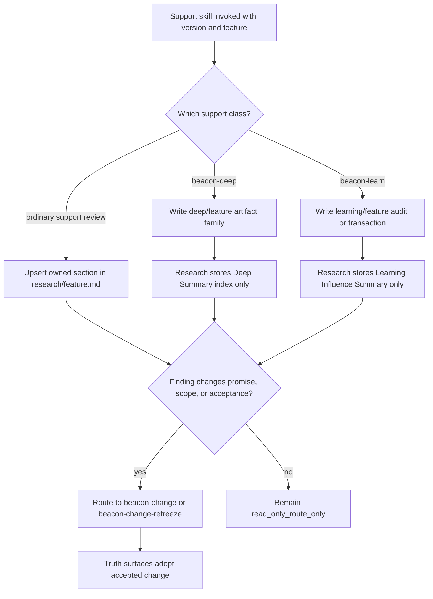
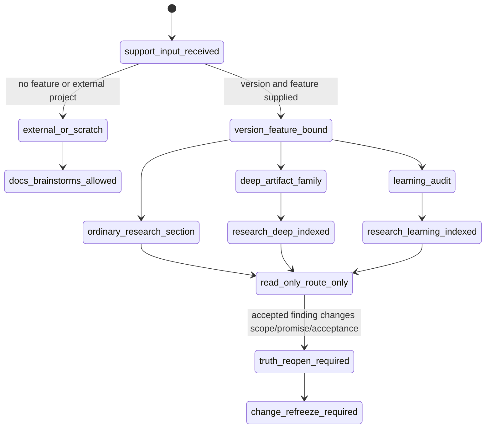

# Research: Read-Only Support Research Write Topology Gate Contract

**Feature**: `read-only-support-research-write-topology-gate-contract`  
**Version**: `v1.4.9`  
**Status**: `refreeze-input`  
**Date**: `2026-05-23`

## 1. Background

Beacon v1.4.8 introduced material effect governance for human-facing subskills, including `read_only_route_only`.

The remaining gap is directory topology. Read-only support skills can still scatter analysis into `docs/brainstorms/`, execution transactions, deep artifacts, or ad hoc side documents. That makes requirement clarification hard to replay and lets old fallback behavior survive beside the stronger material gate.

This research freezes a stricter rule:

> A version-bound, feature-bound read-only support analysis must land in the governed v1.4.9 feature material topology. It must not silently fall back to `docs/brainstorms/` or generate duplicate side files.

Write target selection is a pre-write gate decision. If the support invocation cannot prove its `version`, `feature`, and support surface class, Beacon must fail closed and ask for a repaired route instead of applying any legacy fallback target.

## 2. Support Surface Classes

### 2.1 Ordinary support review surfaces

The following support reviews write into the single feature research document:

- `beacon-brainstorm`
- `beacon-context-engineering`
- `beacon-source-driven`
- `beacon-doubt-review`
- `beacon-security-review`
- `beacon-performance-review`
- `beacon-documentation-adr`
- `beacon-debug-recovery`
- `beacon-ceo-review`
- `beacon-design-review`

Target:

```text
docs/beacon/<version>/research/<feature-slug>.md
```

They append or replace their owned section under `## Support Findings`. They do not create parallel files for repeated clarification rounds.

### 2.2 Deep support surface

`beacon-deep` keeps its dedicated artifact family:

```text
docs/beacon/<version>/deep/<feature-slug>/
docs/beacon/<version>/.machine/deep/<feature-slug>/
```

The feature research document only stores a `Deep Summary` index with the artifact root, status, route decision, and adoption state. Deep findings still require adoption through `change`, `test-case`, `implement`, `qa`, or `release`.

### 2.3 Learning governance surface

`beacon-learn` does not write feature research body content. It writes either:

```text
docs/beacon/<version>/learning/<feature-slug>.md
```

or the existing support transaction surfaces:

```text
docs/beacon/<version>/execution/beacon-learn-transaction.md
docs/beacon/<version>/.machine/execution/beacon-learn-transaction.json
```

The feature research document only records `Learning Influence Summary`: applied, stale, conflicting, suppressed, audit ref, and the policy that learning is advisory and frozen truth wins.

## 3. Business Flow



## 4. State Machine



## 5. Decision Priority

1. Version-bound and feature-bound support output must use governed feature topology.
2. Ordinary support review must upsert one section in `research/<feature>.md`.
3. `docs/brainstorms/` is not a fallback target. It is allowed only for unbound scratch, external analysis, or explicit scratch output.
4. `beacon-deep` owns detailed deep artifacts; research only indexes them.
5. `beacon-learn` owns learning audit; research only summarizes learning influence.
6. Repeated clarification in the same version appends rounds or supersedes prior section content; it does not generate sibling files.
7. Cross-version clarification creates a new version research document with lineage to the prior version.
8. Accepted support findings that alter promise, scope, or acceptance must route through `beacon-change` / `beacon-change-refreeze`.

## 6. Required Research Sections

Feature research documents that receive support writeback must support this minimal section contract:

```md
## Support Findings

### Brainstorm
### Context Engineering
### Source Driven
### Doubt Review
### Security Review
### Performance Review
### Documentation / ADR
### Debug Recovery
### CEO Review
### Design Review

## Deep Summary

## Learning Influence Summary

## Route Decisions

## Version Evolution Notes

## Promotion Log
```

Sections may be absent until the corresponding support surface runs. When present, each section must record:

- source skill
- round id or timestamp
- finding summary
- source refs
- route decision
- material effect
- adoption status: `open`, `adopted`, `superseded`, `rejected`, or `route_only`

## 7. Gate Rules

The gate must fail closed when a version-bound, feature-bound support write violates this topology:

- support write target is not selected by the topology gate before persistence
- support invocation lacks a provable `version`, `feature`, or support surface class while attempting governed writeback
- ordinary support review writes a new sibling document instead of upserting `research/<feature>.md`
- `beacon-brainstorm` falls back to `docs/brainstorms/` for a Beacon feature with explicit version and feature
- `beacon-deep` writes detailed artifacts into `research/<feature>.md` instead of `deep/<feature>/`
- `beacon-learn` writes learning candidates into research body instead of learning audit or transaction
- research lacks the required `Deep Summary` or `Learning Influence Summary` index after deep/learn ran
- accepted finding has no route to `change`, truth surfaces, execution, QA, release, or an explicit obligation

The diagnostic must identify the selected policy class, expected write target, actual attempted target, and the repair route. Silent repair, silent relocation, and fallback persistence are not allowed.

## 8. Truth Bindings

- `prd_refs`: `docs/beacon/v1.4.9/prd/read-only-support-research-write-topology-gate-contract.md`
- `user_story_refs`: `docs/beacon/v1.4.9/user-story/read-only-support-research-write-topology-gate-contract.md`
- `test_case_refs`: `docs/beacon/v1.4.9/qa/test-cases/read-only-support-research-write-topology-gate-contract.md`
- `coverage_notes`: AC-001 through AC-007 cover ordinary support topology, deep separation, learning separation, no brainstorm fallback, repeated clarification, cross-version lineage, and fail-closed diagnostics.
- `out_of_scope_notes`: This research does not implement runtime code and does not make support surfaces truth or gate sources.

## 9. Conclusion

This contract makes read-only support surfaces predictable: one feature research document for ordinary reviews, a dedicated deep artifact family for deep analysis, a dedicated learning audit surface for learning, and gate failure for legacy fallback or duplicate support documents.
