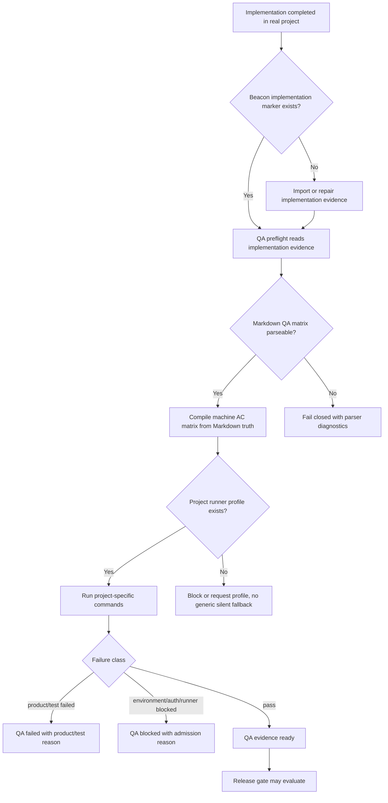
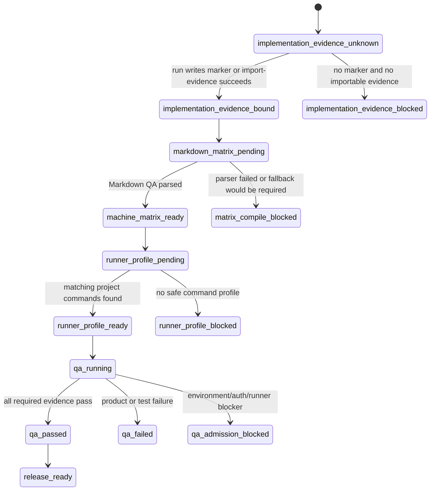

# Research: 真实项目 QA 证据绑定与 Markdown Matrix Fail-Closed

**Feature**: `real-project-qa-evidence-binding-and-markdown-matrix-fail-closed`  
**Version**: `v1.4.9`  
**Status**: `freeze-input`  
**Date**: `2026-05-23`

## 1. 背景

本研究收敛自 `qa-evo-deep-human-subskill-and-implementation-qa-closure-gap` 的 CEO review。

真实项目 BMTOP 暴露的核心问题不是“缺少更聪明的 QA 分析 skill”，而是 Beacon 机器闭环没有严肃承认真实现证据、真实 Markdown QA 矩阵和真实项目 runner profile。

P0 结论：

> 先修 implementation evidence writeback、Markdown QA matrix compiler fail-closed、project runner profile、admission blocker taxonomy 和 BMTOP regression fixture；Better Harness 与 `qa-evo-deep` 后置。

## 2. Source Anchors

- `docs/beacon/v1.4.9/research/qa-evo-deep-human-subskill-and-implementation-qa-closure-gap.md`
- `docs/beacon/v1.4.9/research/better-harness-skill-eval-kit-and-source-driven-regression-core.md`
- `/Users/apple/Developer/Personal/products/slow_uni_bmtop/docs/beacon/v1.0.0/prd/rules-encyclopedia-admin-closure.md`
- `/Users/apple/Developer/Personal/products/slow_uni_bmtop/docs/beacon/v1.0.0/user-story/rules-encyclopedia-admin-closure.md`
- `/Users/apple/Developer/Personal/products/slow_uni_bmtop/docs/beacon/v1.0.0/qa/test-cases/rules-encyclopedia-admin-closure.md`
- `/Users/apple/Developer/Personal/products/slow_uni_bmtop/docs/beacon/v1.0.0/execution/implementation-summary-rules-encyclopedia-admin-closure.md`
- `/Users/apple/Developer/Personal/products/slow_uni_bmtop/docs/beacon/v1.0.0/.machine/qa/rules-encyclopedia-admin-closure.ac-test-matrix.json`
- `beacon/commands/implement.py`
- `beacon/commands/qa.py`
- `beacon/commands/test_case.py`
- `beacon/utils/qa_feature.py`
- `beacon/utils/requirement_parsing.py`
- `beacon/utils/test_contract_governance.py`

## 3. 问题

### 3.1 Implementation evidence writeback 缺失

真实代码和人工实现摘要已经存在，但 Beacon implementation runtime 没有写入 QA 可识别的 implementation marker。

结果：

- `implement status` 返回 `implementation_run_not_found`。
- `qa run` 在 feature-aware 验证前 fail-closed。
- 人类已完成实现与机器认为未实现之间发生断裂。

### 3.2 Markdown QA matrix 没有进入机器矩阵

人工 QA 文档已定义真实 REC001-REC005 类验收用例，但机器 AC matrix 退回：

```text
AC-001 placeholder acceptance row
TC-001 python3 -m pytest -q -k unit
```

这违反 Markdown-first freeze truth。机器矩阵不得在 Markdown QA 存在且可解析时静默 fallback。

### 3.3 Project runner 与真实技术栈脱节

BMTOP 真实验证面包括：

- Go backend target tests
- UniApp / Vue / TypeScript type-check
- miniapp build
- route check
- Playwright E2E

Beacon fallback 仍偏 Python pytest / generic browser profile，会让 QA 证据和项目现实脱节。

### 3.4 Admission blocker taxonomy 不足

Docker / testcontainers MySQL 启动超时应归类为 `environment_blocked` 或 `runner_admission_blocked`，不是 `product_failed`。

目标包通过而全量 suite 因环境失败阻塞时，QA 必须能表达：

- 目标 feature 证据有效。
- 全量 release-grade 证据仍有 admission blocker。
- blocker 不等同于产品功能失败。

## 4. Architecture

```text
frozen Markdown truth
-> implementation run / import-evidence
-> implementation evidence marker
-> QA preflight reads marker + implementation summary + changed files
-> Markdown QA parser compiles real AC matrix
-> project runner profile selects commands
-> QA classifies product/test/environment/evidence outcomes
-> release reads truthful QA evidence
```

### 4.1 Component Ownership

| Component | Owns | Does Not Own |
| --- | --- | --- |
| `beacon implement` | implementation run state and evidence writeback | QA verdict |
| `beacon implement import-evidence` | controlled import of human/agent implementation evidence | inventing implementation proof |
| `beacon test-case` | Markdown QA -> machine matrix projection | silent fallback when Markdown QA is parseable |
| `beacon qa` | execution/admission classification and evidence status | requirement truth edits |
| project runner profile | project-specific command selection | release pass verdict |
| `qa-evo-deep` research | future routeable findings support | P0 runtime repair |

## 5. Business Flow



## 6. State Machine



## 7. Decision Priority

1. Markdown QA truth beats generated fallback.
2. Explicit implementation evidence beats missing runtime state only after controlled import.
3. Project runner profile beats generic fallback command.
4. Environment blocker must not be collapsed into product failure.
5. Better Harness and `qa-evo-deep` cannot substitute P0 runtime closure.

## 8. PRD / User Story / Test Case Map

Truth bindings:

- `prd_refs`: `docs/beacon/v1.4.9/prd/real-project-qa-evidence-binding-and-markdown-matrix-fail-closed.md`
- `user_story_refs`: `docs/beacon/v1.4.9/user-story/real-project-qa-evidence-binding-and-markdown-matrix-fail-closed.md`
- `test_case_refs`: `docs/beacon/v1.4.9/qa/test-cases/real-project-qa-evidence-binding-and-markdown-matrix-fail-closed.md`
- `coverage_notes`: AC-001 through AC-005 map to P0 implementation evidence, Markdown matrix, project runner, blocker taxonomy, and BMTOP regression fixture.
- `out_of_scope_notes`: Better Harness Skill Eval Kit and `qa-evo-deep` remain future research/change inputs.

## 9. 收敛结论

本 P0 change 必须先实现和验收。否则 Beacon 会继续在真实项目中产生假稳定信号：文档看起来完整，机器闭环却不认实现、不认 QA 矩阵、不认项目真实 runner。
