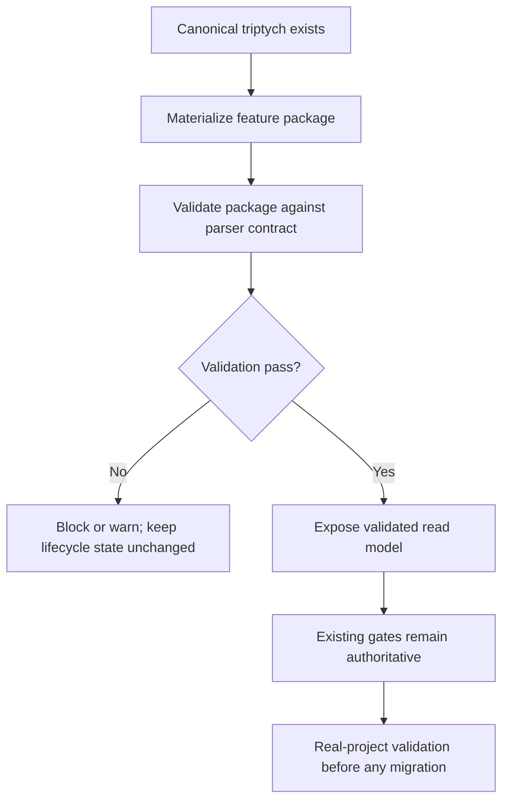
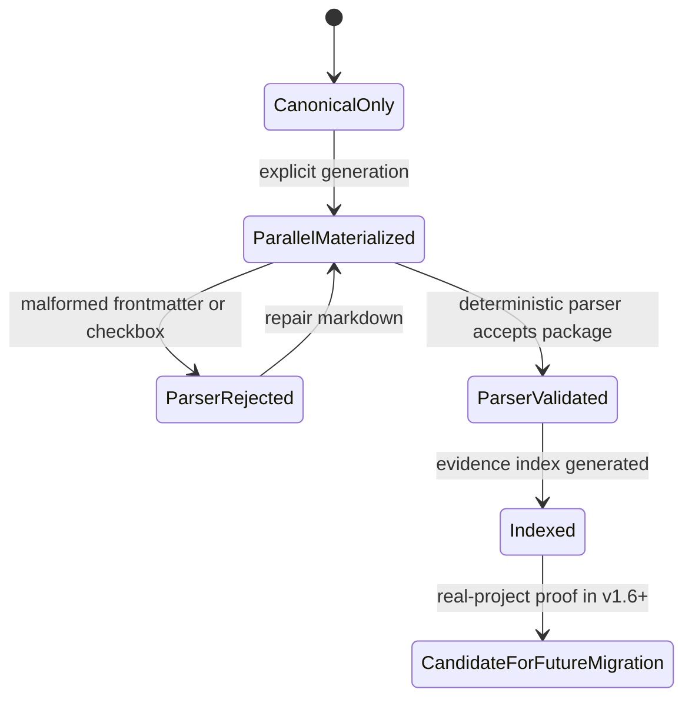

# Source Architecture: Beacon v1.5.0 Parallel Plan B Document Capability

- feature: `beacon-v1.5.0-parallel-plan-b-document-capability`
- version: `v1.5.0`
- status: `frozen`
- language: `zh`

## Architecture

v1.5.0 使用 parallel-lane architecture：

- Canonical lane：现有 `prd/`、`user-story/`、`qa/test-cases/`、`execution/`、`.machine/`、QA、release surfaces。
- Feature package lane：新增 `features/<slug>/{truth,tests,tasks,evidence}.md` materialization/read-model capability。

Feature package lane 必须显式生成或启用，不能在 v1.5.0 删除或替代 canonical lane artifacts。

Feature package 中的 machine-readable islands：

- `truth.md` YAML frontmatter。
- `truth.md` Acceptance Criteria table。
- `tasks.md` checkbox task rows。
- `evidence.md` authority-label rows。

这些 islands 由 CLI 确定性解析；v1.5.0 中不替代 `.machine`。

## Business Flow



## State Machine



## Decision Priority

1. Canonical lane 在 v1.5.0 保持 authoritative。
2. Feature package lane 改善可读性和迁移准备。
3. CLI validation 是 LLM-authored markdown 影响 lifecycle state 前的必要条件。
4. Checkbox rows 不能绕过 implement 或 QA gates。
5. Evidence index 不是 gate verdict source。
6. 旧体系退役需要后续版本和真实项目验证。

## Source Touchpoints

- Materialization entry point：`beacon materialize-feature-package <feature> --version v1.5.0`。
- Validation entry point：`beacon validate-feature-package <feature> --version v1.5.0`。
- Package parser/validator：读取 frontmatter、AC tables、checkbox rows、evidence authority labels，并输出 deterministic diagnostics。
- Validation report：`docs/beacon/v1.5.0/.machine/requirement/feature-package-validation.json`。
- Drift validation：比较 feature package 与 canonical PRD/user-story/test-case。
- Evidence indexing：引用 deep、CEO review、QA verdict、release readiness artifacts，并保留 authority labels。
- Gate integration：v1.5.0 gates 继续读取 canonical outputs。
- Skill templates：为四个 package 文件提供 compact LLM-readable examples。

## Quick Template Contract

`truth.md` 示例：

```yaml
---
slug: example-feature
version: v1.5.0
status: draft
language: en
canonical_refs:
  prd: docs/beacon/v1.5.0/prd/example-feature.md
  user_story: docs/beacon/v1.5.0/user-story/example-feature.md
  test_case: docs/beacon/v1.5.0/qa/test-cases/example-feature.md
parser_contract: beacon-feature-package-v1
---
```

`tasks.md` 示例：

```markdown
- [ ] TASK-001 Create feature package
- [x] TASK-002 Validate frontmatter
- [-] TASK-003 Repair blocked diagnostics
```

`evidence.md` 示例：

```markdown
| Surface | Authority | Canonical Artifact | Status | Route |
|---------|-----------|--------------------|--------|-------|
| beacon-deep | support_advisory | docs/beacon/v1.5.0/research/example.md | indexed | change |
```
