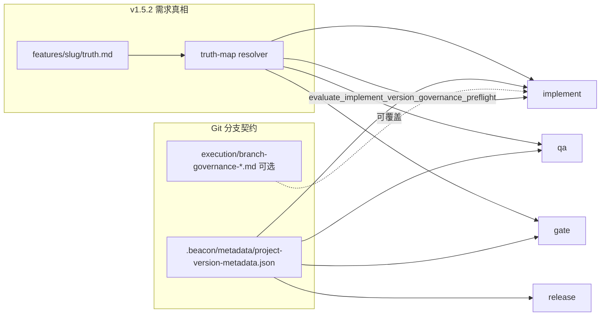

# Research: v1.5.2 版本治理与 Git 分支闭环评估

- version: `v1.5.2`
- status: `support-research`（非 frozen truth）
- related_friction: Rolo `marketing_primary_fe` v2.0.0 Git 治理簇
- related_features: `beacon-truth-map-center-and-package-cutover`, v1.3.10 metadata, v1.4.10 canonical-branch preflight

## 1. 结论摘要

| 问题 | 结论 |
|------|------|
| v1.5.2 是否已有「版本治理面」？ | **有**，但拆成两层：**需求真相**（feature package）与 **交付/Git 契约**（project-version metadata + 可选 execution 投影）。 |
| 单 Git 服务（如 Beacon 自举）是否可闭环？ | **在 metadata 已配置的前提下基本可闭环**：`implement` / `qa` / `release` 会读 metadata 并做分支硬校验；v1.5.2 自身无 per-feature `branch-governance-*.md` 冗余。 |
| 多 Git / monorepo（如 Rolo）是否可闭环？ | **能力具备、实例未闭环**：schema 支持 `topology_kind: monorepo` + 多 `service_bindings` + `per_service_canonical_branch`，但**不会自动发现子仓**；且 **legacy execution 三联文档仍可覆盖 metadata**，易回到 Rolo 旧版多文档冗余。 |
| 能否杜绝「多份文档各写一套分支」？ | **尚未闭环**：当前写主源是 `.beacon/metadata/project-version-metadata.json`（非 MD-first）；`execution/branch-governance-<feature>.md` 仍可并入 implement。 |
| v1.5.2 主线 MD-first 是否已覆盖版本/Git 治理？ | **否**；且目标应为 **零 JSON 孪生**：该层仅 **一份 docs 下 Markdown 真相**，读写同源，经 truth-map 消费（见 §11）。 |
| 与 Rolo evil-merge 类事故 | **不在当前闭环内**：现有 gate 验 **分支名/拓扑/metadata 一致性**，不验 **merge 后路径级内容** 是否等于 feature 侧。 |

**一句话**：v1.5.2 完成了 **需求真相** 的 package 权威化；**Git 分支治理** 在代码上已收口到 **project-version metadata 事务模型**，对 monorepo **可闭环但需正确录入且禁止再手写 execution 分支三联**；对 Rolo 现场仍需 **metadata 落地 + 去掉冗余 execution 文档 + 运维侧 merge 后验收**。

---

## 2. v1.5.2 能力分层（不要混为一谈）

### 2.1 需求真相层（v1.5.2 主线）

| 项 | 权威位置 | 消费者 |
|----|----------|--------|
| Feature 需求/测试/任务 | `docs/beacon/<version>/features/<slug>/{truth,tests,tasks,evidence}.md` | `truth-map` resolver、`prd`/`user-story`/`test-case`（路由到 package）、`gate`/`qa` |
| 版本说明/边界 | `docs/beacon/<version>/SUMMARY.md`、`execution/boundaries.md` 等 | `resolve_version_governance()` |

见 `docs/beacon/v1.5.2/SUMMARY.md` 与 feature `beacon-truth-map-center-and-package-cutover` 的 `truth.md`（AC-001～AC-008）。

**这层不管「marketing_primary_fe 在哪个 git 分支」**——除非你把分支契约写进 feature truth（一般不这么做）。

### 2.2 版本治理真相层（truth-map 定义）

`beacon/utils/truth_map.py` 中 `VERSION_GOVERNANCE_SURFACES` 仅包含 **版本级文档**，例如：

- `docs/beacon/global-boundaries.md`
- `docs/beacon/{version}/SUMMARY.md`
- `docs/beacon/{version}/execution/boundaries.md`
- `docs/beacon/{version}/execution/project-skill-qa-evolution-blueprint.md`
- `docs/beacon/{version}/source-architecture/index.md`
- `docs/beacon/{version}/release/{version}.md`

角色：`version_governance_truth`（产品/流程边界），**不是** per-service Git 分支登记表。

### 2.3 Git / 分支 / 拓扑契约层（v1.3.10+ 延续）

| Sink | 路径 | truth-map 分类 | 作用 |
|------|------|----------------|------|
| 机器面（主消费） | `.beacon/metadata/project-version-metadata.json` | `generated_governance_state`（运行时权威契约，非 requirement truth） | `version -> participating_services -> per_service_canonical_branch`、topology、worktree 策略 |
| 人类面 | `.beacon/metadata/project-version-metadata.md` | 投影 | 人工审阅 |
| SQLite 投影 | runtime-ledger（metadata 事务） | 投影 | 快速查询/治理 |
| **可选** execution 特征文档 | `docs/beacon/<version>/execution/branch-governance-<slug>.md` 等 | 非 version_governance_truth；implement 仍 **会读取并覆盖** | 历史 Rolo / v1.4.10 形态 |

设计来源：v1.3.10「project topology and version-branch metadata transaction governance」——元信息是 **契约**，应被 `implement/qa/release` 硬消费。

---

## 3. 单 Git 服务 vs 多 Git monorepo

### 3.1 数据模型（已实现）

`project-version-metadata.json` 结构：

```text
global_project_metadata:
  topology_kind: single_repo | monorepo
  project_root
  default_execution_service
  service_bindings[]: { service_key, repo_root, writable, worktree_path_policy, ... }

version_scoped_metadata[<version>]:
  participating_services[]
  per_service_canonical_branch: { <service_key>: <branch> }
  branch_guard_mode, branch_governance_template, branch_governance{...}
```

- **单 Git**：`topology_kind: single_repo`，通常 1 个 `service_binding`，`participating_services: ["that_service"]`。
- **多 Git monorepo**：`topology_kind: monorepo`，**每个子服务一条 binding**（绝对 `repo_root`），版本契约里 **每个参与服务一条 branch**。

Beacon 自举实例（`.beacon/metadata/project-version-metadata.json`）：

- `topology_kind: single_repo`
- `v1.5.2` → `beacon` → `beacon/v1.5.2`
- `beacon doctor metadata verify --version v1.5.2` → **pass**

### 3.2 运行时是否「按服务」校验？

`verify_project_metadata()`（`beacon/utils/project_metadata.py`）在传入 `version` 时：

- 对 `participating_services` **逐服务**检查 `repo_root` 存在性与 `current_branch == expected_branch`。
- 因此 **monorepo 在 metadata 填全的情况下，会对每个参与服务做分支契约检查**，不是只查 default 服务。

`implement` 的 `_branch_guard_inputs()` 在存在 version contract 时：

- 用 metadata 的 `per_service_canonical_branch` 设置 `expected_branch`；
- 将 `git_roots` / `direct_delivery_services` 设为 **所有 participating 服务的 repo_root**（monorepo 场景）。

### 3.3 为何 Rolo 仍失败？

典型缺口（与 friction 一致）：

1. **在 Beacon 源码仓执行** `beacon doctor branch-governance` → 只解析 **Beacon 仓** metadata（`service_key: beacon`），不会自动扫描 Rolo 的 `marketing_primary_fe`。
2. **Rolo 项目根** 若未维护 monorepo metadata（bindings + v2.0.0 的 per-service branch），则 runtime 无法替代旧版 `docs/beacon/v2.0.0/execution/branch-governance-*.md` 手写表。
3. **Legacy execution 三联**（`branch-governance-*` / `git-workflow-*` / `deterministic-implementation-contract-*`）若仍存在，`load_execution_branch_contract()` 会 **merge 进 implement 输入**，与 metadata **双源并存**——这正是旧版「多文档冗余记录分支」的根源。

---

## 4. implement / metadata / qa / release 消费链



| 阶段 | metadata | execution 特征文档 | truth-map version governance |
|------|----------|-------------------|------------------------------|
| **implement plan/run** | `evaluate_implement_version_governance_preflight` + `_branch_guard_inputs` | 若存在则 **覆盖** branch map | 检查 SUMMARY/boundaries 等是否存在 |
| **qa** | `verify_project_metadata` | 一般不读 | package truth via resolver |
| **release** | `verify_project_metadata` | 一般不读 | gate inputs via resolver |
| **doctor branch-governance** | `resolve_branch_governance_view(metadata)` | 不读 | — |

**v1.5.2 Beacon 仓自身**：`docs/beacon/v1.5.2/execution/` 下 **没有** `branch-governance-<feature>.md`，implement 主要吃 metadata + `architecture-blueprint` 里的 delivery baseline 投影——**符合「单源 metadata」**。

**Rolo v2.0.0 旧形态**：每个 feature 一套 execution 三联 + 各服务分支表 → 与 metadata **并行** → **未闭环**。

---

## 5. 闭环判定表

### 5.1 单 Git 服务（Beacon 开发 Beacon）

| 能力 | 状态 | 说明 |
|------|------|------|
| 单一机器契约文件 | ✅ | `.beacon/metadata/project-version-metadata.json` |
| 人类可读投影 | ✅ | `.beacon/metadata/project-version-metadata.md` |
| implement 硬校验 | ✅ | version governance preflight + branch preflight |
| qa/release 校验 | ✅ | `verify_project_metadata` |
| 无 execution 分支文档冗余 | ✅（v1.5.2 仓内） | 无 `branch-governance-*.md` |
| merge 后内容验收 | ❌ | 未实现 |

### 5.2 多 Git monorepo（Rolo 类）

| 能力 | 状态 | 说明 |
|------|------|------|
| schema 支持多服务多 repo | ✅ | `monorepo` + `service_bindings` + `per_service_canonical_branch` |
| 自动发现子服务 git 根 | ❌ | 必须 `beacon doctor metadata update` 显式录入 |
| 全服务分支一次校验 | ✅（metadata 填全时） | `verify_project_metadata` 循环 participating |
| 禁止 execution 文档第二权威 | ❌ | `load_execution_branch_contract` 仍会合并 |
| doctor 在「错误 project_root」上的歧义 | ⚠️ | 在 Beacon 仓跑命令看不到 Rolo 子服务 |
| AGENTS/项目规则与 metadata 对齐 | ⚠️ | 项目侧 policy，Beacon 不强制 |
| merge 后内容验收 | ❌ | 未实现 |

### 5.3 「是否还有 Rolo 旧版多文档冗余？」

| 文档类型 | v1.5.2 是否还应存在 | 运行时行为 |
|----------|---------------------|------------|
| `.beacon/metadata/project-version-metadata.json` | **必须**（唯一机器契约） | 主源 |
| `execution/branch-governance-<feature>.md` | **不应再新建**；历史应迁移进 metadata 后删除或标为 archive | 若存在则 **覆盖** implement 分支图 |
| `execution/git-workflow-<feature>.md` | 同上 | 同上 |
| `execution/deterministic-implementation-contract-<feature>.md` | 同上 | 同上 |
| `architecture-blueprint` delivery baseline | 允许作为 **投影** | 实现计划/门禁辅助，不应与 metadata 冲突 |

**结论**：v1.5.2 **产品能力**上已具备「单文件记录各 git 服务与分支」；**未**在代码层禁止 execution 三联继续充当第二权威，因此 **无法自动保证** Rolo 不再冗余——需要 **项目治理决策 + metadata 迁移**。

---

## 6. 与 v1.4.10「显式版本 canonical 分支 preflight」的关系

v1.4.10 feature `explicit-version-canonical-branch-worktree-preflight-gate` 解决的是：

- 显式 `--version` 时，在 **错误分支** 上提交（如 v2.0.0 却用 v1.3.5 分支）；
- 依赖 **execution 材料** 解析 canonical branch/worktree。

v1.5.2 **未** 将该 feature 迁入 `features/<slug>/truth.md`（v1.5.2 无此 package truth），但 **运行时逻辑已并入**：

- `evaluate_implement_version_governance_preflight`
- metadata-first `_branch_guard_inputs`

**缺口延续**（Rolo MSQEdit 事故）：

- preflight 验 **分支名与 worktree**，不验 **merge 后文件内容**；
- monorepo 下仍依赖 **正确 project_root + 完整 metadata**，否则回退到 execution 文档或 LLM 推断。

---

## 7. 要达到「不再出现 Rolo 旧版多文档」的落地清单

### 7.1 Rolo 项目（运维/治理，非 Beacon 源码）

1. 在 **Rolo workspace root** 维护一份 metadata：`topology_kind: monorepo`，列出 `marketing_primary_fe`、`marketing_sys` 等 **绝对 repo_root**。
2. 为 `v2.0.0`（或当前 Beacon version 线）设置 `per_service_canonical_branch`（如 `feature/v2.0.0-all`），与 **唯一** 人类约定一致。
3. **冻结或删除** `docs/beacon/v2.0.0/execution/branch-governance-*.md` 等三联，避免 implement 双源。
4. UAT merge 增加 **路径级验收**（如 MSQEdit.vue `git diff feature..uat`），写入 rolo-dev playbook（Beacon 外）。

### 7.2 Beacon 产品（若要做 change）

| 方向 | 说明 |
|------|------|
| metadata 强制唯一 | implement 在 v1.5.2+ 若 metadata 完整则 **忽略** execution branch-governance 覆盖，或 warn+fail |
| monorepo doctor | `beacon doctor branch-governance --all-services` 遍历 participating 服务输出 |
| post-merge content gate | 新 AC：关键路径 blob 对比（与 evil-merge friction 对齐） |
| 文档 | 在 `execution/boundaries.md` 明确：Git 分支契约 **仅** metadata，execution 三联 deprecated |

**路由**：保持 friction **queue_only**；若进 Beacon 主链 → `beacon-change` 新 feature 或扩展 metadata governance，**不是**直接改 v1.5.2 package truth 除非 AC 明确。

---

## 8. 开放问题（进 change 前必须答）

1. Rolo 的 Beacon version 线（`v2.0.0`？）是否与 `docs/beacon/VERSION` / metadata 的 version key **一一对应**？
2. monorepo 下 **default_execution_service** 仅用于 UI 默认展示，还是 implement **无 `--service` 时只验一个服务**？（当前：guard 可带多 `git_roots`，但 branch_governance 视图偏 selected service。）
3. 是否要在 v1.5.2 声明 **deprecated**：`execution/branch-governance-*` 不得与 metadata 并存？
4. post-merge 内容验收归 Beacon gate 还是纯 rolo-dev CI？

---

## 10. Brainstorm 核实：v1.5.2 MD-first 与「版本/Git 治理唯一真源」

> 用户主张（2026-06-03）：v1.5.2 主线已推动去掉 JSON 真相、MD-first；当前「metadata 优先、execution 可覆盖」不符合唯一真源；应让 **beacon-toolkit-metadata** 与 **beacon-toolkit-branch-governance** 统一经 **MD-first** 生成 **版本/项目治理唯一 Markdown**，内含 Git 治理信息；**禁止** execution 三联覆盖。

### 10.1 核实结论：**主张与 v1.5.2 意图一致，与当前运行时部分一致**

| 维度 | v1.5.2 feature package（已切） | 版本/项目/Git 治理（未切） |
|------|-------------------------------|---------------------------|
| 权威面 | `features/<slug>/*.md` | `.beacon/metadata/project-version-metadata.json` |
| 读取路径 | truth-map resolver → Markdown | `load_project_metadata()` → **JSON** |
| 人类可读面 | 即权威面 | `project-version-metadata.md` 仅为 **写入投影**，**不参与 load** |
| JSON 角色 | generated state / 可选诊断 | **写路径先写 JSON**（`_commit_payload` → `write_json` 再 `_render_human`） |
| truth-map 分类 | `feature_package_authoritative` | `project_version_metadata` 在 `GENERATED_GOVERNANCE_SURFACES` |
| execution 特征文档 | 不应再作 requirement truth | `load_execution_branch_contract()` **仍可合并**进 implement |

**结论**：v1.5.2 **主线 MD-first 只完成了「需求 package」层**，**没有**完成「项目版本 + Git 分支治理」层的 MD-first 与唯一真源；你的「应统一起来」是对齐 v1.5.2 哲学后的 **合理下一刀**，不是重复 v1.5.2 已完成工作。

### 10.2 当前 implement 合并顺序（说明为何不是唯一真源）

`beacon/commands/implement/commands.py` 中 `_branch_guard_inputs()` 实际顺序：

1. `load_or_seed_implementation_git_workflow_contract`（git-workflow 种子/契约）
2. **`load_execution_branch_contract`**：若存在 `execution/branch-governance-<feature>.md` 等，**先**把 `service_branch_map` / `expected_branch` 等 merge 进 `contract`
3. 再从 `resolve_project_metadata_view()` **部分覆盖** `expected_branch`、`git_roots`、`participating_services`、`branch_governance`

因此不是「metadata 绝对优先」，而是 **execution 先写入 contract，metadata 后改部分字段**；`service_branch_map` 等若仅出现在 execution 文档中，**可能残留**。这与 toolkit skill 文案「let implement consume the same projected contract」的 **意图** 冲突。

### 10.3 目标架构（与 v1.5.2 package 同构）

```text
写入（唯一入口）:
  beacon-toolkit-metadata  ──┐
  beacon-toolkit-branch-governance ──┼──> doctor metadata * （改为 MD-first 事务）
                                    │
权威 Markdown（版本治理真相）:      │
  docs/beacon/<version>/execution/project-version-governance.md   # 或 governance/project-version-governance.md
    - topology_kind, service_bindings（全局段）
    - version_contracts[<version>]（每版本 participating_services + per_service_canonical_branch）
    - branch_governance template / evidence_contract（Git 治理段）

读取（所有消费者同一 resolver）:
  truth-map resolve_version_governance / resolve_project_governance
    -> 解析上述 Markdown（parser contract，类似 feature-package-v2）
    -> 投影 .beacon/metadata/project-version-metadata.json（generated，禁止 hand-edit 当权威）
    -> 投影 sqlite（generated）

禁止:
  docs/beacon/<version>/execution/branch-governance-<feature>.md
  docs/beacon/<version>/execution/git-workflow-<feature>.md
  docs/beacon/<version>/execution/deterministic-implementation-contract-<feature>.md
  （v1.5.2+ 存在版本治理 MD 时，load_execution_branch_contract 必须 fail-closed 或只读 archive）
```

**子 skill 统一方式**（不改主链 stage）：

| Skill | 今天 | 目标 |
|-------|------|------|
| `beacon-toolkit-metadata` | `doctor metadata create/update` → JSON 主写 | 只改 **版本治理 MD**；JSON 由投影生成 |
| `beacon-toolkit-branch-governance` | 读 metadata 解析结果 `resolve_branch_governance_view` | 读/写 **同一 MD** 的 Git 治理段；不再维护 per-feature execution 表 |
| `beacon-implement` | execution 可覆盖 + metadata 补丁 | **仅** resolver 解析后的 governance contract |

### 10.4 与 truth-map `VERSION_GOVERNANCE_SURFACES` 的关系

今日 version governance truth 指向 `SUMMARY.md`、`execution/boundaries.md` 等 **产品边界文档**，**不包含** per-service 分支表。

统一后建议扩展 resolver（命名待定）：

- **保留**现有 surfaces 作为「版本产品边界」truth
- **新增** `project_version_governance` surface → `docs/beacon/<version>/execution/project-version-governance.md`（**Git/拓扑唯一真源**）
- `GENERATED_GOVERNANCE_SURFACES` 中的 `project_version_metadata` JSON **明确**为投影（与 AC-006 同哲学）

### 10.5 差距清单（进 change 的 AC 种子）

| ID | 差距 | 建议 AC 方向 |
|----|------|----------------|
| G-01 | `load_project_metadata` 只读 JSON | v1.5.2+ 必须从治理 MD 解析；JSON 缺失时若 MD 存在则投影后读 |
| G-02 | `_commit_payload` JSON-first | 改为 parse MD → validate → project JSON/sqlite |
| G-03 | `load_execution_branch_contract` 仍合并 | v1.5.2+ 若版本治理 MD 存在则 **拒绝或忽略** execution 三联 |
| G-04 | toolkit 双 skill 写路径分裂 | metadata / branch-governance 命令只改同一 MD |
| G-05 | truth-map 未登记治理 MD | `resolve_version_governance` 或新 resolver 包含拓扑/分支 |
| G-06 | Rolo 旧仓多份 execution 文档 | 迁移工具：吸收进治理 MD + archive 旧文件 |

### 10.6 路由（brainstorm，非 freeze）

| 动作 | 路由 |
|------|------|
| 认可「版本/Git 治理 MD-first 唯一真源」 | **`beacon-change`** 新 feature（建议 slug：`markdown-first-project-version-governance` 或并入下一 v1.5.3 线） |
| 仅修 Rolo 实例 | friction + `doctor metadata update` + 删 execution 三联（**临时**，不解决 Beacon JSON-first） |
| 写进 v1.5.2 已 freeze package truth | **不允许**（scope 不同）；最多在 research/change 中引用 |
| 立刻改 implement 删 execution merge | **implement** 仅当 change AC 冻结后 |

**推荐下一跳**：见 **§11**（MD-only 零 JSON）；`beacon-change` feature `markdown-only-project-version-governance`。

---

## 11. 硬约束：版本 / 拓扑 / Git 分支治理 — MD-only 唯一真源

> §10.3 含「投影 JSON」方案 **已 supersede**；用户要求 **该层零 JSON**。

### 11.1 四项硬约束

1. **MD-first** — Markdown 即 authority。  
2. **零 JSON** — `.beacon/metadata/project-version-metadata.json` 等 governance JSON **不得再存在**（非 stale 容忍）。  
3. **唯一文档** — 拓扑 + 版本分支契约在同一 truth 文件。  
4. **读写同源** — metadata / branch-governance toolkit、implement、gate 共用 **truth-map resolver**。

### 11.2 唯一真相路径

```text
docs/beacon/governance/project-version-governance.md
```

结构：`Global topology` + `Version contracts / <version>`（participating_services、per_service_canonical_branch、branch_governance）。

### 11.3 必须退役

| 路径 | 目标 |
|------|------|
| `.beacon/metadata/project-version-metadata.json` | 删除；verify fail-closed 若仍存在 |
| `.beacon/metadata/project-version-metadata.md` | 删除（非第二真相） |
| sqlite `payload_json` 存 governance | 停写；ledger 仅 md hash |
| `execution/branch-governance-*` | implement fail-closed |
| `material_gate_contract` → JSON | 改 governance md resolver |

### 11.4 AC 种子

- G-01：`load_project_metadata` 仅 parse governance md  
- G-02：commit 只写 md，禁止 governance JSON  
- G-03：execution 三联含 branch → fail-closed  
- G-04：truth-map `project_governance_truth` surface  
- G-05：tests 不再断言 JSON 路径  
- G-06：migrate JSON → md → 删 JSON  
- G-07：双 toolkit skill → governance md transaction  

### 11.5 路由

**`beacon-change`** → `markdown-only-project-version-governance`；runtime 改动 blocked 至 freeze。

---

## 9. Promotion Notes

- 本文档为 **support research**，不修改 `features/*/truth.md` 或 `.machine/` freeze 态。
- 若采纳「MD-only governance + 零 JSON + 废弃 execution 三联」，应走 `beacon-change`（§11）并补 `tests.md` 覆盖 monorepo 双源拒绝与 JSON 存在 fail-closed。
- 关联 brainstorm 产物：`docs/beacon/v1.5.2/research/explicit-version-canonical-branch-worktree-preflight-gate.md`（可保留为 v1.4.10 专题索引）。

---

## Support Findings

### Brainstorm round 2026-06-03（闭环评估）

- source: 用户请求 + 源码/文档对照
- route_decision: **friction queue + rolo metadata 落地**；Beacon 侧 **optional beacon-change**
- finding_summary: v1.5.2 需求真相已 package 闭环；Git 分支对单仓可 metadata 闭环；monorepo 需录入且禁止 execution 文档双源；merge 后内容仍不闭环。

### Brainstorm round 2026-06-03（MD-only 零 JSON 收敛）

- source: 用户二次澄清 + `project_metadata.py` / `truth_map.py` / `material_gate_contract.py`
- material_effect: `read_only_route_only`
- adoption_status: `route_only`
- route_decision: **`beacon-change`**（`markdown-only-project-version-governance`）
- finding_summary: 目标不是「JSON 投影可 stale」，而是 **版本/拓扑/Git 治理层零 JSON**；唯一 authority = `docs/beacon/governance/project-version-governance.md`；metadata + branch-governance toolkit **读写同一 resolver**；退役 `.beacon/metadata/*.json`、sqlite payload_json、execution 三联覆盖。
