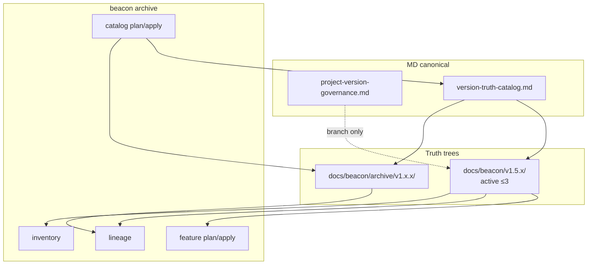

# Research: version-truth-archive-lineage

**Feature slug (proposed)**: `version-truth-archive-lineage`  
**Version**: `v1.5.2`  
**Status**: `support-research` (brainstorm — not requirement truth)  
**Evolution line**: **MD-only** (aligned with `project-version-governance.md` and v1.5.2+ feature-package truth)  
**Related shipped work**: `project-governance-projection-lifecycle`, `markdown-only-project-version-governance`, `beacon-truth-map-center-and-package-cutover`

---

## 0. Locked decisions (2026-06-04 brainstorm)

| Decision | Status |
|----------|--------|
| Future Beacon evolution is **MD-only canonical** for archive/catalog authority | **Locked** |
| **Version catalog** = Markdown commit source (not `.machine/*.json` as authority) | **Locked** |
| **Global-boundaries §4** must be extended for MD-only catalog + archive plane | **Locked** (text draft below; not yet merged into global-boundaries) |
| Physical truth trees move to **`docs/beacon/archive/<version>/`** | **Locked** (not deferred) |
| Active delivery plane keeps **`docs/beacon/<version>/`** for **last 3** versions only | **Locked** |
| Historical lookup / cross-version evolution / capability inventory live in **`beacon-archive` skill** with scenario examples | **Locked** (skill draft below) |
| `.machine/archive/*` remains **projection** from MD catalog transactions (same pattern as governance sqlite hash) | **Locked** |
| Human nav via **`docs/beacon/archive/INDEX.md`** (generated, not hand-edited per version) | **Locked** |
| **One-time bootstrap relocate** for all non-active versions (~49 → 46 archived + 3 active) | **Locked** (single `catalog bootstrap --confirm` transaction) |

---

## 1. User outcome (first principles)

Operators developing Beacon itself need:

1. **Default focus** on the last **3** Beacon release lines under `docs/beacon/v1.5.0` … `v1.5.2`.
2. **Historical lookup** — frozen truth under `docs/beacon/archive/<version>/` remains addressable.
3. **Cross-version evolution** — stable `feature_slug` lineage across active + archived roots.
4. **Capability inventory (“功能梳理”)** — derived from **`truth.md` AC tables**, not folder grep.

Archive extends existing **`beacon-archive`** (v1.3.8+). It is **not** a new lifecycle stage.

---

## 2. Two archive planes (orthogonal)

| Plane | MD canonical | Active location | Archived location | “Recent 3” |
|-------|--------------|-----------------|-------------------|------------|
| **Governance** (branch/topology) | `docs/beacon/governance/project-version-governance.md` | `###` blocks in same file | pruned from MD (git retains history) | 3 version **contract blocks** |
| **Requirement truth** (delivery tree) | `docs/beacon/governance/version-truth-catalog.md` | `docs/beacon/<version>/` | `docs/beacon/archive/<version>/` | 3 **version directories** |

Governance: *which git branch for this Beacon version?*  
Truth catalog: *which requirement trees are active vs archived, and where do they live?*

---

## 3. MD-only version catalog (canonical design)

### 3.1 Authority file

**Path**: `docs/beacon/governance/version-truth-catalog.md`

Mirrors governance MD conventions:

```markdown
---
schema_version: "1.0"
parser_contract: "beacon-version-truth-catalog-v1"
active_delivery_window: 3
transaction_id: "tx-..."
committed_at: "..."
source_hash: "..."
event_type: "catalog-upsert|version-archive|version-relocate"
---

# Version Truth Catalog

## Policy
- active_delivery_window: `3`
- active_truth_root_pattern: `docs/beacon/{version}/`
- archived_truth_root_pattern: `docs/beacon/archive/{version}/`

## Active Delivery Versions

### v1.5.0
- validation_state: `active`
- truth_root: `docs/beacon/v1.5.0`

### v1.5.1
- validation_state: `active`
- truth_root: `docs/beacon/v1.5.1`

### v1.5.2
- validation_state: `active`
- truth_root: `docs/beacon/v1.5.2`

## Archived Versions

### v1.4.11
- validation_state: `archived-reference-only`
- truth_root: `docs/beacon/archive/v1.4.11`
- archived_at: `2026-06-04T...`
- reason: `release-line-window`
```

### 3.2 Projections (non-authoritative)

| Projection | Role |
|------------|------|
| `docs/beacon/.machine/version-truth-catalog.json` | resolver fast path (generated on commit) |
| sqlite `source_hash` row (if shared with governance projection store) | drift verify via `doctor metadata verify` pattern |
| per-version `docs/beacon/<v>/.machine/archive/*` | feature-level archive index (existing) |

**Rule**: JSON/sqlite **never** the commit source; human MD frontmatter carries `transaction_id` + `source_hash`.

### 3.3 Writers / readers

| Action | Command (proposed) |
|--------|-------------------|
| Plan catalog change | `beacon archive catalog plan` |
| Commit MD + relocate trees | `beacon archive catalog apply --confirm` |
| Verify MD ↔ projection drift | `beacon doctor verify-version-truth-catalog --strict` |
| Read active set | all default delivery commands |
| Read archived path | explicit `--version` + catalog resolver |

---

## 4. Physical archive layout (determined)

```text
docs/beacon/
├── governance/
│   ├── project-version-governance.md    # branch contracts (existing)
│   └── version-truth-catalog.md         # truth catalog (new canonical)
├── v1.5.0/ … v1.5.2/                    # ACTIVE only (≤3)
└── archive/
    ├── v1.4.11/
    ├── v1.4.10/
    └── …                                # full historical truth trees
```

### 4.1 Relocate transaction (not delete)

When `v1.5.0` ages out at `v1.5.3` cutover:

1. Update catalog MD: `v1.5.0` → `archived-reference-only`, `truth_root` → `docs/beacon/archive/v1.5.0`
2. **Move** directory `docs/beacon/v1.5.0` → `docs/beacon/archive/v1.5.0`
3. Rewrite internal refs in catalog + optional `docs/beacon/archive/INDEX.md` (human navigation)
4. Regenerate `.machine` projections + run strict verify

**Unlike governance prune**: truth content is **relocated**, not erased. Git history + archive path preserve evidence.

### 4.2 `docs/beacon/archive/INDEX.md` (human nav — generated)

**Not canonical.** Regenerated on every `catalog apply` / `catalog bootstrap`. Operators read it; machines read `version-truth-catalog.md`.

Minimal template (大道至简):

```markdown
# Beacon Archive Index

> Generated from version-truth-catalog.md — do not edit by hand.

- active_window: 3
- active: v1.5.0, v1.5.1, v1.5.2
- archived_count: 46

## Active (delivery plane)

| Version | Path | Features (count) |
|---------|------|------------------|
| v1.5.2 | docs/beacon/v1.5.2 | 4 |

## Archived (inspect / lineage)

| Version | Path | Archived at |
|---------|------|-------------|
| v1.4.11 | docs/beacon/archive/v1.4.11 | 2026-06-… |

## Quick commands

- Status: `beacon archive catalog status`
- Feature history: `beacon archive lineage <slug>`
- Active capability map: `beacon archive inventory`
```

No per-version stub files. No duplicate feature lists in catalog MD — INDEX pulls feature **counts** only; detail via `lineage` / `truth-map resolve`.

### 4.3 One-time bootstrap (locked)

Single operator transaction when feature ships:

```bash
beacon archive catalog bootstrap --project-root . \
  --active v1.5.0,v1.5.1,v1.5.2 \
  --dry-run    # default: show 46 moves + catalog draft + INDEX preview

beacon archive catalog bootstrap --project-root . \
  --active v1.5.0,v1.5.1,v1.5.2 \
  --confirm    # one shot: write catalog MD + mv trees + INDEX + projections + verify
```

Scope today: **49** version dirs under `docs/beacon/v*` → **3** stay at root, **46** → `docs/beacon/archive/<version>/`.

Lineage: **command-first** (`archive lineage`); optional `--emit-md` writes one-off report under `research/` or stdout — **no** standing `governance/lineage/*.md` forest.

---

## 5. Proposed global-boundaries supplement (§4 extension)

> **Not merged yet** — input for `beacon-change` on `version-truth-archive-lineage`.  
> Fits global-boundaries principle: cross-version, implementation-agnostic.

### Draft text for §4 (append after line 88)

```markdown
### 4.1 MD-only catalog and archive plane (v1.5.2+ evolution line)

- Requirement-truth **version catalog** canonical source is Markdown under `docs/beacon/governance/version-truth-catalog.md`, not scattered JSON or hand-edited directory lists.
- **Active delivery truth** lives under `docs/beacon/<version>/` for at most the configured active window (default: 3 release lines).
- **Archived requirement truth** lives under `docs/beacon/archive/<version>/`; archive is relocation, not deletion of requirement evidence.
- Project **governance** (branch/topology) and **truth catalog** (delivery tree placement) are separate MD authorities; neither substitutes for `features/<slug>/truth.md`.
- `.machine/` and sqlite projections of the catalog are read/verify surfaces; drift against catalog MD must fail closed for freeze, qa, and release on the active plane.
- Default resolver, doctor, status, and truth-map bulk scans use the catalog active set; explicit `--version` may target archived roots for inspect-only commands.
```

### Draft cross-reference in §1 (support surface)

Add to support surface list clarification:

```markdown
- `archive` governs historical requirement isolation and version-truth catalog commits; it does not replace `change` for editing frozen feature truth.
```

---

## 5b. Human closure (architecture / flow / state)

### Architecture

- **Canonical write paths**: `version-truth-catalog.md` (truth placement); `project-version-governance.md` (branch); per-feature truth remains `features/<slug>/truth.md` inside each version tree.
- **Read projections**: `.machine/version-truth-catalog.json`, per-version `.machine/archive/*`, optional sqlite `source_hash`.
- **Modules**: extend `archive_governance.py` + new catalog parser; truth-map / doctor / versioning read catalog before scanning dirs.

### Business flow

1. Operator triggers cutover or audit need.
2. `archive catalog plan` diffs active window vs disk layout.
3. `catalog apply --confirm` commits MD + relocates trees + regenerates projections.
4. `verify-version-truth-catalog --strict` gates freeze/qa/release on active plane.
5. Inspect commands use catalog to resolve `truth_root` for active or archive path.

### State machine (version-level)

| State | Meaning | Transitions |
|-------|---------|-------------|
| `active` | Under `docs/beacon/<v>/`; in default delivery scans | → `archived-reference-only` via catalog apply |
| `archived-reference-only` | Under `docs/beacon/archive/<v>/`; inspect-only | terminal (no delete) |

Feature-level four states (`active` / `superseded` / `archived-learnable` / `archived-reference-only`) unchanged within each version tree.

### Decision priority

1. MD catalog truth_root wins over directory glob discovery.
2. Explicit `--version` wins for inspect; delivery commands fail-closed on non-active unless `--include-archived`.
3. Feature `truth.md` wins over prd for discovery on v1.5.2+.
4. Governance MD never holds feature requirement content.

---

## 6. Existing `beacon-archive` baseline + gaps

### 6.1 Today

- Commands: `plan` / `apply` / `status` / `explain`
- Feature statuses: `active` | `superseded` | `archived-learnable` | `archived-reference-only`
- Per-version `.machine/archive/*` (v1.3.9 evidence exists)
- `help` routes archived features away from delivery

### 6.2 Gaps vs locked decisions

| Gap | Fix in feature |
|-----|----------------|
| No MD catalog authority | `version-truth-catalog.md` + catalog apply |
| Feature discovery `prd`-only | unify with `features/*/truth.md` |
| No relocate command | `catalog apply` moves tree to `archive/` |
| No lineage / inventory commands | `archive lineage`, `archive inventory` |
| Skill lacks scenario examples | extend `beacon-archive` SKILL.md (below) |

---

## 7. Target business闭环



---

## 8. `beacon-archive` skill extension (draft — for future SKILL.md)

Follow global-boundaries §5: **decision boundary → minimal tools → cold-start examples**.

### 8.1 Decision boundary

- Use **`beacon-archive`** when historical requirement truth must stay traceable but stop polluting the **active delivery plane**.
- **Do not** use archive to edit frozen `truth.md`; route scope changes to **`beacon-change`**.
- **Do not** confuse with **`doctor metadata archive-version`** (governance branch blocks only).
- Default delivery commands (`implement`, `qa`, `release`) bind to **catalog active versions** under `docs/beacon/<v>/`.
- Inspect / lineage / inventory may read **`docs/beacon/archive/<v>/`** with explicit `--version`.

### 8.2 Minimal tool set

```bash
beacon archive explain
beacon archive catalog plan|apply|status
beacon archive plan|apply|status          # feature-level (existing)
beacon archive lineage <slug> [--from v] [--to v]
beacon archive inventory [--version auto]
beacon doctor verify-version-truth-catalog --strict
```

### 8.3 Scenario examples (cold-start)

#### Example A — Release cutover: roll the active window

**When**: Shipping `v1.5.3`; active window stays 3.

```bash
# 1) Preview: v1.5.0 will leave active plane and move under archive/
beacon archive catalog plan --project-root . --version v1.5.3 --json

# 2) Apply: commit version-truth-catalog.md + relocate docs/beacon/v1.5.0 → docs/beacon/archive/v1.5.0
beacon archive catalog apply --project-root . --version v1.5.3 --confirm --json

# 3) Verify MD ↔ projection
beacon doctor verify-version-truth-catalog --project-root . --strict
```

**Done when**: catalog lists active `v1.5.1`, `v1.5.2`, `v1.5.3`; `v1.5.0` truth_root points at `docs/beacon/archive/v1.5.0`.

---

#### Example B — Audit historical feature truth (read-only)

**Scenario:** Audit historical feature truth for `version-aggregate-projection-guard-contract` in v1.4.11 (read-only).

```bash
beacon archive status --project-root . --version v1.4.11 \
  --feature version-aggregate-projection-guard-contract --json

beacon truth-map resolve version-aggregate-projection-guard-contract \
  --project . --version v1.4.11 --json
# resolves under docs/beacon/archive/v1.4.11/features/... or legacy prd/
```

**Done when**: paths + archive status returned; no implement/qa attempted on archived version without `--include-archived`.

---

#### Example C — Trace cross-version evolution

**Scenario:** Trace cross-version evolution of browser QA acceptance from v1.4.10 through v1.5.2.

```bash
beacon archive lineage qa-multi-layer-real-browser-e2e-acceptance \
  --project-root . --from v1.4.10 --to v1.5.2 --json
```

**Done when**: ordered version list with `truth_path`, `change_path`, freeze revision / source_hash per hop.

---

#### Example D — Capability inventory before planning

**When**: Planning v1.5.3 roadmap; need AC-level map of **active** plane only.

```bash
beacon archive inventory --project-root . --version auto --json
```

**Done when**: matrix of feature_slug × AC IDs from active versions’ `truth.md` only; archived versions omitted unless `--include-archived`.

---

#### Example E — Retire a shipped feature inside an active version

**When**: Feature frozen and shipped; should not appear on implement board for v1.5.2.

```bash
beacon archive plan --project-root . --version v1.5.2 \
  --feature markdown-only-project-version-governance \
  --archive-status archived-reference-only \
  --reason shipped-and-superseded --json

beacon archive apply --project-root . --version v1.5.2 \
  --feature markdown-only-project-version-governance \
  --archive-status archived-reference-only --json
```

**Done when**: `beacon help` routes away from implement; truth files remain readable.

---

#### Example F — Learn from history without overriding active truth

**When**: Extract pattern from old implementation, not current promise.

```bash
beacon archive apply --project-root . --version v1.4.11 \
  --feature version-aggregate-projection-guard-contract \
  --archive-status archived-learnable \
  --reason pattern-source-for-v1.5.3 --json

beacon learn recall --topic "aggregate projection guard" --json
```

**Done when**: learn cites `learnable_archive_refs` only; active v1.5.2 truth unchanged.

---

## 9. Draft acceptance themes (NOT binding — for future freeze)

| ID | Theme | Sketch AC |
|----|-------|-----------|
| AC-V1 | MD catalog canonical | `version-truth-catalog.md` is sole commit source; JSON projection derived |
| AC-V2 | Active window | Exactly 3 active versions; roots under `docs/beacon/<v>/` |
| AC-V3 | Physical archive | Archived versions only under `docs/beacon/archive/<v>/`; relocate transaction audited |
| AC-V4 | Drift verify | `verify-version-truth-catalog --strict` fails on MD/projection/path mismatch |
| AC-V5 | Resolver default | Delivery commands use active catalog; inspect allows archive paths |
| AC-V6 | Feature discovery | `archive plan` lists `features/*/truth.md` on v1.5.2 |
| AC-V7 | Lineage | `archive lineage <slug>` spans active + archive roots |
| AC-V8 | Inventory | `archive inventory` from active truth AC tables |
| AC-V9 | Skill surface | `beacon-archive` documents Examples A–F |
| AC-V10 | Global-boundaries | §4.1 MD-only catalog + archive plane merged |

---

## 10. Non-goals

- Deleting archived truth trees (contrast: governance **prune**)
- Auto-archiving without `catalog apply --confirm`
- Making archive a lifecycle stage or release gate
- JSON-first catalog (rejected for v1.5.2+ evolution line)

---

## 11. Closure backlog (discuss → decide before freeze)

### 11.1 Resolved in brainstorm

| Item | Decision |
|------|----------|
| INDEX.md | Yes — **generated only**, single file |
| Migration cadence | **One-time bootstrap**, not batch-by-release |
| Lineage MD files | **No** standing tree; CLI + optional `--emit-md` |
| Catalog authority | MD-only (`version-truth-catalog.md`) |

### 11.2 Still needs decision (recommended default → 大道至简)

| # | Gap | Recommendation | Why simple |
|---|-----|----------------|------------|
| **C1** | `docs/beacon/research/` (non-version) | Leave at root; catalog lists it as `support_research_root`, not a version | Avoid moving unrelated brainstorm |
| **C2** | `v0.0.1-debug` | Archive like any other non-active version dir | One rule, no special case |
| **C3** | Internal link rewrite after `mv` | **Bootstrap owns it**: rewrite `docs/beacon/` → `docs/beacon/archive/` in moved trees + known cross-version index files only; **do not** rewrite git history or code comments | Bounded scope; strict verify catches misses |
| **C4** | `truth-map resolve` path rules | Single helper: `resolve_version_truth_root(version)` reads catalog → active or archive path | One resolver, all commands inherit |
| **C5** | Slug renames across versions | **Defer** dedicated alias MD; `lineage` follows directory presence + change doc `parent_feature` when present; add `_aliases` section in catalog **only when pain appears** | YAGNI |
| **C6** | Human skill surface | **4 operator verbs** (see §13), not 8 commands | Strong capability, minimal mental model |
| **C7** | global-boundaries §4.1 | Merge **in same feature** as one AC block, not separate ADR | One delivery, one truth |
| **C8** | Tests / CI path assumptions | One pytest module + bootstrap dry-run golden; CI runs dry-run on PR | Fail before merge |
| **C9** | Ongoing cutover (v1.5.3+) | Reuse **`catalog apply`** (same as bootstrap but delta=1 version) | Same code path as bootstrap |
| **C10** | Feature-level archive vs version-level | Keep both: **version** = catalog/bootstrap; **feature** = existing four states inside active versions only | Clear separation |

### 11.3 Risks to accept or mitigate in freeze

| Risk | Mitigation |
|------|------------|
| One-shot move breaks external bookmarks | INDEX.md + catalog MD list old→new paths; git log preserves pre-move paths |
| 46-tree move is large PR | Single atomic commit; `--dry-run` mandatory review; verify strict |
| Legacy `prd/` vs `features/` discovery | Fix in same feature: one `discover_features(version)` used by archive + truth-map |
| Operators confuse governance vs truth archive | Skill + INDEX quick commands; `archive explain` prints two-plane diagram |

---

## 13. 大道至简 — recommended operator surface

**Principle**: 1 catalog MD, 1 INDEX, 1 bootstrap, 4 verbs.

| Verb | Command | You use it when… |
|------|---------|------------------|
| **Status** | `beacon archive catalog status` | “Which versions are active? Where is v1.4.11?” |
| **History** | `beacon archive lineage <slug>` | “How did this feature evolve?” |
| **Map** | `beacon archive inventory` | “What does active plane promise?” (AC matrix) |
| **Cutover** | `beacon archive catalog apply` / `bootstrap --confirm` | Release window roll or first-time migration |

Feature-level retire stays **`archive apply --feature`** ( fifth verb, rare).

Everything else (`explain`, `doctor verify-version-truth-catalog`, `truth-map resolve --version`) is **support**, not daily vocabulary.

**Skill doc structure**: one diagram → four verbs → six examples (A–F) collapsed to **four stories** in user-facing skill (merge E into apply, F into lineage+learn footnote).

---

## 12. Route

| Operator intent | Route |
|-----------------|-------|
| Continue brainstorm | This research + `beacon-brainstorm` |
| Freeze scope | **`beacon-change`** → `version-truth-archive-lineage` |
| Merge global-boundaries | Same feature or dedicated docs ADR via **`beacon-documentation-adr`** |
| Implement | **`beacon-implement`** after freeze only |

---

## Brainstorm rounds

### Round 2026-06-04T01:12:57Z — project-evolution (CLI)

- route: `beacon-prd` / `beacon-change`
- summary: evolution candidate; extend archive with catalog + lineage

### Round 2026-06-04T01:46:55Z — requirement-convergence (CLI)

- **mode**: `requirement-convergence`
- **route_decision**: converge questions before freeze; `beacon-change` when ready
- **finding_summary**: MD-only catalog + physical archive + global-boundaries §4.1 + skill Examples A–F

---

## Version projection truth binding

- prd_refs: `docs/beacon/v1.5.2/features/version-truth-archive-lineage/truth.md`
- user_story_refs: `docs/beacon/v1.5.2/features/version-truth-archive-lineage/truth.md`
- test_case_refs: `docs/beacon/v1.5.2/features/version-truth-archive-lineage/tests.md`
- coverage_notes: Twelve AC rows (AC-001…AC-012) map 1:1 to tests.md TC-001…TC-012; bootstrap and relocate covered by AC-003/AC-010 integration tests on fixture trees.
- out_of_scope_notes: No JSON-first catalog; no archive lifecycle stage; no slug alias MD (C5); no deletion of archived trees; governance prune remains separate plane.

## Promotion log

| Date | Action | Target |
|------|--------|--------|
| 2026-06-03 | In progress | `features/version-truth-archive-lineage/truth.md` via change refreeze |
| — | Pending | `global-boundaries.md` §4.1 |
| — | Pending | `docs/beacon/governance/version-truth-catalog.md` |
| — | Pending | `beacon-archive` SKILL.md Examples A–F |

## Deep Summary

- source_skill: `beacon-deep`
- updated_at: `2026-06-04T02:56:29.240606+00:00`
- deep_artifact_root: `docs/beacon/v1.5.2/deep/version-truth-archive-lineage`
- machine_artifact_root: `docs/beacon/v1.5.2/.machine/deep/version-truth-archive-lineage`
- deep_requirement_state: `required`
- status: `closed`
- route_decision: `closed`
- release_supplement_ref: `docs/beacon/v1.5.2/.machine/deep/version-truth-archive-lineage/release-supplement.json`
- adoption_status: `route_only`

## Support Findings

### Brainstorm

#### Round 2026-06-04T03:35:38.065923+00:00

- source_skill: `beacon-brainstorm`
- round_id: `2026-06-04T03:35:38.065923+00:00`
- material_effect: `read_only_route_only`
- adoption_status: `route_only`
- route_decision: beacon-brainstorm
- finding_summary: Converge missing or ambiguous requirement points into explicit questions and candidate decisions before editing frozen truth.
- source_refs: `docs/beacon/global-boundaries.md`, `docs/beacon/v1.5.2/SUMMARY.md`, `docs/beacon/v1.5.2/execution/index.md`, `docs/beacon/v1.5.2/execution/architecture-blueprint.md`, `docs/beacon/v1.5.2/features/version-truth-archive-lineage/truth.md`, `docs/beacon/v1.5.2/features/version-truth-archive-lineage/truth.md`, `docs/beacon/v1.5.2/features/version-truth-archive-lineage/tests.md`
