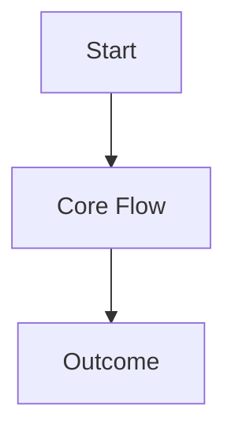

# PRD: beacon-agent-eval-v161

**Feature**: `beacon-agent-eval-v161`
**Version**: `v1.6.1`
**Status**: `bootstrap-generated / review-required / not-yet-frozen`
**Date**: `2026-06-15`
**Language**: `zh`

## Overview

v1.6.1 Agent Eval full parity：统一 eval 分数面、能力目录全 harness 覆盖、live/replay/simulated 分层 runner、with_skill vs baseline 行为证据、继承 v1.6.0 skill-eval benchmark 契约并闭合 AC-018..022、program harness 与 public CLI 纳入 catalog、产出 composite 0-100 scorecard（runtime_evidence_only，不替代 formal QA/release）

## Outline

<!-- FILL: Mermaid diagram showing the feature's core flow or state transitions.
     Use flowchart TD/LR for procedural features, stateDiagram-v2 for stateful features. -->

## Context

- Global boundaries: `docs/beacon/global-boundaries.md`
- Version summary: `docs/beacon/v1.6.1/SUMMARY.md`
- Execution index: `docs/beacon/v1.6.1/execution/index.md`

## Problem

<!-- FILL: Specific problem this feature solves. -->

## Goals

<!-- FILL: List of goals this feature must achieve. -->

## Design Principles

<!-- FILL: Design constraints and principles this feature must follow. -->

## Scope

### In Scope

- `beacon-agent-eval-v161` 的核心业务流程与必要风控校验。

### Out of Scope

- 与该需求无关的跨域重构或新增平台能力。

## Functional Requirements

<!-- 验收边界：FR 与 AC 一一映射，分层清晰。
     风险项需在 implementation 前完成缓解方案评审。 -->

| FR ID | Related AC | Requirement |
|-------|-----------|-------------|
| FR-001 | AC-001 | 用户可以完成「beacon-agent-eval-v161」主流程，满足：v1.6.1 Agent Eval full parity：统一 eval 分数面、能力目录全 harness 覆盖、live/replay/simulated 分层 runner、with_skill vs baseline 行为证据、继承 v1.6.0 skill-eval benchmark 契约并闭合 AC-018..022、program harness 与 public CLI 纳入 catalog、产出 composite 0-100 scorecard（runtime_evidence_only，不替代 formal QA/release） |
| FR-002 | AC-002 | 输入校验规则明确，非法输入会返回可读错误。 |
| FR-003 | AC-003 | 依赖失败时系统可恢复并提供下一步指引。 |
| FR-004 | AC-004 | 关键步骤具备可追踪日志与最小化诊断信息。 |
| FR-005 | AC-005 | 仅授权用户可执行敏感操作，越权请求被拒绝。 |

## Acceptance Criteria

| AC ID | Theme | Description |
|-------|-------|-------------|
| AC-001 | happy-path | 用户可以完成「beacon-agent-eval-v161」主流程，满足：v1.6.1 Agent Eval full parity：统一 eval 分数面、能力目录全 harness 覆盖、live/replay/simulated 分层 runner、with_skill vs baseline 行为证据、继承 v1.6.0 skill-eval benchmark 契约并闭合 AC-018..022、program harness 与 public CLI 纳入 catalog、产出 composite 0-100 scorecard（runtime_evidence_only，不替代 formal QA/release） |
| AC-002 | validation | 输入校验规则明确，非法输入会返回可读错误。 |
| AC-003 | error-handling | 依赖失败时系统可恢复并提供下一步指引。 |
| AC-004 | observability | 关键步骤具备可追踪日志与最小化诊断信息。 |
| AC-005 | security | 仅授权用户可执行敏感操作，越权请求被拒绝。 |

## Non-Goals

<!-- FILL: Explicitly excluded items beyond scope. -->

## Success Metrics

<!-- FILL: How to determine successful delivery. -->
