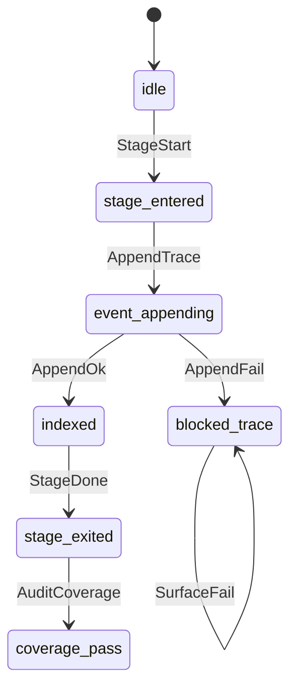

# Requirement Truth: Lifecycle ↔ agent_trace 绑定 (v1.6.10 R1)

## 人话

材料门已经够硬，但**过程/LLM 轨迹**还没闭环：权威落点是 `.beacon/traces/<run_id>.jsonl`（`agent_trace.v1`），默认 truth / freeze / implement / qa / release / goal 却不写。结果项目能 release，却 `agent_trace_coverage=missing`，复盘与防漂移做不了。

本湖只做一件事：在 **1+6 生命周期关键 stage 出口** 用已有 `record_governed_iteration` / `append_event` 写轨迹，绑定 `feature_slug` + `harness`，不存全文 chat，不新增第 7 个公共 harness。

- 能做：plan/truth/freeze/implement/qa/release/goal 写出 agent_trace 事件；lifecycle index 记 trace_path；loop-audit 覆盖信号可 pass；路径引用摘要
- 不能做：默认落全文对话；把 trace 当第 7 个对外 skill；静默吞掉 governed append 失败
- 怎样算完：金样 shape + TRG 过；至少 truth review / freeze / qa / goal-turn 后 traces 存在且 coverage≠永久 missing；单元/CLI 契约绿

## User Intent

让 Beacon 新生命周期在真实项目与自身迭代中留下可复盘、可回归、可评分的 LLM/agent_trace，并与需求真相字段绑定，约束过程不漂移。

## User Intent Snapshot

```yaml
lake_or_ocean: 湖
scope_mode: full_parity
authority: agent_trace.v1
storage: .beacon/traces/<run_id>.jsonl
binding: feature_slug + harness (+ truth revision when known)
no_full_chat: true
public_surface: 1plus6_only
```

## Intent Coverage Matrix（Check A）

| intent_id | source | strength | landing | status |
|-----------|--------|----------|---------|--------|
| INT-TRC-01 | prompt/handoff | must | AC-TRC-001 | covered |
| INT-TRC-02 | prompt/handoff | must | AC-TRC-002 | covered |
| INT-TRC-03 | prompt/handoff | must | AC-TRC-003 | covered |
| INT-TRC-04 | prompt/handoff | must | AC-TRC-004 | covered |
| INT-TRC-05 | review/v1.6.6 parent | must | AC-TRC-005 | covered |
| INT-TRC-06 | prompt | must | AC-TRC-006 | covered |
| INT-TRC-07 | review | must | AC-TRC-007 | covered |
| INT-TRC-08 | vision optional | should | Non-goal: hard release gate on missing trace 另湖 | deferred |

## First principles（域）

| ID | Constraint |
|----|------------|
| FP-TRC-001 | 权威存储仅为 `.beacon/traces/<run_id>.jsonl` + lifecycle `run_traces` 索引 |
| FP-TRC-002 | 事件禁止默认全文 chat；仅 path refs / summary |
| FP-TRC-003 | governed stage 写出须带 harness；feature 已知时带 feature_slug |
| FP-TRC-004 | append 失败不得静默当成功（goal driver 含） |
| FP-TRC-005 | 不新增公共 harness；host skill/CLI 无 LLM API key 也可写 trace |

## 用户旅程 / 故事

### Journey J-TRC-01 生命周期留痕

1. 用户/Agent 对 feature 跑 truth review → 写出 gate_verdict 事件  
2. freeze 成功 → 写出 output/gate_verdict（status=frozen）  
3. implement / qa 运行 → 写出 decision 或 gate_verdict  
4. doctor loop-audit → agent_trace_coverage 非 missing  

### User Stories

| US ID | Story | AC |
|-------|-------|-----|
| US-TRC-001 | 作为运维/审查方，我要在每次关键 lifecycle 动作后看到 jsonl trace | AC-TRC-001..003 |
| US-TRC-002 | 作为回归方，我要事件绑定 feature+harness 以便对照 truth | AC-TRC-004 |
| US-TRC-003 | 作为 goal 长跑方，driver turn 不得吞掉 trace 失败 | AC-TRC-005 |
| US-TRC-004 | 作为合规方，trace 不得成为全文 chat 仓库 | AC-TRC-006 |

## Acceptance Criteria

| AC ID | Description |
|-------|-------------|
| AC-TRC-001 | 提供 `record_lifecycle_stage_trace`（或等价）封装 `record_governed_iteration`，统一 stage/harness/feature/run_id 解析 |
| AC-TRC-002 | `beacon truth review` 在写出报告后 append ≥1 条 `gate_verdict`（或 decision）事件，path 在 `.beacon/traces/` |
| AC-TRC-003 | `beacon freeze` 成功路径 append ≥1 条事件，payload 含 status/revision 摘要（非全文） |
| AC-TRC-004 | 事件含 `harness`；feature 已知时含 `feature_slug`；schema 为 `agent_trace.v1` |
| AC-TRC-005 | goal driver turn 调用 trace 时不再 bare `except: pass`；失败写入 driver state 或返回 status≠ok |
| AC-TRC-006 | payload/汇总禁止 `full_chat` 作为权威；aggregate 继续 strip full_chat |
| AC-TRC-007 | `qa run` 结束时 append `gate_verdict`（final status 摘要） |
| AC-TRC-008 | 模拟 lifecycle 后 `agent_trace_coverage` 不为 missing（至少 1 个 valid run） |
| AC-TRC-009 | 本 package 金样 shape：人话 + Intent Matrix + FSM 五元组 + illegal + AC + Non-goals |
| AC-TRC-010 | 每 AC 在 tests.md 有 ≥1 TC |

## Domain Model

| Entity | Key | Precedence / Requires |
|--------|-----|------------------------|
| LifecycleRun | run_id | root；优先复用 goal run_id |
| TraceFile | path | requires LifecycleRun |
| TraceEvent | (run_id, iteration, event_type, ts) | requires TraceFile |
| StageBinding | harness + feature_slug | requires TraceEvent |

## Domain FSM TraceLifecycle

| State | From | Guard |
|-------|------|-------|
| idle | — | initial |
| stage_entered | idle / stage_exited | harness_known |
| event_appending | stage_entered | run_id_resolved |
| indexed | event_appending | append_ok |
| blocked_trace | event_appending | append_failed |
| stage_exited | indexed | stage_complete |
| coverage_pass | stage_exited | ≥1 valid jsonl run |

## Illegal transitions

- stage_complete → coverage_pass without any valid event
- append_failed → silent success (no reason_code)
- event with full_chat body as sole evidence
- invent public harness `trace` outside 1+6

## FSM 五元组

| State | Event | Guard | To | Action |
|-------|-------|-------|-----|--------|
| idle | StageStart | harness_in_1plus6 | stage_entered | resolve_run_id |
| stage_entered | AppendTrace | run_id_nonempty | event_appending | record_lifecycle_stage_trace |
| event_appending | AppendOk | schema_valid | indexed | update_run_trace_index |
| event_appending | AppendFail | os_or_schema_error | blocked_trace | surface_reason_code |
| indexed | StageDone | — | stage_exited | attach_payload_agent_trace |
| blocked_trace | SurfaceFail | fail_closed_policy | blocked_trace | return_blocked |
| stage_exited | AuditCoverage | valid_run≥1 | coverage_pass | agent_trace_coverage_signal |



## Non-goals

- 全文 chat 落库或作为 trace 权威
- 把 agent_trace 做成第 7 个公共 host skill
- release check 强制 fail-closed（INT-TRC-08 deferred；本湖 release 仅可选写 gate_verdict）
- 替换 workflow-lifecycle.json 主存（仅 index pointer）
- 要求用户配置 LLM API key 才能写 trace（Beacon 是 host skill/CLI）

## Downstream Routes

- implement: `beacon/utils/agent_trace.py` helper + hooks in truth/freeze/qa/implement/goal
- qa: TC matrix + unit tests `tests/test_v1610_trace_lifecycle_binding.py`
- freeze: 本 package TRG → freeze R1
