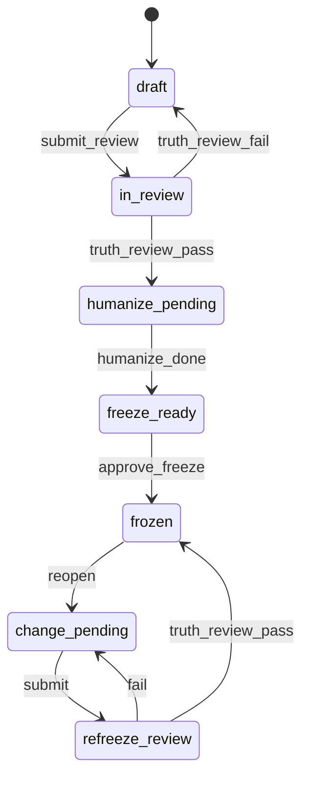

# Requirement Truth: Truth Core Authority (v1.6.10 R3)

## 人话

需求真相是完成标准。Plan 写出来的草稿，必须先过一道**强制审查门**，才能冻结。这道门查三件事：用户意图有没有漏、状态机有没有卡死或悬空、每条验收能不能测。过了门再用人话规则润色，然后冻结。冻结后实现和测试才算数。改真相要 reopen，材料校验，依赖的 tests/tasks 先算过期，再冻一次。

- 能做：Plan 出 Draft；Truth Review 出报告；通过后 Humanizer；Freeze；reopen 变更
- 不能做：跳过审查直接冻；未冻就 implement；改完不 refreeze；release 带 stale 材料
- 怎样算完：审查门 AC 齐；三契约仍在；命令合同写清

## User Intent

确立 Product Truth 内核，并规定 **Plan → Truth 的 Mandatory Review Gate** 为全流程最高优先级首冻关卡，防止错误真相级联污染 tasks / implement / tests。

## User Intent Snapshot

```yaml
lake_or_ocean: 湖
scope_mode: full_parity
kernel: product_truth
mandatory_gate: truth_review_gate_first_freeze
contracts: [freeze, reopen_verify, cascade_stale]
pipeline: [plan_draft, truth_review_gate, freeze, implement_qa]
```

## First principles / 不可变约束

| ID | Constraint |
|----|------------|
| FP-001 | 完成定义 ∈ frozen truth + tests，∉ agent 自述 |
| FP-002 | implement / qa 派生自 truth，禁止反向写 truth |
| FP-003 | 改 promise/AC/FSM/范围 ⇒ reopen 治理环 |
| FP-004 | lifecycle ⇒ FSM 五元组 + illegal + 无悬空中间态 |
| FP-005 | 海→湖→收敛进 package（总分总） |
| FP-006 | Humanizer 不改 AC-ID / 状态名 / 非法边 |
| FP-007 | **未 Truth Review Gate pass 不得 first freeze** |
| FP-008 | **错误 truth 的级联成本 > 审查成本** ⇒ Gate 最高优先级 |

## User Decisions

| ID | Value |
|----|-------|
| UD-TCA-001..010 | 同 R2 精神（freeze/reopen/stale/FSM/doctor/GoalRun） |
| UD-TCA-011 | Plan→Truth = Mandatory Review Gate（首冻） |
| UD-TCA-012 | 3-Step：Draft → Review(A/B/C+Humanizer) → Freeze |
| UD-TCA-013 | Intent & Goal Coverage Matrix 为首冻必交工件 |
| UD-TCA-014 | 每 AC ≥ 1 TC 口径（首冻与 refreeze 均检查） |
| UD-TCA-015 | `beacon truth review`（或 catalog 等价名）产出 pass/fail 报告 |
| UD-TCA-016 | review_gate_pass=true 才允许 status=frozen（first freeze） |
| UD-TCA-017 | refreeze 前必须重跑 Gate A/B/C（可并入 verify-materials） |

## 三契约（R2 保留）

### C1 Freeze Contract
- frozen revision 后 implement/qa 可信
- **first freeze** 额外要求：Truth Review Gate pass

### C2 Reopen + Verify
- reopen → re-review → change → **verify-materials（含 Gate A/B/C）** → refreeze

### C3 Cascade Stale
- truth revision bump ⇒ tests/tasks stale
- release gate fail-closed on stale

---

## Truth Review Gate（首冻强制 · 最高优先级）

> 错 truth 会让 tasks / implement / tests **高效率做错事**。本门是 Plan→Truth 的强制审核关卡。

### 三步管线

```text
[用户 Prompt / 意图]
        │
        ▼
1. Plan 拆解 → Draft Truth
   （GoalRun / Journey / Story / FSM draft / AC draft / Non-goals）
        │
        ▼
2. Truth Review Gate  （全部 pass 才可进入 3）
   ├── Check A: Intent & Goal Coverage Matrix
   ├── Check B: FSM Audit（完备 / 悬空 / illegal / 幂等与逆向已声明）
   ├── Check C: Testability（每 AC ≥ 1 TC 口径）
   └── Polish: Humanizer fulltext（仅 L0/叙述；在 A/B/C pass 后）
        │
        ▼
3. Freeze（status=frozen, review_gate_pass=true）
        │
        ▼
   解锁 implement / 可信 tasks 生成 / qa 对照
```

### Check A — Intent & Goal Coverage Matrix

工件：`Intent Coverage Matrix`（可嵌 truth.md 或旁路 matrix 节）

| 列 | 含义 |
|----|------|
| intent_id | 来自 Prompt/Plan 的强意图或约束 |
| source | prompt / plan / stakeholder |
| strength | must / should |
| landing | AC-id \| Non-goal \| Deferral-id |
| status | covered \| missing \| deferred |

**Pass 规则：** 每条 `must` 意图的 landing ≠ missing；不允许用沉默省略。

### Check B — FSM Audit

对 `domain_required` / lifecycle 湖：

1. 存在五元组表 State|Event|Guard|To|Action  
2. 存在 invalid / reject 列表  
3. **悬空规则：** 每个非终态至少 1 条合法转出 Event（含超时/失败/取消等）  
4. 并发/幂等/逆向：若业务相关，须有 AC 或显式 Non-goal/Deferral  
5. doctor（实现时）对违反 1–3 fail-closed  

### Check C — Testability

- 每条 AC 至少 1 行 tests.md：Command + Assertion  
- AC 必须可判定 pass/fail（禁止纯形容词验收）

### Humanizer 序

- **仅在** Check A/B/C 均为 pass 之后  
- **且在** freeze 之前  
- 按 humanizer 配置读 oss-sync 全文；preserve_machine_fields=true  

### 与现有表面关系

| 表面 | 角色 |
|------|------|
| beacon-plan / pln-review | 可产出 Draft 与 advisory findings；**不能**单独授权 freeze |
| requirement_clarity | 可并入 Gate 证据，不替代 Matrix/FSM Audit |
| doctor verify-materials | refreeze / 可实现为 Gate 的机器检查载体 |
| **Truth Review Gate** | **first freeze 与 refreeze 的强制门** |

### 命令合同（应然）

```text
beacon truth review <feature> --project-root . --version <ver> [--json]
```

- 输出：intent_coverage report、fsm_audit warnings、testability gaps、overall pass|fail  
- fail ⇒ freeze 拒绝（reason_code: `truth_review_gate_failed`）  
- skill 面：`$beacon-truth` 子意图 / progressive mode `truth-review`（实现时）或 plan+truth 联合，**禁止**无报告自觉 freeze  

等价名允许，但 catalog 必须可发现「truth review」。


## Intent Coverage Matrix（Check A · 本包）

| intent_id | source | strength | landing | status |
|-----------|--------|----------|---------|--------|
| INT-TRG-mandatory-gate | prompt | must | AC-TRG-001 | covered |
| INT-TRG-3step | prompt | must | AC-TRG-002 | covered |
| INT-TRG-matrix | prompt | must | AC-TRG-003 | covered |
| INT-TRG-fsm-hang | prompt | must | AC-TRG-004 | covered |
| INT-TRG-ac-tc | prompt | must | AC-TRG-005 | covered |
| INT-TRG-humanizer-order | prompt | must | AC-TRG-006 | covered |
| INT-TRG-freeze-precheck | prompt | must | AC-TRG-007, AC-TRG-009 | covered |
| INT-TRG-cli | prompt | must | AC-TRG-008 | covered |
| INT-TRG-refreeze | prompt | must | AC-TRG-010 | covered |
| INT-TRG-plan-boundary | prompt | must | AC-TRG-011 | covered |
| INT-TRG-cascade-cost | prompt | must | AC-TRG-012 | covered |
| INT-TCA-kernel | plan | must | AC-TCA-001..016 | covered |
| INT-partial-optional | vision | should | Non-goal: 部分湖另包 | deferred |

## Acceptance Criteria

| AC ID | Description |
|-------|-------------|
| AC-TCA-001 | implement 无 frozen 不得声称交付完成 |
| AC-TCA-002 | qa 不改写 truth |
| AC-TCA-003 | 变更：reopen→review→change→verify-materials→refreeze |
| AC-TCA-004 | lifecycle：FSM 五元组 + invalid |
| AC-TCA-005 | illegal 在 tests 有口径 |
| AC-TCA-006 | GoalRun Illegal：无 freeze 进 implement；soft tick |
| AC-TCA-007 | 四件套齐全 |
| AC-TCA-008 | 人话 L0 四线索 |
| AC-TCA-009 | 无 pending deferral 假 full freeze |
| AC-TCA-010 | 对齐 global-boundaries 链 |
| AC-TCA-011 | reopen 为 frozen→change_pending 合法入口 |
| AC-TCA-012 | verify-materials 为 refreeze 前必过（含 Gate A/B/C） |
| AC-TCA-013 | truth 变更 → tests/tasks stale；release 见 stale 失败 |
| AC-TCA-014 | doctor：缺五元组/缺 invalid/悬空态 fail-closed |
| AC-TCA-015 | FP 专章 ≥ FP-001..008 |
| AC-TCA-016 | GoalRun 引用 FP |
| AC-TRG-001 | 文档规定 Plan→Truth 为 Mandatory Review Gate（最高优先级首冻） |
| AC-TRG-002 | 3-Step 管线：Draft → Gate(A/B/C+Humanizer) → Freeze 成文 |
| AC-TRG-003 | Check A：Intent Coverage Matrix 必交；must 意图不得 missing |
| AC-TRG-004 | Check B：悬空规则（非终态≥1 转出 Event）+ illegal 列表 |
| AC-TRG-005 | Check C：每 AC ≥ 1 TC（Command+Assertion） |
| AC-TRG-006 | Humanizer 仅在 A/B/C pass 后、freeze 前 |
| AC-TRG-007 | first freeze 要求 review_gate_pass（或等价证据） |
| AC-TRG-008 | `beacon truth review`（或等价）合同：产出报告 + pass/fail |
| AC-TRG-009 | fail 时 reason_code `truth_review_gate_failed`，阻断 freeze |
| AC-TRG-010 | refreeze 前重跑 Gate A/B/C |
| AC-TRG-011 | plan/pln-review 不得单独授权 freeze |
| AC-TRG-012 | 错 truth 级联成本论述进入人话/FP（FP-008） |

## State Model（package lifecycle + gate）

### FSM 五元组（节选增补）

| State | Event | Guard | To | Action |
|-------|-------|-------|-----|--------|
| draft | submit_review | package_complete | in_review | — |
| in_review | truth_review_pass | gate_A_B_C_pass | humanize_pending | set_review_gate_pass |
| humanize_pending | humanize_done | profile_ok | freeze_ready | — |
| freeze_ready | approve_freeze | review_gate_pass | frozen | set_revision_frozen |
| in_review | truth_review_fail | — | draft | attach_gate_report |
| frozen | reopen_change | authorized | change_pending | mark_stale |
| change_pending | submit_refreeze_review | surfaces_refreshed | refreeze_review | — |
| refreeze_review | truth_review_pass | gate_A_B_C_pass | frozen | bump_revision_clear_stale |

### invalid

- draft → frozen  
- in_review → frozen without review_gate_pass  
- change_pending → frozen without gate re-pass  
- frozen → draft  



## GoalRun

```text
done_when:
  - TRG AC present
  - C1–C3 + FP-007/008
Illegal:
  - freeze without review_gate_pass
  - implement on non-frozen
  - release with stale tests/tasks
```

## Non-goals

- 本包实现 CLI 代码  
- 部分退款/多币种 Gold（另变更）  

## Freeze readiness R3

- [x] AC-TCA + AC-TRG
- [x] 3-Step pipeline
- [x] tests/tasks/evidence
- [ ] implement truth review CLI
