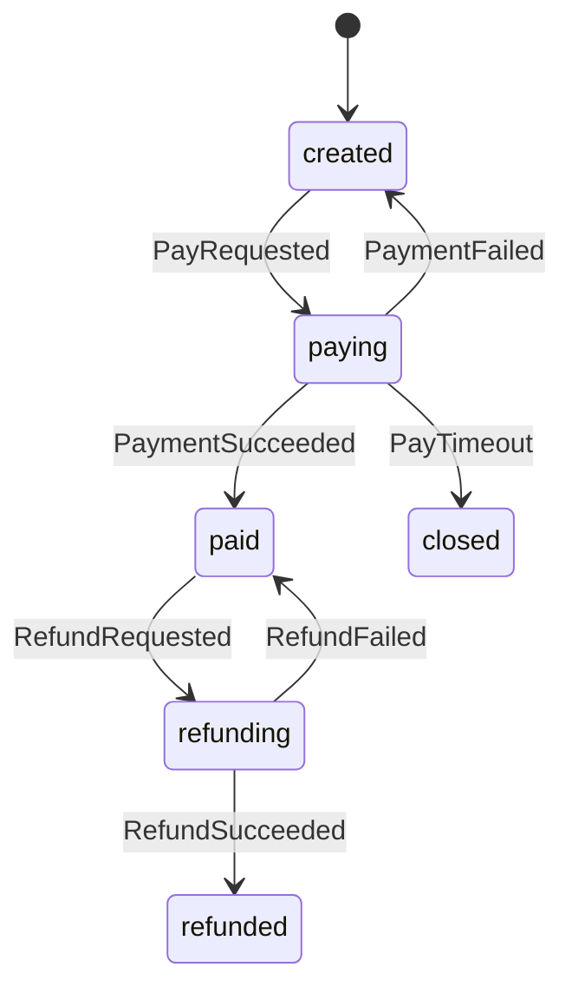

# Requirement Truth: Gold 订单支付/关单/退款 (v1.6.10 R3)

## 人话

样板湖：下单→支付→成功/失败重试/超时关单→可退则退、已发货拦截。重复通知只算一次。本 revision 补上**意图覆盖矩阵**，示范首冻审查 Check A 怎么填，避免只写快乐路径。

- 能做：支付、重试、关单、合规退款、幂等
- 不能做：跳态 paid、无 success 进 paid、关单后再付成功、shipped 退款成功
- 怎样算完：五元组+矩阵+每 AC 有 TC 口径；skill 示例同步

## User Intent

公共 Gold 示例：支付/关单/退款 + **Intent Coverage Matrix**，供 Truth Review Gate 对照。

## User Intent Snapshot

```yaml
lake_or_ocean: 湖
skill_example: true
truth_review_gate: required
```

## Intent Coverage Matrix（Check A 示例）

| intent_id | source | strength | landing | status |
|-----------|--------|----------|---------|--------|
| INT-PAY-01 | prompt/gold | must | AC-PAY-001 | covered |
| INT-PAY-02 | prompt/gold | must | AC-PAY-002 | covered |
| INT-PAY-03 | prompt/gold | must | AC-PAY-003 | covered |
| INT-PAY-04 | prompt/gold | must | AC-PAY-010 | covered |
| INT-PAY-05 | review | must | AC-PAY-022 | covered |
| INT-PAY-06 | review | must | AC-PAY-023 | covered |
| INT-RF-01 | prompt/gold | must | AC-RF-001 | covered |
| INT-RF-02 | prompt/gold | must | AC-RF-002 | covered |
| INT-RF-03 | review | must | AC-RF-003 | covered |
| INT-RF-04 | review | must | AC-RF-004 | covered |
| INT-IDEM-01 | review | must | AC-PAY-003, AC-RF-002 | covered |
| INT-EDGE-partial-refund | vision optional | should | Non-goal: 部分退款另湖 | deferred |
| INT-EDGE-concurrent-cancel | vision optional | should | Non-goal: 并发撤单另湖 | deferred |

## First principles（域）

| ID | Constraint |
|----|------------|
| FP-PAY-001 | 无 created 不支付 |
| FP-PAY-002 | paid 须有 success 支付事实 |
| FP-PAY-003 | closed/refunded 不再支付成功 |
| FP-PAY-004 | shipped 退款请求拒绝（本示例） |

## 用户旅程 / 故事

同 R2：下单→支付→结果→退款；US-PAY-001..003、US-RF-001..002。

## Acceptance Criteria

| AC ID | Description |
|-------|-------------|
| AC-PAY-001 | created + PayRequested → paying + intent |
| AC-PAY-002 | 非 created 支付 → 拒绝 |
| AC-PAY-003 | PaymentSucceeded 幂等 → paid，success=1 |
| AC-PAY-010 | PaymentFailed → created |
| AC-PAY-011 | paid 再 PayRequested → 拒绝 |
| AC-PAY-020 | 禁 created→paid 跳态 |
| AC-PAY-021 | 禁无 success→paid |
| AC-PAY-022 | PayTimeout → closed |
| AC-PAY-023 | closed 再 PayRequested → 拒绝 |
| AC-RF-001 | RefundRequested + 可退 → refunding |
| AC-RF-002 | RefundSucceeded 幂等 → refunded |
| AC-RF-003 | shipped 退款 → 拒绝，仍 paid |
| AC-RF-004 | refunded 再支付/退成功路径 → 拒绝 |
| AC-PAY-030 | skill 示例含人话+mermaid |
| AC-PAY-031 | 状态集含 created,paying,paid,closed,refunding,refunded |
| AC-PAY-032 | 含 FSM 五元组表 |
| AC-PAY-033 | 含 Intent Coverage Matrix；must 无 missing |
| AC-PAY-034 | 本 package 每 AC 在 tests.md 有 ≥1 行 |

## FSM 五元组

| State | Event | Guard | To | Action |
|-------|-------|-------|-----|--------|
| created | PayRequested | order_exists | paying | create_payment_intent |
| paying | PaymentSucceeded | intent_matches | paid | record_success_once |
| paying | PaymentFailed | intent_matches | created | record_failure |
| paying | PayTimeout | elapsed>=timeout | closed | release_hold |
| paid | RefundRequested | not_shipped ∧ window | refunding | create_refund_intent |
| refunding | RefundSucceeded | intent_matches | refunded | record_refund_once |
| refunding | RefundFailed | intent_matches | paid | record_refund_failure |

**悬空检查：** created/paying/paid/refunding 均有转出；closed/refunded 为终态。

invalid：created→paid；无 success→paid；closed→paid；shipped 退款成功；refunded→paying



## Truth Review Gate 示范结论（文档层）

| Check | Result |
|-------|--------|
| A Intent Matrix | pass（must 全 covered；partial-refund/concurrent deferred） |
| B FSM Audit | pass（无悬空；illegal 列出） |
| C Testability | pass（见 tests.md 行） |
| Humanizer | 人话保持短句、无宣传腔（示例已人工收敛） |
| review_gate_pass | **true**（本 gold 作为形态示范） |

## Non-goals

- 部分退款、并发撤单、真实渠道代码  

## Freeze readiness R3

- [x] Matrix + AC-PAY-033/034
- [x] skill 同步
- [ ] runtime truth review CLI
