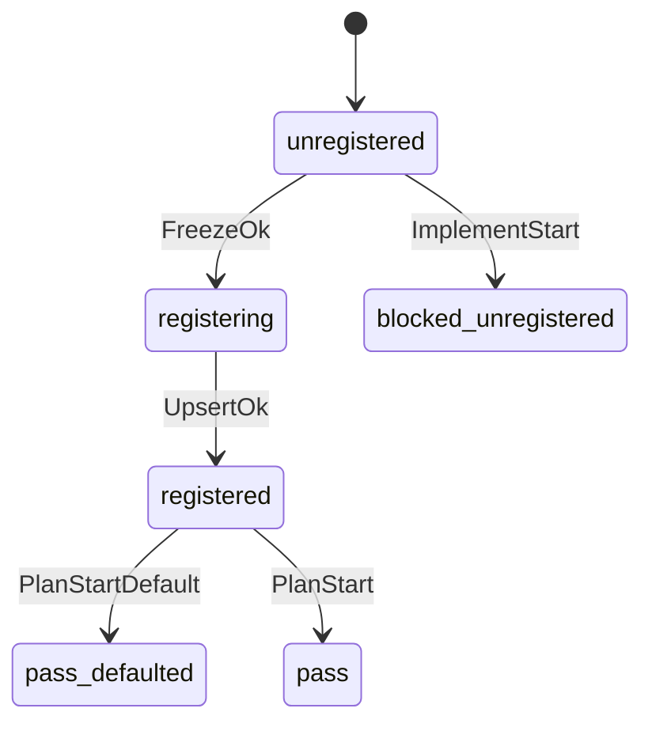

# Requirement Truth: Version Contract Auto-Register (v1.6.10 R1)

## 人话

rolo 这类 monorepo 能把功能 freeze、写代码、上 UAT，却经常漏写 `project-version-governance.md` 的开发分支合同。Beacon 源码有三处洞：freeze 不登记、doctor upsert 写不进 `truth_canonical`、implement 在空合同时还软跳过。本湖只补这些洞，让合同可交付验收。

- 能做：freeze 后从 package 登记 participating_services+branch；monorepo 规范 `beacon/vX/slug`→`feature/vX`；upsert 持久化 truth_canonical；空合同 implement 硬拦
- 不能做：改 rolo 业务代码；自动无人工 release；补全所有产品线 SUMMARY 材料面
- 怎样算完：单元/回归绿；freeze 写 version_contract_sync；precheck/implement reason_code 清晰；合入 main 并跑 post-release local install

## User Intent

修复 Beacon 导致 monorepo 跳过开发分支登记的源码缺口，使合同可交付验收并合入主分支，触发本机 skill/CLI 更新。

## User Intent Snapshot

```yaml
lake_or_ocean: 湖
outcome: freeze_auto_registers_version_contract_and_implement_fail_closed_when_missing
non_negotiables:
  - no soft-skip empty version_contract under governance_md
  - freeze attempts registration
  - truth_canonical writable
out_of_scope:
  - product business lanes
  - inventing SUMMARY for every customer monorepo version
```

## Intent Coverage Matrix

| intent_id | source | strength | landing | status |
|-----------|--------|----------|---------|--------|
| INT-VCA-001 | rolo skip analysis | must | AC-VCA-001 | covered |
| INT-VCA-002 | freeze gap | must | AC-VCA-002 | covered |
| INT-VCA-003 | truth_canonical upsert | must | AC-VCA-003 | covered |
| INT-VCA-004 | implement soft-skip | must | AC-VCA-004 | covered |
| INT-VCA-005 | historical precheck | must | AC-VCA-005 | covered |
| INT-VCA-006 | deliverability | must | AC-VCA-006 | covered |

## 用户旅程

1. 开发者在 monorepo 为新版本写 feature package 并 freeze。
2. Beacon freeze 从 package frontmatter 登记 `per_service_canonical_branch` 到 governance md。
3. implement 启动时若合同缺失 → blocked `governance_version_not_registered`。
4. plan start 对已登记但缺 truth_canonical 的历史合同默认 main 并通过 precheck。
5. QA 跑契约测试后合入 main，执行 post-release local install 更新 skill/CLI。

## Acceptance Criteria

| AC ID | Description |
|-------|-------------|
| AC-VCA-001 | monorepo package `git_canonical_branch=beacon/vX/slug` 登记为 `feature/vX` 到 per_service_canonical_branch |
| AC-VCA-002 | freeze 成功路径调用 ensure_version_contract_from_feature_package 并输出 version_contract_sync |
| AC-VCA-003 | create_or_update_project_metadata / doctor --truth-canonical 可持久化 truth_canonical |
| AC-VCA-004 | governance_md 权威且合同无 participating/branch map 时 implement preflight reason_code=governance_version_not_registered |
| AC-VCA-005 | 已登记但缺 truth_canonical 的版本 governance_precheck 默认 main 且 pass（truth_canonical_defaulted） |
| AC-VCA-006 | 回归套件 tests/test_version_contract_auto_register.py + test_v166_governance_precheck_sync_catalog 全绿 |

## Domain Model

| Entity | Key | Precedence / Requires |
|--------|-----|------------------------|
| ProjectGovernance | project_root | root markdown authority |
| VersionContract | version | requires ProjectGovernance |
| ServiceBranchMap | (version, service_key) | requires VersionContract |
| FeaturePackage | (version, slug) | source of participating_services + git_canonical_branch |
| FreezeSync | freeze_run_id | requires FeaturePackage; writes VersionContract |

## Domain FSM VersionContractRegister

| State | From | Guard |
|-------|------|-------|
| unregistered | — | initial when version missing |
| package_ready | unregistered | package frontmatter has services |
| registering | package_ready | freeze_ok |
| registered | registering | upsert_ok |
| blocked_unregistered | unregistered | implement_start under governance_md |
| pass_defaulted | registered | plan_start missing truth_canonical but has services |

## Illegal transitions

- VersionContractRegister.implement_start → pass when contract empty under governance_md
- VersionContractRegister.freeze_ok → registered without ensure_version_contract attempt
- VersionContractRegister.upsert success without truth_canonical default/write on new contracts
- VersionContractRegister.plan_start hard-block only for missing truth_canonical when participating_services already present
- VersionContractRegister.normalize inventing expected_branch when governance contract empty
- VersionContractRegister.freeze without participating_services silently marking registered

## FSM 五元组

| State | Event | Guard | To | Action |
|-------|-------|-------|----|--------|
| unregistered | FreezeOk | package_has_services | registering | ensure_version_contract_from_feature_package |
| registering | UpsertOk | branch_normalized | registered | write_governance_md |
| unregistered | ImplementStart | governance_md_active | blocked_unregistered | reason_code=governance_version_not_registered |
| registered | PlanStart | truth_canonical_missing && has_services | pass_defaulted | default_truth_canonical=main |
| registered | PlanStart | truth_canonical_present | pass | governance_precheck_pass |



## Non-goals

- 自动补 rolo 全量历史版本 SUMMARY/boundaries 材料面
- 改业务服务业务逻辑
- 无人确认的 release 签核
- 把 doctor metadata 变成第二个 truth 权威

## Downstream Routes

- implement: project_metadata / freeze / truth_map / program_plan_runtime / doctor / implement branch guard
- qa: tests/test_version_contract_auto_register.py
- release: post-release local install hook after main merge
