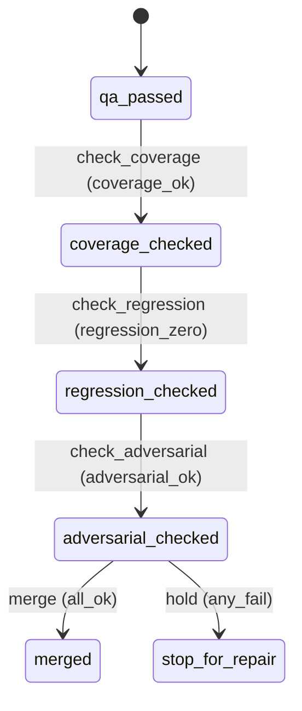

# Requirement Truth: beacon-v1615-automerge-gate (v1.6.15)

## 人话

给"agent 自动合并代码"加一道**质量闸门**。自动合入（auto-merge）允许后，坏代码会更快进主干——所以合并前必须确认三件事都过关：**① QA 类型覆盖达标**（不是只测正常路径）、**② 失败模式回归库没命中**（agent 犯过的错没再犯）、**③ 对抗式审查通过**。这三样都过了，agent 才被允许自动合并；发布（release）那道"必须人点头"的门保持不变。

- 能做：合并前检查类型覆盖 + 失败模式回归 + 对抗式审查；不达标拦下（stop_for_repair）
- 不能做：不替代 release 人类 gate；不自动打 tag/部署；不改变已冻结 truth
- 怎样算完：QA 通过但类型覆盖不足 → 合并被拦；三条件全过 → 允许合并

## User Intent

把 `global-boundaries.md §4.1` 的「自动合入契约」落地为可执行 gate：合并回 main 前强制检查 ① 类型覆盖达标（L1 coverage_type_weighted）② 失败模式回归库命中 0 ③ 对抗式审查通过；不达标 fail-closed。

## User Intent Snapshot

```yaml
lake_or_ocean: 湖
truth_review_gate: required
intent_source: 2026-08-27 beacon-automerge-first-principles + beacon-qa-strength-auto-merge
```

## Intent Coverage Matrix

| intent_id | source | strength | landing | status |
|-----------|--------|----------|---------|--------|
| INT-001 | 合并前置门禁（类型覆盖+回归+对抗）| must | AC-001 | covered |
| INT-002 | 失败模式回归库接入合并前置 | must | AC-002 | covered |
| INT-003 | 对抗式审查通过作为合并前置 | must | AC-003 | covered |
| INT-004 | release 人类 gate 不动 | must | AC-004 | covered |

## 用户旅程

1. 触发：QA passed 后、merge 回 main 前
2. 关键操作：检查类型覆盖达标 → 失败模式回归库命中 0 → 对抗式审查通过
3. 结果：三条件全过 → 允许自动合并；任一不达标 → stop_for_repair
4. 异常：release 阶段仍走人类 gate（auto-merge 不越过发布判定）

## First principles

- 系统边界：门禁只管"合并是否安全"，release 判定永远人类
- 不可变：类型覆盖不足 / 回归库命中 / 对抗审查不过 → 合并 fail-closed
- 可推翻假设：类型覆盖阈值默认 = L1 coverage_rate ≥ 阈值（0.85）

## Domain Model

| Entity | Key fields | Notes |
|--------|------------|-------|
| AutomergeGate | coverage_ok, regression_ok, adversarial_ok | 三条件 |
| RegressionHit | failure_mode_id, hits | 失败模式回归库命中 |
| AdversarialReview | checklist, evidence | 3-5 翻车点 + 验证证据 |

## Acceptance Criteria

| AC ID | Description |
|-------|-------------|
| AC-001 | merge 回 main 前 gate 检查三条件（类型覆盖达标 + 失败模式回归命中 0 + 对抗式审查通过）；任一不达标 → coverage_checked/regression_checked/adversarial_checked 任一状态 fail-closed（stop_for_repair）。 |
| AC-002 | 失败模式回归库（v1.6.13 D3 已建）作为合并前置输入：在 regression_checked 阶段命中 > 0 → 合并被拦。 |
| AC-003 | 对抗式审查（global-boundaries §5）作为合并前置：在 adversarial_checked 阶段缺翻车点清单/验证证据 → 合并被拦。 |
| AC-004 | release 人类 gate 保持不变：auto-merge 不自动打 tag/部署/发布（merged 后仍须人类确认）；`manual_confirmation_required` 仍须人工确认。 |

## FSM 五元组

| State | Event | Guard | To | Action |
|-------|-------|-------|-----|--------|
| qa_passed | check_coverage | coverage_ok | coverage_checked | verify_types |
| coverage_checked | check_regression | regression_zero | regression_checked | scan_catalog |
| regression_checked | check_adversarial | adversarial_ok | adversarial_checked | review_checklist |
| adversarial_checked | merge | all_ok | merged | auto_merge |
| adversarial_checked | hold | any_fail | stop_for_repair | block_merge |

**终态：** merged, stop_for_repair

## Domain FSM Order

| State | From | Guard |
|-------|------|-------|
| coverage_checked | qa_passed | coverage_ok |
| regression_checked | coverage_checked | regression_zero |
| adversarial_checked | regression_checked | adversarial_ok |
| merged | adversarial_checked | all_ok |

## Illegal transitions

- 覆盖不足仍合并（gate 绕过）
- 回归库命中仍合并（安全网失效）
- 对抗审查缺失仍合并（无翻车点清单）

### invalid / illegal

- 覆盖不足仍合并（gate 绕过）
- 回归库命中仍合并（安全网失效）
- 对抗审查缺失仍合并（无翻车点清单）

## Non-goals

- 不替代 release 人类 gate（发布判定永远人工）
- 不自动打 tag / 部署 / 发布
- 不改变已冻结 truth 语义

## Freeze readiness

- [x] Intent Matrix must 无 missing
- [x] 用户旅程非「待补」占位
- [x] First principles / Domain Model 已具体化
- [x] 元状态 FSM + illegal
- [x] 每 AC ≥ 1 TC（Command+Assertion）+ exec-layer TC
- [x] tasks 均有 ac= + evidence= 绑定
- [x] package_maturity: filled
- [x] `beacon truth review` pass 后再 freeze

### Gap vs gold (订单支付示例)

- 对照：`docs/beacon/v1.6.10/features/truth-gold-order-pay-v1610/truth.md`

## Source Excerpt

```markdown
beacon-v1615-automerge-gate
来源：2026-08-27 auto-merge 第一性原理（合入层自动、发布层人类）+ QA 强度分析
落地：global-boundaries.md §4.1 自动合入契约 → 可执行 gate
```

## FSM mermaid（投影）


