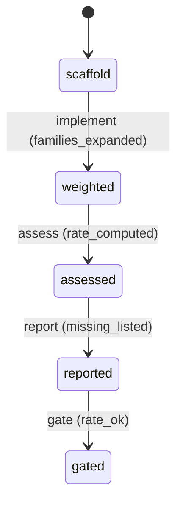

# Requirement Truth: beacon-v1615-coverage-type-weighted (v1.6.15)

## 人话

把 beacon QA 的"覆盖率"从**数个数**升级成**看类型**。现在一个功能哪怕只测了正常路径（happy path），覆盖率也可能报 100%——因为只数"测了几个用例"，不看"有没有测异常、边界、恢复这些情况"。这次改成：**要求测的类型（正常/异常/边界/恢复/兼容）都得有覆盖，缺一类就算没测满**。这样 agent 自动合入代码时，才不会拿"只测了正常路径"当"全绿"骗过门禁。

- 能做：coverage_rate 按类型族加权计算；类型族缺失 → 覆盖率 < 100%；QA 判定反映类型缺口
- 不能做：不改各 lake 的业务语义；不要求所有 lake 都测浏览器场景（非浏览器按自身类型展开）
- 怎样算完：只测 happy path 的 lake，coverage_rate 不再是 1.0，QA 会指出缺了哪些类型

## User Intent

把 beacon QA 的 `coverage_rate` 从数量覆盖升级为类型加权覆盖：`required_scenario_families`（happy/negative/boundary/recovery/compatibility）中缺一类 → 覆盖率扣分，QA 非全绿，自动合入前置门禁可据此拦下。

## User Intent Snapshot

```yaml
lake_or_ocean: 湖
truth_review_gate: required
intent_source: 2026-08-27 beacon-qa-strength-auto-merge-2026-08-27.md（假覆盖缺口）
```

## Intent Coverage Matrix

| intent_id | source | strength | landing | status |
|-----------|--------|----------|---------|--------|
| INT-001 | coverage_rate 类型加权 | must | AC-001 | covered |
| INT-002 | 非浏览器场景也展开类型 family | must | AC-002 | covered |
| INT-003 | 类型缺口可审计（缺哪类） | must | AC-003 | covered |
| INT-004 | 兼容既有 lake（不改语义） | must | AC-004 | covered |

## 用户旅程

1. 触发：QA 运行任何 feature（含非浏览器 contract/docs lake）
2. 关键操作：scenario map 生成类型 family（happy+negative+boundary…）；coverage_rate 按类型加权
3. 结果：只测 happy path → coverage_rate < 1.0，QA 列出 missing families
4. 异常：非浏览器 lake 无 UI 语义 → 类型展开适度（happy+negative+boundary），不强制 recovery/compatibility

## First principles

- 系统边界：coverage_rate 只反映验证类型充分性，不改业务语义
- 不可变：类型缺失 ≠ 全绿；数量全绿不代表验证充分
- 可推翻假设：非浏览器 lake 展开 3 类（happy+negative+boundary）为默认，可配置

## Domain Model

| Entity | Key fields | Notes |
|--------|------------|-------|
| CoverageTypeWeight | family, weight | happy/negative/boundary/recovery/compatibility 权重 |
| ScenarioFamily | family, covered, required | 类型族覆盖状态 |
| TypeWeightedRate | rate, missing_families | 类型加权覆盖率 |

## Acceptance Criteria

| AC ID | Description |
|-------|-------------|
| AC-001 | `coverage_rate` 按类型族加权：required_families 缺一类 → 状态 assessed 时 rate < 1.0（非数量覆盖）。 |
| AC-002 | 非浏览器（contract/docs/unit）场景在 weighted 阶段展开类型 family（默认 happy+negative+boundary），不再固定 primary-only。 |
| AC-003 | coverage 输出在 reported 阶段列出 missing_families（缺哪类），供 QA 与自动合入门禁审计。 |
| AC-004 | 兼容既有 lake：已通过 QA 的 lake 语义不变，仅覆盖计算方式变化（gated 判定更新），不引入新命令面。 |

## FSM 五元组

| State | Event | Guard | To | Action |
|-------|-------|-------|-----|--------|
| scaffold | implement | families_expanded | weighted | compute_type_weights |
| weighted | assess | rate_computed | assessed | compute_rate |
| assessed | report | missing_listed | reported | list_missing |
| reported | gate | rate_ok | gated | block_if_low |

**终态：** gated

## Domain FSM Order

| State | From | Guard |
|-------|------|-------|
| weighted | scaffold | families_expanded |
| assessed | weighted | rate_computed |
| reported | assessed | missing_listed |
| gated | reported | rate_ok |

## Illegal transitions

- 数量全绿仍报 rate=1.0（类型缺口被掩盖）
- 非浏览器 lake 仍 primary-only（类型覆盖被跳过）

### invalid / illegal

- 数量全绿仍报 rate=1.0（类型缺口被掩盖）
- 非浏览器 lake 仍 primary-only（类型覆盖被跳过）

## Non-goals

- 不改各 lake 业务 FSM 语义
- 不强制所有 lake 测浏览器场景
- 不引入新命令面

## Freeze readiness

- [x] Intent Matrix must 无 missing
- [x] 用户旅程非「待补」占位
- [x] First principles / Domain Model 已具体化
- [x] 元状态 FSM + illegal
- [x] 每 AC ≥ 1 TC（Command+Assertion）+ exec-layer TC
- [x] tasks 均有 ac= + evidence= 绑定
- [x] package_maturity: filled
- [x] `beacon truth review` pass 后再 freeze

### Gap vs gold (订单支付示例)

- 对照：`docs/beacon/v1.6.10/features/truth-gold-order-pay-v1610/truth.md`

## Source Excerpt

```markdown
beacon-v1615-coverage-type-weighted
来源：2026-08-27 QA 强度分析——v1.6.14 三个 lake 均声明 5 类 family 但只覆盖 primary 且 coverage_rate=1.0
根因：story_scenarios._scenario_families 对非浏览器场景返回 ["primary"]；coverage_rate 为数量覆盖
```

## FSM mermaid（投影）


