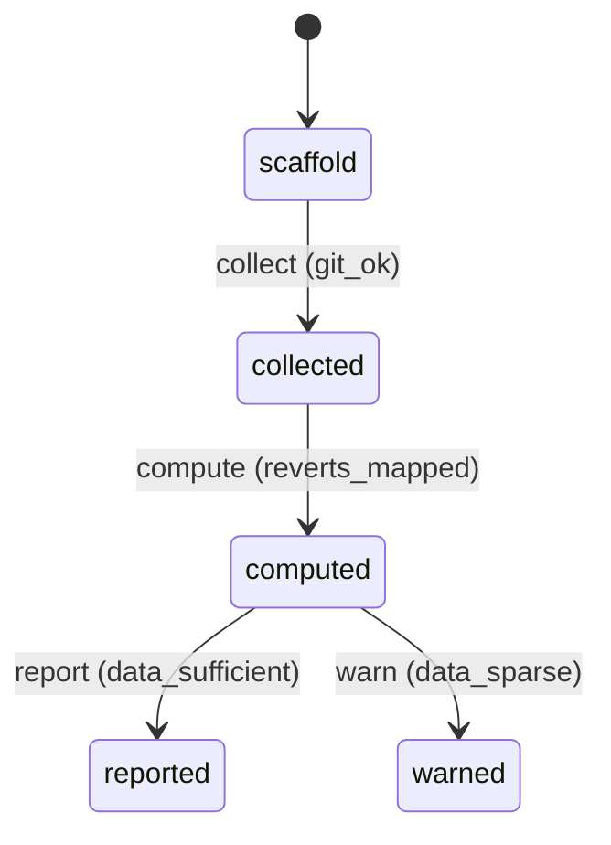

# Requirement Truth: beacon-v1616-bad-merge-baseline (v1.6.16)

## 人话

v1.6.15 放开了"自动合入"（agent 自己合并代码进主干），但目前**没有任何数据**衡量"自动合入进来的代码有多少是坏的"——没有基线就没法判断自动合入是否值得信任。这次做到：**建立 bad-merge 率基线**——统计合并后多久内被回滚（revert）的比例，作为衡量自动合入质量的起点。

- 能做：统计 v1.6.15 以来合并到 main 的提交及其 revert 情况，算 bad-merge 率
- 不能做：不改变自动合入行为；不替代人类 release 把关
- 怎样算完：产出可对比的 bad-merge 率基线数据（合并数、revert 数、比率、时间窗）

## User Intent

为 auto-merge（v1.6.15 放开）建立 bad-merge 率基线：统计合并到 main 的提交及其 revert 情况，衡量自动合入质量，提供可对比的基线数据。

## User Intent Snapshot

```yaml
lake_or_ocean: 湖
truth_review_gate: required
intent_source: 2026-08-27 对抗式审查 P5——auto-merge 后无 bad-merge 基线数据
```

## Intent Coverage Matrix

| intent_id | source | strength | landing | status |
|-----------|--------|----------|---------|--------|
| INT-001 | 统计合并/revert 数据 | must | AC-001 | covered |
| INT-002 | 计算 bad-merge 率 | must | AC-002 | covered |
| INT-003 | 产出可对比基线 | must | AC-003 | covered |
| INT-004 | 不改自动合入行为 | must | AC-004 | covered |

## 用户旅程

1. 触发：v1.6.15 auto-merge 启用后定期统计
2. 关键操作：git 分析合并提交 + revert 提交，按时间窗聚合
3. 结果：bad-merge 率基线数据（合并数/revert 数/比率）
4. 异常：数据不足（合并太少）→ 标 low-confidence，不硬算

## First principles

- 系统边界：基线是观测数据，不改变合并行为
- 不可变：revert 判定要准确（区分 revert vs 正常回滚）；不粉饰数据
- 可推翻假设：时间窗默认 30 天，可配置

## Domain Model

| Entity | Key fields | Notes |
|--------|------------|-------|
| MergeRecord | commit, sha, date, branch | 合并记录 |
| RevertRecord | commit, reverted_sha, date | 回滚记录 |
| BadMergeRate | merges, reverts, rate, window | 基线 |

## Acceptance Criteria

| AC ID | Description |
|-------|-------------|
| AC-001 | collected 阶段：统计 v1.6.15 以来合并到 main 的提交数及 revert 数（git 分析）。 |
| AC-002 | computed 阶段：计算 bad-merge 率（revert 数 / 合并数，按时间窗）。 |
| AC-003 | reported 阶段：产出可对比基线报告（合并数/revert 数/比率/时间窗/置信度）。 |
| AC-004 | warned 判定：统计不改变自动合入行为，数据不足标低置信度；数据不足时标低置信度不硬算。 |

## FSM 五元组

| State | Event | Guard | To | Action |
|-------|-------|-------|-----|--------|
| scaffold | collect | git_ok | collected | scan_merges |
| collected | compute | reverts_mapped | computed | calc_rate |
| computed | report | data_sufficient | reported | emit_baseline |
| computed | warn | data_sparse | warned | flag_low_confidence |

**终态：** reported, warned

## Domain FSM Order

| State | From | Guard |
|-------|------|-------|
| collected | scaffold | git_ok |
| computed | collected | reverts_mapped |
| reported | computed | data_sufficient |
| warned | computed | data_sparse |

## Illegal transitions

- 数据不足仍硬算（无置信度）
- revert 误判仍计入（数据失真）

### invalid / illegal

- 数据不足仍硬算（无置信度）
- revert 误判仍计入（数据失真）

## Non-goals

- 不改变自动合入行为
- 不替代人类 release 把关
- 不引入新命令面

## Freeze readiness

- [x] Intent Matrix must 无 missing
- [x] 用户旅程非「待补」占位
- [x] First principles / Domain Model 已具体化
- [x] 元状态 FSM + illegal
- [x] 每 AC ≥ 1 TC（Command+Assertion）+ exec-layer TC
- [x] tasks 均有 ac= + evidence= 绑定
- [x] package_maturity: filled
- [x] `beacon truth review` pass 后再 freeze

### Gap vs gold (订单支付示例)

- 对照：`docs/beacon/v1.6.10/features/truth-gold-order-pay-v1610/truth.md`

## Source Excerpt

```markdown
beacon-v1616-bad-merge-baseline
来源：2026-08-27 对抗式审查 P5——auto-merge 后无 bad-merge 基线
背景：v1.6.15 放开 auto-merge（global-boundaries §4.1）
修复：git 分析合并/revert，产出 bad-merge 率基线
```

## FSM mermaid（投影）


