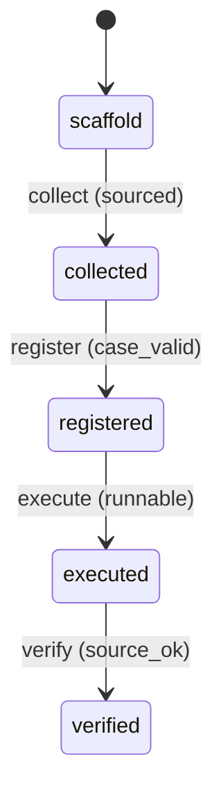

# Requirement Truth: beacon-v1616-eval-external-anchor (v1.6.16)

## 人话

beacon 的能力评估案例（benchmark cases）全是系统自己写的（内置在代码里）。这就像考试题是考生自己出的——考得再好也不能证明能力。这次做到：**给评估案例引入"外部锚点"**——从真实失败案例、社区标准、第三方公开评测里提取一部分案例，让评估基准不再完全自产自销。

- 能做：benchmark 案例集引入外部来源（真实失败案例/社区标准），案例带来源追溯
- 不能做：不改系统内置案例；不把外部锚点当"自动判 pass"的裁判
- 怎样算完：案例集含 ≥N 条外部来源案例，且每条可追溯来源

## User Intent

打破 eval 案例集的自我验证闭环：`_default_v161_benchmark_cases()` 是系统内置，需引入外部来源案例（真实失败案例、社区标准、第三方评测），让评估基准有外部锚点。

## User Intent Snapshot

```yaml
lake_or_ocean: 湖
truth_review_gate: required
intent_source: 2026-08-27 对抗式审查 P2——eval 案例集系统内置无外部锚点
```

## Intent Coverage Matrix

| intent_id | source | strength | landing | status |
|-----------|--------|----------|---------|--------|
| INT-001 | 案例集引入外部来源 | must | AC-001 | covered |
| INT-002 | 案例来源可追溯 | must | AC-002 | covered |
| INT-003 | 外部案例可执行 | must | AC-003 | covered |
| INT-004 | 内置案例保留 | must | AC-004 | covered |

## 用户旅程

1. 触发：eval benchmark 加载案例集
2. 关键操作：内置案例 + 外部来源案例合并；每案例带 source_ref
3. 结果：评估覆盖内部能力 + 外部基准
4. 异常：外部案例无法执行 → 标 skip + 来源记录，不算 fail

## First principles

- 系统边界：外部锚点是评估输入，不是自动裁判
- 不可变：案例来源必须可追溯（真实失败案例/社区标准）；不得伪称外部来源
- 可推翻假设：外部案例占比默认 ≥ 20%，可配置

## Domain Model

| Entity | Key fields | Notes |
|--------|------------|-------|
| EvalCase | case_id, tc_id, prompt, source_ref | 评估案例 |
| SourceAnchor | source, provenance | 外部来源追溯 |
| CaseRegistry | cases, external_ratio | 案例注册表 |

## Acceptance Criteria

| AC ID | Description |
|-------|-------------|
| AC-001 | collected 阶段：benchmark 案例集引入外部来源案例（真实失败案例/社区标准），不再全内置。 |
| AC-002 | verified 阶段：每个外部案例带 source_ref，伪称来源被拒（可追溯来源），伪称外部来源的案例被拒。 |
| AC-003 | executed 阶段：外部案例可被 benchmark 执行（prompt + expected_route 完整）。 |
| AC-004 | registered 兼容：系统内置案例保留（回归兼容），外部案例为增量。 |

## FSM 五元组

| State | Event | Guard | To | Action |
|-------|-------|-------|-----|--------|
| scaffold | collect | sourced | collected | gather_external |
| collected | register | case_valid | registered | add_to_registry |
| registered | execute | runnable | executed | run_case |
| executed | verify | source_ok | verified | check_provenance |

**终态：** verified

## Domain FSM Order

| State | From | Guard |
|-------|------|-------|
| collected | scaffold | sourced |
| registered | collected | case_valid |
| executed | registered | runnable |
| verified | executed | source_ok |

## Illegal transitions

- 无来源案例冒充外部（伪称来源）
- 外部案例不执行只登记

### invalid / illegal

- 无来源案例冒充外部（伪称来源）
- 外部案例不执行只登记

## Non-goals

- 不把外部锚点当自动 pass 裁判
- 不改系统内置案例语义
- 不引入新命令面

## Freeze readiness

- [x] Intent Matrix must 无 missing
- [x] 用户旅程非「待补」占位
- [x] First principles / Domain Model 已具体化
- [x] 元状态 FSM + illegal
- [x] 每 AC ≥ 1 TC（Command+Assertion）+ exec-layer TC
- [x] tasks 均有 ac= + evidence= 绑定
- [x] package_maturity: filled
- [x] `beacon truth review` pass 后再 freeze

### Gap vs gold (订单支付示例)

- 对照：`docs/beacon/v1.6.10/features/truth-gold-order-pay-v1610/truth.md`

## Source Excerpt

```markdown
beacon-v1616-eval-external-anchor
来源：2026-08-27 对抗式审查 P2——eval 案例集系统内置无外部锚点
根因：_default_v161_benchmark_cases() 内置；评估基准与被测系统同源
修复：引入外部来源案例（真实失败/社区标准）+ source_ref 追溯
```

## FSM mermaid（投影）


