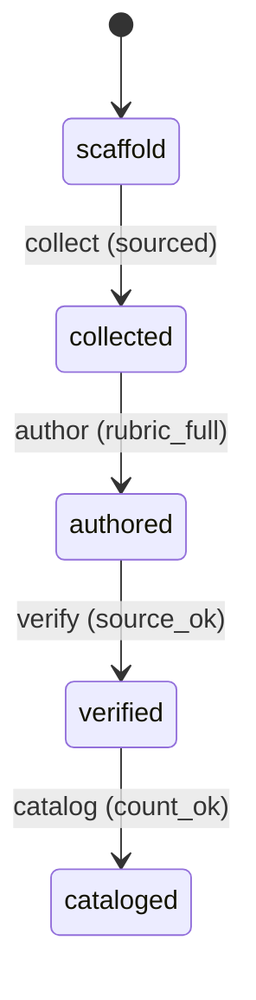

# Requirement Truth: beacon-v1616-failure-mode-expansion (v1.6.16)

## 人话

beacon 的"失败模式目录"（记录 agent 会犯什么错的清单）只有 5 条——太少，覆盖不了 agent 的各种翻车方式。对抗式审查要用它抽翻车点，5 条根本不够。这次做到：**从 v1.6.13-15 实际发生的 QA 失败中提取，把目录扩充到 20+ 条**，每条都有真实来源。

- 能做：失败模式库从 5 条扩到 20+ 条，每条含症状/判定规则/rubric/来源
- 不能做：编造失败模式；不改各 skill 语义
- 怎样算完：目录 ≥ 20 条，且每条来自真实失败记录（v1.6.13-15 QA/实现失败）

## User Intent

扩充失败模式目录（v1.6.13 D3 产物）：从 5 条扩到 20+ 条，从 v1.6.13-15 实际 QA 失败中提取，每条带真实来源，支撑对抗式审查的翻车点抽取。

## User Intent Snapshot

```yaml
lake_or_ocean: 湖
truth_review_gate: required
intent_source: 2026-08-27 对抗式审查 P4——失败模式库仅 5 条太薄
```

## Intent Coverage Matrix

| intent_id | source | strength | landing | status |
|-----------|--------|----------|---------|--------|
| INT-001 | 目录扩充到 ≥ 20 条 | must | AC-001 | covered |
| INT-002 | 每条来自真实失败记录 | must | AC-002 | covered |
| INT-003 | 每条含完整 rubric（症状/判定/通过/拦截）| must | AC-003 | covered |
| INT-004 | 支撑对抗式审查翻车点抽取 | must | AC-004 | covered |

## 用户旅程

1. 触发：QA/release 前对抗式审查
2. 关键操作：从目录抽 3-5 个翻车点逐条验证
3. 结果：目录覆盖更多失败类型，审查更有力
4. 异常：目录条目来源不可追溯 → 拒收

## First principles

- 系统边界：目录是审查输入，不是自动判 pass
- 不可变：条目必须真实来源（v1.6.13-15 失败记录）；不得编造
- 可推翻假设：每条含 source_ref，可扩展至后续版本

## Domain Model

| Entity | Key fields | Notes |
|--------|------------|-------|
| FailureMode | fm_id, name, symptom, judge, rubric, source | 失败模式条目 |
| FailureCatalog | entries, count | 目录 |

## Acceptance Criteria

| AC ID | Description |
|-------|-------------|
| AC-001 | cataloged 阶段：失败模式目录条目 ≥ 20（从 5 扩到 20+）。 |
| AC-002 | verified 阶段：每条条目带 source_ref（v1.6.13-15 真实失败记录）（来自 v1.6.13-15 真实失败记录），可追溯。 |
| AC-003 | authored 阶段：每条含完整 rubric（症状/判定/通过/拦截）：症状 / 判定规则 / 通过标准 / 拦截标准。 |
| AC-004 | cataloged→审查：目录可作为对抗式审查翻车点输入（QA/release 前）。 |

## FSM 五元组

| State | Event | Guard | To | Action |
|-------|-------|-------|-----|--------|
| scaffold | collect | sourced | collected | gather_failures |
| collected | author | rubric_full | authored | write_entry |
| authored | verify | source_ok | verified | check_provenance |
| verified | catalog | count_ok | cataloged | finalize |

**终态：** cataloged

## Domain FSM Order

| State | From | Guard |
|-------|------|-------|
| collected | scaffold | sourced |
| authored | collected | rubric_full |
| verified | authored | source_ok |
| cataloged | verified | count_ok |

## Illegal transitions

- 编造条目入目录（无来源）
- 条目缺 rubric 仍 cataloged

### invalid / illegal

- 编造条目入目录（无来源）
- 条目缺 rubric 仍 cataloged

## Non-goals

- 不改各 skill 语义
- 不自动判 pass
- 不引入新命令面

## Freeze readiness

- [x] Intent Matrix must 无 missing
- [x] 用户旅程非「待补」占位
- [x] First principles / Domain Model 已具体化
- [x] 元状态 FSM + illegal
- [x] 每 AC ≥ 1 TC（Command+Assertion）+ exec-layer TC
- [x] tasks 均有 ac= + evidence= 绑定
- [x] package_maturity: filled
- [x] `beacon truth review` pass 后再 freeze

### Gap vs gold (订单支付示例)

- 对照：`docs/beacon/v1.6.10/features/truth-gold-order-pay-v1610/truth.md`

## Source Excerpt

```markdown
beacon-v1616-failure-mode-expansion
来源：2026-08-27 对抗式审查 P4——失败模式库仅 5 条（FM-001..005）
现状：skills/beacon/beacon-qa/references/failure-mode-catalog.md
修复：从 v1.6.13-15 QA 失败提取，扩到 20+ 条
```

## FSM mermaid（投影）


