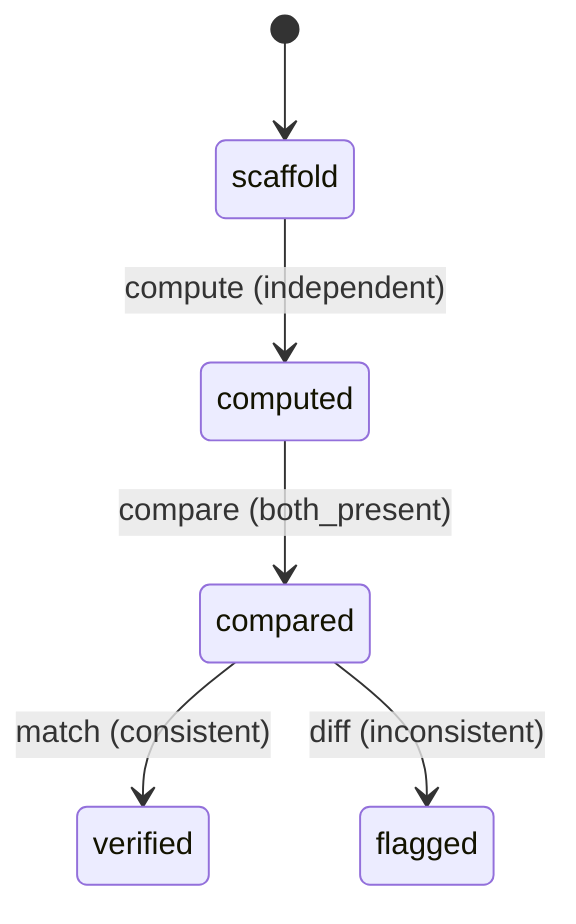

# Requirement Truth: beacon-v1616-gate-independent-judge (v1.6.16)

## 人话

beacon 的门禁判定（比如覆盖率、状态机校验）是系统自己算自己判的。这像运动员自己当裁判——算错了一时发现不了。这次做到：**给关键门禁判定加一个"独立裁判"**——用一套独立的、不依赖原系统的脚本重新计算覆盖率等关键值，跟系统判定的结果比对。两者一致才算数，不一致就报警。

- 能做：coverage_rate 等关键门禁值由独立脚本重算，与系统判定比对
- 不能做：改各 gate 的业务规则；独立裁判不是"自动判 pass"
- 怎样算完：独立重算与系统判定一致率 100%，或发现偏差并暴露

## User Intent

给 gate 判定逻辑加"二次验证层"（独立裁判）：coverage_rate 等关键值由独立脚本重算，与系统判定比对，防"球员兼裁判"的自我背书。

## User Intent Snapshot

```yaml
lake_or_ocean: 湖
truth_review_gate: required
intent_source: 2026-08-27 对抗式审查 P3——gate 判定逻辑无独立裁判
```

## Intent Coverage Matrix

| intent_id | source | strength | landing | status |
|-----------|--------|----------|---------|--------|
| INT-001 | coverage_rate 独立重算 | must | AC-001 | covered |
| INT-002 | 比对系统判定 vs 独立判定 | must | AC-002 | covered |
| INT-003 | 偏差暴露可审计 | must | AC-003 | covered |
| INT-004 | 不改变 gate 业务规则 | must | AC-004 | covered |

## 用户旅程

1. 触发：QA 判定 coverage_rate 后
2. 关键操作：独立脚本用原始 TC/证据重算 coverage_rate，与系统值比对
3. 结果：一致 → 通过；不一致 → 偏差暴露，标记审计
4. 异常：独立重算数据缺失 → 标记待补证状态，不掩盖

## First principles

- 系统边界：独立裁判复核关键 gate 值，不替代业务 gate
- 不可变：比对不一致 → 暴露偏差，不得静默通过；独立裁判不判 pass/fail，只判"系统值可信"
- 可推翻假设：独立重算默认覆盖 coverage_rate + FSM 校验，可扩展

## Domain Model

| Entity | Key fields | Notes |
|--------|------------|-------|
| GateVerdict | gate, value, source | 系统判定 |
| IndependentJudge | gate, value, algorithm | 独立重算 |
| JudgeComparison | gate, match, diff | 比对结果 |

## Acceptance Criteria

| AC ID | Description |
|-------|-------------|
| AC-001 | computed 阶段：coverage_rate 等关键 gate 值可由独立脚本重算（独立于系统判定逻辑）。 |
| AC-002 | compared 阶段：独立判定与系统判定比对：一致 → 标记可信；不一致 → 暴露偏差。 |
| AC-003 | flagged 阶段：偏差记录可审计（gate/系统值/独立值/diff）。 |
| AC-004 | verified 判定：独立裁判不改变 gate 业务规则，不判 pass/fail，只核验系统值可信度。 |

## FSM 五元组

| State | Event | Guard | To | Action |
|-------|-------|-------|-----|--------|
| scaffold | compute | independent | computed | recalc_value |
| computed | compare | both_present | compared | diff_verdicts |
| compared | match | consistent | verified | mark_trusted |
| compared | diff | inconsistent | flagged | expose_deviation |

**终态：** verified, flagged

## Domain FSM Order

| State | From | Guard |
|-------|------|-------|
| computed | scaffold | independent |
| compared | computed | both_present |
| verified | compared | consistent |
| flagged | compared | inconsistent |

## Illegal transitions

- 偏差不暴露仍 verified（掩盖）
- 独立裁判缺数据仍判一致（脑补）

### invalid / illegal

- 偏差不暴露仍 verified（掩盖）
- 独立裁判缺数据仍判一致（脑补）

## Non-goals

- 不改 gate 业务规则
- 独立裁判不替代业务 gate 判 pass/fail
- 不引入新命令面

## Freeze readiness

- [x] Intent Matrix must 无 missing
- [x] 用户旅程非「待补」占位
- [x] First principles / Domain Model 已具体化
- [x] 元状态 FSM + illegal
- [x] 每 AC ≥ 1 TC（Command+Assertion）+ exec-layer TC
- [x] tasks 均有 ac= + evidence= 绑定
- [x] package_maturity: filled
- [x] `beacon truth review` pass 后再 freeze

### Gap vs gold (订单支付示例)

- 对照：`docs/beacon/v1.6.10/features/truth-gold-order-pay-v1610/truth.md`

## Source Excerpt

```markdown
beacon-v1616-gate-independent-judge
来源：2026-08-27 对抗式审查 P3——gate 判定逻辑无独立裁判
根因：QA 的 coverage_rate 由系统自算自判（_compute_coverage_current）
修复：独立脚本重算关键值 + 比对 + 偏差暴露
```

## FSM mermaid（投影）


