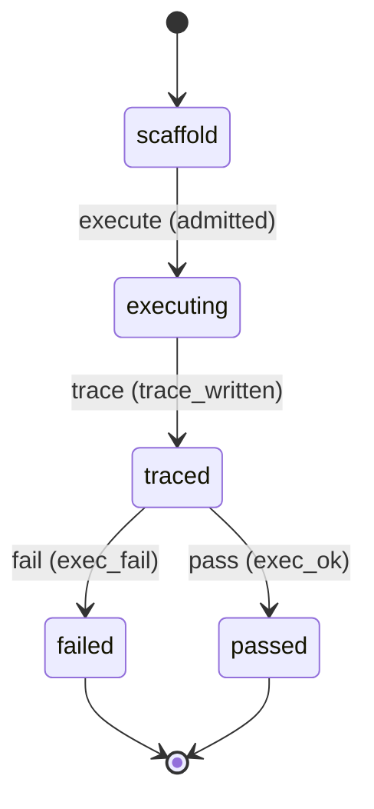

# Requirement Truth: beacon-v1616-live-skill-smoke (v1.6.16)

## 人话

beacon 有 37 个 skill（技能），但能力评估里只有 1 个被真实跑过，其余 36 个只做了"表面检查"（看看文件在不在，没真跑）。这就像一辆车只试驾了 1 个档位就说整车没问题。这次做到：**用本地完整模式把 37 个 skill 全跑一遍真实执行**，让"声称有这能力"变成"真的验证过这能力"。

- 能做：eval benchmark 用 local_admitted tier 跑全量 skill host_behavior 执行；每个 skill 有真实执行 trace
- 不能做：不改各 skill 的语义；不伪造执行结果
- 怎样算完：live_skill_pass 从 1/37 → ≥30/37，且有每个 skill 的 host_behavior 执行证据

## User Intent

补齐 eval live 层覆盖缺口：eval benchmark 从 ci_default（只冒烟 1 个 skill）切换到 local_admitted tier，全量 37 skill 走 host_behavior 真实执行，提升 live_skill_pass 到 ≥30/37。

## User Intent Snapshot

```yaml
lake_or_ocean: 湖
truth_review_gate: required
intent_source: 2026-08-27 对抗式审查——live_skill 1/37 暴露"能力层验证滞后"
```

## Intent Coverage Matrix

| intent_id | source | strength | landing | status |
|-----------|--------|----------|---------|--------|
| INT-001 | benchmark 全量 skill host_behavior 执行 | must | AC-001 | covered |
| INT-002 | live_skill_pass ≥ 30/37 | must | AC-002 | covered |
| INT-003 | 每 skill 有执行 trace 证据 | must | AC-003 | covered |
| INT-004 | 不改 skill 语义、不伪造 | must | AC-004 | covered |

## 用户旅程

1. 触发：`beacon eval benchmark`（local_admitted tier）
2. 关键操作：37 skill 逐个 host_behavior 执行（prompt fixture → 路由 → 冒烟）
3. 结果：live_skill_pass 提升，每 skill 有 trace
4. 异常：某 skill 执行超时/失败 → 记录 reason_code，不算 pass

## First principles

- 系统边界：live 冒烟只验证"skill 可执行"，不验证业务结果正确
- 不可变：执行失败不得伪装成 pass；tier 切换不降低判定标准
- 可推翻假设：host_behavior 默认覆盖 37 skill，个别 skill 无 CLI 面可标 surface_only

## Domain Model

| Entity | Key fields | Notes |
|--------|------------|-------|
| LiveSkillTrace | skill_id, status, reason_code, mode | 每 skill 执行记录 |
| EvalTier | ci_default / local_admitted / release_hook | 决定执行深度 |
| LiveSkillMatrix | entries, pass_count, total | 全量 skill 矩阵 |

## Acceptance Criteria

| AC ID | Description |
|-------|-------------|
| AC-001 | executing 阶段：eval benchmark 在 local_admitted tier 下对 37 个 skill 全量执行 host_behavior（非 ci_default 的 1-skill 冒烟）。 |
| AC-002 | traced→passed 后：live_skill_pass 从 1/37 提升到 ≥ 30/37（真实执行通过率）。 |
| AC-003 | traced 阶段：每个执行过的 skill 落盘 host_behavior 执行 trace（含 status/reason_code/route）。 |
| AC-004 | failed 判定：执行结果不伪造，失败 skill 标 fail + reason_code，不折算为 pass。 |

## FSM 五元组

| State | Event | Guard | To | Action |
|-------|-------|-------|-----|--------|
| scaffold | execute | admitted | executing | run_host_behavior |
| executing | trace | trace_written | traced | write_trace |
| traced | pass | exec_ok | passed | mark_pass |
| traced | fail | exec_fail | failed | mark_fail |

**终态：** passed, failed

## Domain FSM Order

| State | From | Guard |
|-------|------|-------|
| executing | scaffold | admitted |
| traced | executing | trace_written |
| passed | traced | exec_ok |
| failed | traced | exec_fail |

## Illegal transitions

- 执行失败仍标 pass（伪造）
- 表面检查冒充 host_behavior

### invalid / illegal

- 执行失败仍标 pass（伪造）
- 表面检查冒充 host_behavior

## Non-goals

- 不改各 skill 语义
- 不验证业务结果正确（只验证可执行）
- 不引入新命令面

## Freeze readiness

- [x] Intent Matrix must 无 missing
- [x] 用户旅程非「待补」占位
- [x] First principles / Domain Model 已具体化
- [x] 元状态 FSM + illegal
- [x] 每 AC ≥ 1 TC（Command+Assertion）+ exec-layer TC
- [x] tasks 均有 ac= + evidence= 绑定
- [x] package_maturity: filled
- [x] `beacon truth review` pass 后再 freeze

### Gap vs gold (订单支付示例)

- 对照：`docs/beacon/v1.6.10/features/truth-gold-order-pay-v1610/truth.md`

## Source Excerpt

```markdown
beacon-v1616-live-skill-smoke
来源：2026-08-27 对抗式审查 P1——live_skill 1/37（ci_default 只冒烟 1 skill）
根因：_live_execution_mode_for_entry 在 ci_default tier 下非 ci_smoke_skill_id 走 surface_only
修复：local_admitted tier 全量 host_behavior
```

## FSM mermaid（投影）


