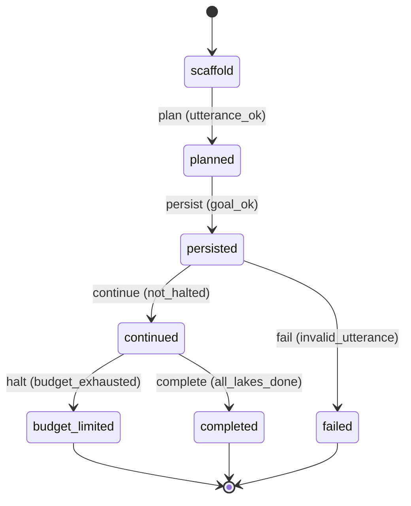

# Requirement Truth: beacon-plan-persistent-goal (v1.6.17)

## 人话

beacon 的实现真相已在 `truth.md` 落下，但**目标本身没持久化**——`beacon goal run` 的 `utterance` 是一次性字符串，跨 `plan→truth→implement→qa` 后下一次 `tick` 就丢了上下文，实战里靠人反复重说需求导致 delivery 不稳。这次让 `beacon-plan` 在 `plan_artifact.v1` 里产出一个持久目标对象（`objective/status/budget/fingerprint`，对齐 `codex` 的 `ThreadGoal`），`beacon-goal` 只负责持久化与跨轮续跑，`truth` 仍负责 LLM 实现路径。

- 能做：`beacon plan start "用 Computer Use 复刻天气应用"` 后自动产出 `persistent_goal`；`beacon goal run --feature <lake>` 跨阶段不丢目标；`budget_limit` 不硬拦而收尾
- 不能做：不新建 SQLite `thread_goals` 表；不为 `ephemeral thread` 强加 goal；不把 `--tokens` 做成正式 CLI 参数
- 怎样算完：`plan_artifact` 含 `persistent_goal` 且 `goal run` 的 `payload.goal_objective` 在 `tick` 后仍为初值；`continuation` 注入含 `objective/tokens_used/remaining`

## User Intent

让 `beacon` 拥有 `codex goal` 同款的线程级持久目标能力，但用编排方式实现（`plan` 产持久目标，`truth` 留 LLM 实现真相），解决 `beacon goal` 实战中目标丢失导致 delivery 不稳。

## User Intent Snapshot

```yaml
lake_or_ocean: 湖
truth_review_gate: required
intent_source: 用户 2026-08-28 原话：需要留下 LLM 具体如何实现的真相，/beacon-goal 实战无法稳定交付；源码核实 codex goal 为 Stable 默认开 ThreadGoal 持久对象
```

## Intent Coverage Matrix

| intent_id | source | strength | landing | status |
|-----------|--------|----------|---------|--------|
| INT-001 | plan 产持久目标（objective/status/budget/fingerprint 对齐 ThreadGoal） | must | AC-001 | covered |
| INT-002 | goal 运行时持久化并跨阶段不丢（utterance→goal_objective） | must | AC-002 | covered |
| INT-003 | 跨轮自动续跑（continuation 注入含 objective/tokens_used/remaining） | must | AC-003 | covered |
| INT-004 | 预算收尾不硬拦（budget_limit 模板收尾而非 blocked） | should | AC-004 | covered |
| INT-005 | planner only 边界（不写 frozen truth/不自证完成） | must | AC-005 | covered |

## 用户旅程

1. 触发：`beacon plan start "用 Computer Use 复刻天气应用并 1:1 打磨"` 或 `beacon goal run "复刻天气" --feature studio --version v1.6.17`
2. 关键操作：`plan` 产 `plan_artifact.persistent_goal` → `create_goal_run` 写入 `payload.goal_objective/goal_status/goal_budget` → `tick` 触发 `goal_steering.render_steering(continuation)` 注入下一阶段
3. 结果：`payload.goal_objective` 在 `plan→truth→implement` 后仍为初值；`truth.md` 保留 LLM 实现路径段；`budget_limit` 时给出总结与下一步而非直接 `blocked`
4. 异常：`utterance` 为空 → `goal_objective` 为空但不阻断 plan；`token_budget` 未设 → `remaining=unbounded`；`ephemeral thread` 不建 goal

## First principles

- 系统边界：本湖只解决 `beacon-plan` 产持久目标 + `beacon-goal` 消费持久目标；不解决 `codex` Rust 运行时照搬、不解决多仓分治
- 不可变：持久目标必须在 `plan` 阶段产出（planner only），不得在 `truth` 阶段现编；`truth.md` 仍是 LLM 实现真相唯一真源；跨阶段不得丢 `objective`；`budgetLimited` 不得当作 `complete`
- 可推翻假设：`utterance` 等同 `objective` 的扁平化假设可推翻——需显式 `persistent_goal` 对象

## Domain Model

| Entity | Key fields | Notes |
|--------|------------|-------|
| PersistentGoal | objective, status(Active/Paused/Blocked/BudgetLimited/Complete), token_budget, objective_fingerprint, source | plan_artifact 产出，对齐 codex ThreadGoal，存于 payload.goal_objective |
| PlanArtifact | persistent_goal, surface_ask, deep_want, intent_decomposition, journeys | plan_artifact.v1 扩展 |
| GoalSteering | continuation, budget_limit, objective_updated templates | beacon/utils/goal_steering.py 已有三模板 |
| GoalPayload | goal_objective, goal_status, goal_budget, last_objective_fp | product_goal_runtime 持久化 |

## Acceptance Criteria

| AC ID | Description |
|-------|-------------|
| AC-001 | plan 阶段：`build_plan_artifact(utterance)` 产出 `persistent_goal{objective=status=active, token_budget, objective_fingerprint, source=plan_artifact.v1}`，`objective` 为 `utterance.strip()` 非空即持久化。 |
| AC-002 | goal 运行时：`create_goal_run` 将 `persistent_goal` 写入 `payload{goal_objective, goal_status, goal_budget, last_objective_fp}`，且 `tick`/`goal_continue_run` 后仍为初值（跨 `plan→truth→implement` 不丢）。 |
| AC-003 | 续跑：`goal_steering.render_steering` 在 `halt_budget=false` 时选 `continuation` 模板，注入 `objective/tokens_used/remaining`，下一阶段可见持久目标。 |
| AC-004 | 预算收尾：`goal_steering.select_template_id(halt_budget=true)` 选 `budget_limit` 模板，不直接 `blocked`，提示总结与下一步。 |
| AC-005 | 边界：`beacon-plan` 仅产 `programs/<slug>/` 咨询产物，不写 `features/<slug>/truth.md` frozen truth，不自证 QA/release。 |

## FSM 五元组

| State | Event | Guard | To | Action |
|-------|-------|-------|-----|--------|
| scaffold | plan | utterance_ok | planned | build_plan_artifact |
| planned | persist | goal_ok | persisted | write_persistent_goal |
| persisted | continue | not_halted | continued | inject_continuation |
| continued | halt | budget_exhausted | budget_limited | inject_budget_limit |
| continued | complete | all_lakes_done | completed | mark_complete |
| persisted | fail | invalid_utterance | failed | mark_fail |

**终态：** completed, failed, budget_limited

## Domain FSM Order

| State | From | Guard |
|-------|------|-------|
| planned | scaffold | utterance_ok |
| persisted | planned | goal_ok |
| continued | persisted | not_halted |
| budget_limited | continued | budget_exhausted |
| completed | continued | all_lakes_done |
| failed | persisted | invalid_utterance |

## Illegal transitions

- 未经 `plan` 直接 `persist` 持久目标
- `budgetLimited` 当作 `complete` 宣告完成
- 在 `truth` 阶段现编持久目标（绕过 planner）
- `ephemeral` 场景强建持久目标

### invalid / illegal

- 未经 `plan` 直接 `persist` 持久目标
- `budgetLimited` 当作 `complete` 宣告完成
- 在 `truth` 阶段现编持久目标（绕过 planner）
- `ephemeral` 场景强建持久目标

## Non-goals

- 不新建 SQLite `thread_goals` 表（复用现有 `product_goal_runtime` payload）
- 不为 `ephemeral thread` 强加 goal（codex 亦拒绝）
- 不把 `--tokens` 做成正式 CLI 参数（当前仅 `token_budget: None`）
- 不修改 `truth.md` 的 LLM 实现真相段（已存在）

## Freeze readiness

- [x] Intent Matrix must 无 missing
- [x] 用户旅程非「待补」占位
- [x] First principles / Domain Model 已具体化
- [x] 元状态 FSM + illegal
- [x] 每 AC ≥ 1 TC（Command+Assertion）+ exec-layer TC
- [x] tasks 均有 ac= + evidence= 绑定
- [x] package_maturity: filled
- [x] `beacon truth review` pass 后再 freeze

### Gap vs gold (订单支付示例)

- 对照：`docs/beacon/v1.6.10/features/truth-gold-order-pay-v1610/truth.md`

## Source Excerpt

```markdown
beacon-plan-persistent-goal
来源：codex goal 源码核实 Stable 默认开 + ThreadGoal 6态 + continuation/budget_limit 模板；beacon 已有 goal_steering.py 三模板但 main goal run 未接线；beacon-plan 需产 persistent_goal
实测：codex: codex-rs/protocol/src/protocol.rs:4067 ThreadGoal{objective,status,token_budget,tokens_used} + state/src/runtime/goals.rs:30 SQLite；beacon: product_goal_runtime.py:547 utterance 扁平化为字符串字段，无独立持久对象
修复：plan_artifact 增 persistent_goal{objective,status,budget,fingerprint}，goal runtime 消费并跨 tick 不丢，continuation 注入 objective/tokens_used/remaining
```

## FSM mermaid（投影）


