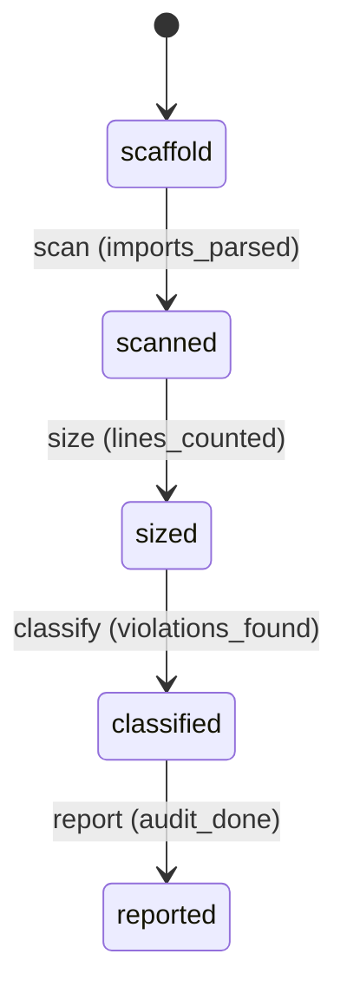

# Requirement Truth: beacon-v1617-layering-audit (v1.6.17)

## 人话

beacon 有 232 个代码模块、16 个超大的"巨无霸文件"（最大 6805 行），但**没有明确的"分层规则"**——任何模块可以随便引用任何其他模块。这就像一栋楼没有楼层结构，哪里都能穿墙走。这次做到：**画出模块之间的依赖地图，找出越界引用和巨无霸文件，判断 beacon 的可维护性风险到底在哪**。

- 能做：生成 utils/commands 的 import 依赖图；识别越界引用（command 层直接依赖不该依赖的）；列出 God Module（>2000 行）
- 不能做：本轮不重构（只审计判断）；不改各模块语义
- 怎样算完：产出依赖图 + God Module 清单 + 可维护性风险判断

## User Intent

为 beacon 做分层边界审计：生成 import 依赖图、识别越界引用与 God Module（>2000 行），判断可维护性风险，产出可验证的审计报告。

## User Intent Snapshot

```yaml
lake_or_ocean: 湖
truth_review_gate: required
intent_source: 2026-08-28 全面审查 A2——232 utils 平铺无分层约束
```

## Intent Coverage Matrix

| intent_id | source | strength | landing | status |
|-----------|--------|----------|---------|--------|
| INT-001 | 生成 import 依赖图 | must | AC-001 | covered |
| INT-002 | 识别 God Module（>2000 行）| must | AC-002 | covered |
| INT-003 | 识别越界引用 | must | AC-003 | covered |
| INT-004 | 产出可维护性风险判断 | must | AC-004 | covered |

## 用户旅程

1. 触发：分层审计命令/脚本
2. 关键操作：扫描 beacon/utils + commands 的 import；统计模块大小；分析引用方向
3. 结果：依赖图 + God Module 清单 + 越界引用 + 风险判断
4. 异常：依赖复杂难解析 → 标注待补，不硬判断

## First principles

- 系统边界：审计是观测，不改变代码结构
- 不可变：数据必须真实（import 扫描结果），不脑补
- 可推翻假设：God Module 是否等于风险需结合内聚度判断（大但高内聚可接受）

## Domain Model

| Entity | Key fields | Notes |
|--------|------------|-------|
| ImportGraph | module, depends_on[] | 依赖图 |
| GodModule | module, lines | >2000 行模块 |
| LayerViolation | from_module, to_module | 越界引用 |

## Acceptance Criteria

| AC ID | Description |
|-------|-------------|
| AC-001 | scanned 阶段：生成 beacon/utils + commands 的 import 依赖图（模块 × 依赖列表）。 |
| AC-002 | sized 阶段：列出所有 >2000 行的 God Module（含行数）（含行数）。 |
| AC-003 | classified 阶段：识别越界引用（command 层 → 不应依赖的 utils）（command 层 → 不应依赖的 utils；utils 内部跨层引用）。 |
| AC-004 | reported 阶段：产出可维护性风险判断（分层缺失/God Module 风险等级）。 |

## FSM 五元组

| State | Event | Guard | To | Action |
|-------|-------|-------|-----|--------|
| scaffold | scan | imports_parsed | scanned | scan_imports |
| scanned | size | lines_counted | sized | count_lines |
| sized | classify | violations_found | classified | detect_violations |
| classified | report | audit_done | reported | emit_report |

**终态：** reported

## Domain FSM Order

| State | From | Guard |
|-------|------|-------|
| scanned | scaffold | imports_parsed |
| sized | scanned | lines_counted |
| classified | sized | violations_found |
| reported | classified | audit_done |

## Illegal transitions

- 扫描不全仍 report（数据不实）
- 越界引用不识别仍判低风险（掩盖）

### invalid / illegal

- 扫描不全仍 report（数据不实）
- 越界引用不识别仍判低风险（掩盖）

## Non-goals

- 本轮不重构（只审计）
- 不改各模块语义
- 不引入新命令面

## Freeze readiness

- [x] Intent Matrix must 无 missing
- [x] 用户旅程非「待补」占位
- [x] First principles / Domain Model 已具体化
- [x] 元状态 FSM + illegal
- [x] 每 AC ≥ 1 TC（Command+Assertion）+ exec-layer TC
- [x] tasks 均有 ac= + evidence= 绑定
- [x] package_maturity: filled
- [x] `beacon truth review` pass 后再 freeze

### Gap vs gold (订单支付示例)

- 对照：`docs/beacon/v1.6.10/features/truth-gold-order-pay-v1610/truth.md`

## Source Excerpt

```markdown
beacon-v1617-layering-audit
来源：2026-08-28 全面审查 A2——232 utils 平铺无分层约束
基线：runtime 被 101 模块引用、versioning 99、story_state 84；16 个 >2000 行模块
修复：import 依赖图 + God Module + 越界识别 + 风险判断
```

## FSM mermaid（投影）


