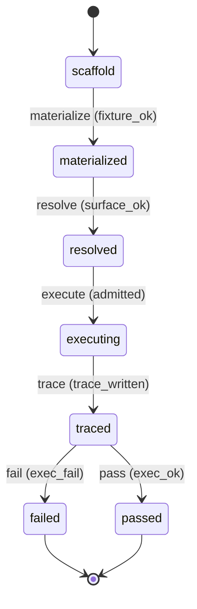

# Requirement Truth: beacon-v1617-live-benchmark-verify (v1.6.17)

## 人话

v1.6.16 的 P1 承诺"让 37 个技能全跑真实执行"，但**实现后没验证过**——实测 eval 里 34 个技能只有 1 个真跑通过，其余 33 个都因"技能文件找不到"失败。这次做到：**补齐 live 评估的基础设施**（给每个技能生成测试题目文件 + 修正技能文件查找），然后真的跑一遍全量 live benchmark，让"承诺的能力"变成"验证过的能力"。

- 能做：补齐 prompt fixture（测试题目）+ 修正 skill surface 解析（mode 子能力映射到主 skill）；跑全量 live benchmark
- 不能做：不改各 skill 语义；不伪造执行结果
- 怎样算完：live_skill_pass 从 1/37 → ≥30/37，且每个通过都有真实执行证据

## User Intent

兑现 v1.6.16 P1 承诺：补齐 live benchmark 评估基础设施（prompt fixture 缺失 + skill surface 解析失败），跑全量 live benchmark，使 live_skill_pass 从 1/37 → ≥30/37。

## User Intent Snapshot

```yaml
lake_or_ocean: 湖
truth_review_gate: required
intent_source: 2026-08-28 全面审查 A1——实现≠验证（P1 落地但 eval live 仍 1/37）
```

## Intent Coverage Matrix

| intent_id | source | strength | landing | status |
|-----------|--------|----------|---------|--------|
| INT-001 | 补齐 prompt fixture（34 个 live skill） | must | AC-001 | covered |
| INT-002 | 修正 skill surface 解析（mode→主 SKILL.md） | must | AC-002 | covered |
| INT-003 | 跑全量 live benchmark | must | AC-003 | covered |
| INT-004 | live_skill_pass ≥ 30/37 且证据真实 | must | AC-004 | covered |

## 用户旅程

1. 触发：`beacon eval scorecard --runner live --live-tier local_admitted`
2. 关键操作：34 skill 逐个 surface preflight → host_behavior 执行 → trace
3. 结果：live_skill_pass ≥30/37，每个通过有 trace
4. 异常：某 skill 无法解析/执行 → 标 fail + reason_code，不折算 pass

## First principles

- 系统边界：live benchmark 验证"skill 可真实执行"，不验证业务结果正确
- 不可变：执行失败不得伪装成 pass；fixture 必须真实存在（非占位）
- 可推翻假设：mode 子能力映射到主 SKILL.md 的 surface 解析是合理修正

## Domain Model

| Entity | Key fields | Notes |
|--------|------------|-------|
| PromptFixture | skill_id, path, route | 测试题目文件 |
| SkillSurface | skill_id, SKILL.md, mode_map | surface 解析 |
| LiveTrace | skill_id, status, reason | 执行记录 |

## Acceptance Criteria

| AC ID | Description |
|-------|-------------|
| AC-001 | materialized 阶段：34 个 live skill 的 prompt fixture 文件真实存在（非空、含 ROUTE: 行）。 |
| AC-002 | resolved 阶段：skill surface 解析修正（mode 子能力映射到主 SKILL.md）：mode 子能力（如 beacon-gen-design-explore）能解析到主 SKILL.md（含 HARD GATE），不再 skill_surface_missing。 |
| AC-003 | executing 阶段：`beacon eval scorecard --runner live --live-tier local_admitted` 跑通，产出每 skill host_behavior trace。 |
| AC-004 | passed 判定：live_skill_pass ≥ 30/37（真实执行），失败 skill 有真实 reason_code（不折算 pass）。 |

## FSM 五元组

| State | Event | Guard | To | Action |
|-------|-------|-------|-----|--------|
| scaffold | materialize | fixture_ok | materialized | write_fixtures |
| materialized | resolve | surface_ok | resolved | map_surface |
| resolved | execute | admitted | executing | run_live |
| executing | trace | trace_written | traced | write_trace |
| traced | pass | exec_ok | passed | mark_pass |
| traced | fail | exec_fail | failed | mark_fail |

**终态：** passed, failed

## Domain FSM Order

| State | From | Guard |
|-------|------|-------|
| materialized | scaffold | fixture_ok |
| resolved | materialized | surface_ok |
| executing | resolved | admitted |
| traced | executing | trace_written |
| passed | traced | exec_ok |
| failed | traced | exec_fail |

## Illegal transitions

- 执行失败仍标 pass（伪造）
- fixture 缺失仍执行（占位冒充）

### invalid / illegal

- 执行失败仍标 pass（伪造）
- fixture 缺失仍执行（占位冒充）

## Non-goals

- 不改各 skill 语义
- 不验证业务结果正确（只验证可执行）
- 不引入新命令面

## Freeze readiness

- [x] Intent Matrix must 无 missing
- [x] 用户旅程非「待补」占位
- [x] First principles / Domain Model 已具体化
- [x] 元状态 FSM + illegal
- [x] 每 AC ≥ 1 TC（Command+Assertion）+ exec-layer TC
- [x] tasks 均有 ac= + evidence= 绑定
- [x] package_maturity: filled
- [x] `beacon truth review` pass 后再 freeze

### Gap vs gold (订单支付示例)

- 对照：`docs/beacon/v1.6.10/features/truth-gold-order-pay-v1610/truth.md`

## Source Excerpt

```markdown
beacon-v1617-live-benchmark-verify
来源：2026-08-28 全面审查 A1——实现≠验证（P1 落地但 eval live 仍 1/37）
实测：34 trace 中 33 个 fail skill_surface_missing（fixture 目录空 + mode 无独立 SKILL.md）
修复：补齐 prompt fixture + surface 解析 mode→主 SKILL.md
```

## FSM mermaid（投影）


