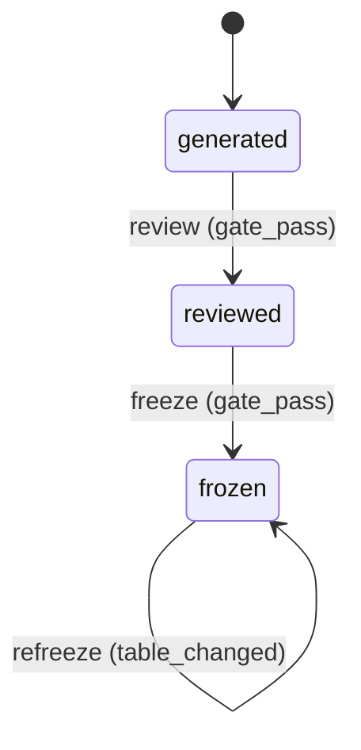

# Requirement Truth: beacon-truth-fsm-terminal-unification

## 人话

Beacon 生成的 truth 骨架，过去通不过自己的冻结门：终态必须显式声明、`truth review` 与 `freeze` 对终态各用一套规则、非法转移段里的自然语言句子会被当成机器边，导致「越写清楚越报错」。本湖把这套 FSM 门禁收敛成一条规则。

- 能做：生成即通过 review 与 freeze；终态按结构（无转出边）判定；非法转移只认显式结构化语法；改表后投影自动重算。
- 不能做：放松安全门；改写已冻结需求语义；让 review 与 freeze 继续各判一套。
- 怎样算完：Intent Matrix must 全 covered；每个 AC 有可执行 TC；本包自身过 review 与 freeze；既有 18 个 domain 包全部可达。

## User Intent Snapshot

```yaml
lake_or_ocean: 湖
language: zh
source: user_intent
utterance: 修复 Beacon 自己的 truth FSM 门禁，让生成的需求物料能通过自己的冻结门，并让 review 与 freeze 判定一致。
```

## 用户旅程

1. 作者运行 `beacon truth gen --intent-first` 生成骨架，直接 `beacon truth review` 得到 pass。
2. 作者运行 `beacon freeze` 得到冻结成功，全程零手改。
3. 作者修改 FSM 五元组表后再次 `beacon freeze`，`## FSM mermaid（投影）` 自动重算为新语义。
4. 作者在非法转移段写自然语言说明（含箭头），不再触发 `illegal_declared_as_legal` 误判。
5. 作者的 `freeze` 被拦时，truth.md 不被写入或改动。

## First principles

- 门禁是纯函数 `V(状态) -> 判定`，必须满足：唯一实现、对本阶段输入无环、判定绑定输入摘要、对生成器封闭、机器语法与散文分离、失败可行动。
- 「终态」的定义是结构性的：无转出边的状态即终态；显式声明只是完整性确认，作为告警而非硬拦。
- 门禁的价值是「正确写法能过 + 真缺陷能拦」，不是最严；0 通过率或高误报率会让门禁被绕过。

## Intent Coverage Matrix

| intent_id | source | strength | landing | status |
|-----------|--------|----------|---------|--------|
| INT-001 | prompt | must | AC-001 | covered |
| INT-002 | prompt | must | AC-002 | covered |
| INT-003 | prompt | must | AC-003 | covered |
| INT-004 | prompt | must | AC-004 | covered |
| INT-005 | prompt | must | AC-005 | covered |
| INT-EDGE-optional | vision | should | Non-goal: deferred explicit-state-list hard check | deferred |

## Acceptance Criteria

| AC ID | Description |
|-------|-------------|
| AC-001 | 生成器对自己的门禁封闭：`render_truth_package` 与 `render_intent_first_truth` 产出的骨架经 `validate_truth_fsm` 判定 `blocked=False`。 |
| AC-002 | 单一规则一致：同一 truth 上 `check_b_fsm_audit(domain_required=True)["pass"] == (not validate_truth_fsm(...)["blocked"])`；domain 包缺 FSM 时 review 与 freeze 同时阻断，非 domain 包同时跳过。 |
| AC-003 | 终态按结构判定：目标状态无转出边且未显式声明时只产生 `terminal_undeclared` 告警且不阻断；转移缺目标时产生 `transition_target_missing` 错误并阻断。 |
| AC-004 | 非法转移仅认显式结构化语法：`- illegal: a -> b` 前缀写法和 `from|to` 表格行才形成机器边；含箭头的自然语言句子不形成机器边、不触发 `illegal_declared_as_legal`。 |
| AC-005 | 投影可重算且无副作用：`attach_fsm_mermaid` 对过期投影返回 `mermaid_resynced` 并只改写 FSM 标题之后的块；被拦的 `freeze` 不改写 truth.md（文件 hash 不变）。 |

## FSM 五元组

| State | Event | Guard | To | Action |
|-------|-------|-------|-----|--------|
| generated | review | gate_pass | reviewed | record_review |
| reviewed | freeze | gate_pass | frozen | write_revision |
| frozen | refreeze | table_changed | frozen | resync_projection |

**终态：** frozen

### invalid / illegal

- illegal: generated → frozen（跳过 review）
- illegal: reviewed → generated（未冻结即回退）

## Non-goals

- 不放松 `forbidden` 与 secret 安全门。
- 不改写已冻结 truth 的语义；语义变化走新 revision。
- 本版本不引入显式状态清单（`States:`）作为硬校验来源。

## Freeze readiness

- [x] Intent Matrix must 无 missing
- [x] 用户旅程非占位
- [x] First principles / Domain Model 已具体化
- [x] 非 domain 湖：FSM 五元组作为示例且显式声明终态
- [x] 每 AC ≥ 1 TC（Command+Assertion）+ ≥1 exec-layer TC
- [x] tasks 均有 ac= + evidence= 绑定
- [x] package_maturity: filled
- [ ] `beacon truth review` pass 后再 freeze

## FSM mermaid（投影）


