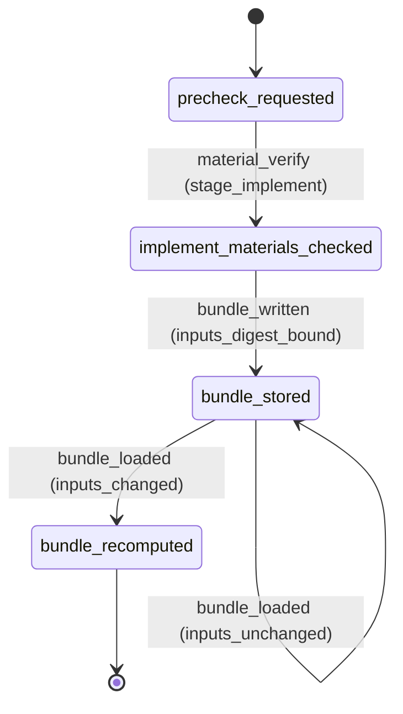

# Requirement Truth: beacon-precheck-stage-and-bundle-freshness

## 人话

Beacon 的「实现前置门」过去在实现之前就要求 `docs/beacon/<v>/release/` 文档——而 release 文档只在 implement + qa 之后才存在，于是门禁把自己锁死（鸡生蛋）。另外 precheck 判定被当成静态缓存，原因修好之后仍显示 blocked，让人继续在错方向上排查。本湖把「物料必需性」按阶段分级，并让 precheck 判定绑定当前工作区输入。

- 能做：实现阶段只校验 research / SUMMARY / 边界 / 架构等实现前物料；release 文档改由 release 阶段强制；precheck 判定随输入变化自动重算。
- 不能做：放松 release 阶段对 release 文档的要求；用陈旧缓存冒充新鲜判定。
- 怎样算完：Intent Matrix must 全 covered；每个 AC 有可执行 TC；本包自身过 review 与 freeze；release 阶段仍要求 release 文档。

## User Intent Snapshot

```yaml
lake_or_ocean: 湖
language: zh
source: user_intent
utterance: 实现前置门不应要求 release 文档；precheck 判定应绑定输入并随变化重算。
```

## 用户旅程

1. 作者在实现前跑 `beacon status standard-execution-precheck`，不再因缺 release 文档而 blocked。
2. 作者在 release 阶段跑 `beacon doctor verify-materials --strict`，缺 release 文档时仍被要求补齐。
3. 作者修改 feature 包或新增 release 文档后，旧的 precheck bundle 被判定为陈旧，消费方自动重算而不是沿用旧结论。

## First principles

- 门禁是纯函数，其输入必须属于「本阶段已存在的东西」；要求未来产物就是门禁依赖图成环，任何守规矩的循环都无法前进。
- 判定只对「当时那份输入」有效；把判定当静态文件缓存而不绑定输入摘要，就会读到陈旧结论。
- 门禁的价值是「正确写法能过 + 真缺陷能拦」，不是最严。

## Intent Coverage Matrix

| intent_id | source | strength | landing | status |
|-----------|--------|----------|---------|--------|
| INT-001 | prompt | must | AC-001 | covered |
| INT-002 | prompt | must | AC-002 | covered |
| INT-003 | prompt | must | AC-003 | covered |
| INT-EDGE-optional | vision | should | Non-goal: deferred precheck auto-refresh CLI flag | deferred |

## Acceptance Criteria

| AC ID | Description |
|-------|-------------|
| AC-001 | 阶段分级：`build_material_audit(stage="implement")` 中 `formal_release_present` 的 `required` 为 false 且状态为 pass；`build_material_audit(stage="")`（release 阶段）中该检查为 fail 且 `required` 为 true，补上 release 文档后转为 pass。 |
| AC-002 | 判定内容寻址：precheck bundle 写入 `inputs_digest`；`precheck_inputs_digest` 在 feature 包内容变化、release 文档变化时随之改变；`bundle_is_fresh` 对无 digest、digest 不符、输入已变化的 bundle 均返回 False。 |
| AC-003 | 陈旧即重算：`record_standard_execution_precheck` 加载到的 CLI bundle 若 `bundle_is_fresh` 为假，则重跑 `run_standard_execution_precheck` 并用新结果覆盖，而不是信任陈旧判定。 |

## FSM 五元组

| State | Event | Guard | To | Action |
|-------|-------|-------|-----|--------|
| precheck_requested | material_verify | stage_implement | implement_materials_checked | run_materials_verify |
| implement_materials_checked | bundle_written | inputs_digest_bound | bundle_stored | write_bundle |
| bundle_stored | bundle_loaded | inputs_changed | bundle_recomputed | run_precheck |
| bundle_stored | bundle_loaded | inputs_unchanged | bundle_stored | reuse_bundle |

**终态：** bundle_stored

### invalid / illegal

- illegal: precheck_requested → frozen（跳过物料校验直接冻结）
- illegal: bundle_stored → implement_materials_checked（复用陈旧判定冒充新鲜）

## Non-goals

- 不放松 `forbidden` 与 secret 安全门。
- 不取消 release 阶段对 release 文档的要求。
- 本版本不新增 `beacon status standard-execution-precheck --refresh` 显式 CLI。

## Freeze readiness

- [x] Intent Matrix must 无 missing
- [x] 用户旅程非占位
- [x] First principles 已具体化
- [x] 非 domain 湖：FSM 五元组作为示例且显式声明终态
- [x] 每 AC ≥ 1 TC（Command+Assertion）+ ≥1 exec-layer TC
- [x] tasks 均有 ac= + evidence= 绑定
- [x] package_maturity: filled
- [ ] `beacon truth review` pass 后再 freeze

## FSM mermaid（投影）


