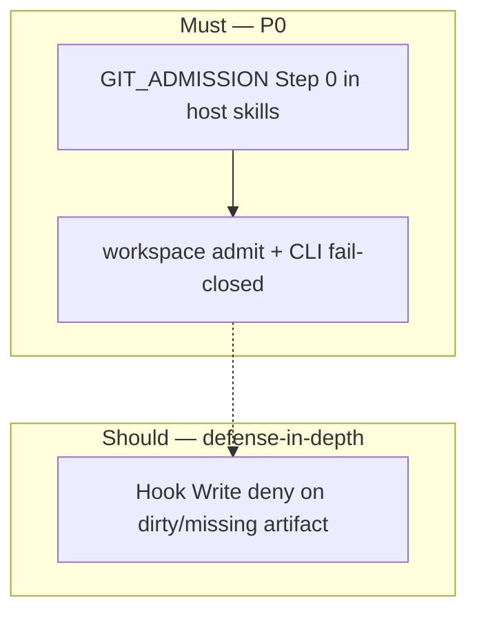

# 需求真相：Global Workspace Git Admission v1.6.2

## 概述

`beacon-global-workspace-git-admission-v162` 解决 **host skill（slash + 提示词）路径不稳定触发分支治理** 的问题：操作者用 `/beacon-gen-implement v1.6.2 …` 等 host skill 时，agent 必须在写 repo 前 **准确解析并进入** `beacon/v1.6.2/<feature-slug>` 开发分支（默认 **专用 worktree**）。

**P0 交付（Must）：**

1. **L1 Skill** — 共享 `GIT_ADMISSION` Step 0：先 `beacon workspace admit`，再写文件；agent `cwd` = `worktree_path`
2. **L2 CLI** — `beacon workspace admit` 公共 resolve 面 + governed commands **fail-closed**（无有效 admission / dirty 状态）
3. **v1.6.2 governance MD** — version contract + worktree 默认

**Should（不挡 refreeze / 不挡 release MVP）：**

4. **L3 Hook** — Cursor/Claude/Codex Write deny（defense-in-depth；**非**唯一 enforcement）

**不**新增 Beacon 主 lifecycle stage；**不**用时间 TTL 强制 re-admit；**不** reopen v1.6.1 frozen truth。

## User Intent（一行）

slash/skill 激活时 **稳定**跑分支治理 Step 0 → **准确找到** `beacon/v1.6.2/<feature>` 开发 worktree → 再 Beacon 作业；CLI 对无/脏 admission **fail-closed**。

## User Intent Snapshot

| 字段 | 值 |
|------|-----|
| 用户原话（稳定 paraphrase） | host skill 的 slash + skill 提示词 → 稳定分支治理 → 准确找到开发分支作业 |
| `lake_or_ocean` | **湖** |
| `scope_mode` | **`branch_resolution_first`** |
| 强度词 | Step 0 强制、fail-closed、worktree 默认 |
| 非协商边界 | **无时间 TTL**；invalidation **仅 dirty**；hook **不能**作为唯一 enforcement |

## User Decisions（locked）

| ID | Decision | Value |
|----|----------|-------|
| UD-001 | Admission CLI | **`beacon workspace admit`**（implement 无关） |
| UD-002 | v1.6.2 branch | **`beacon/v1.6.2/<feature-slug>`** |
| UD-003 | Worktree | **Dedicated worktree default**（`use_git_worktree: true`） |
| UD-004 | Enforcement **Must** | **L1 Skill Step 0 + L2 CLI fail-closed** |
| UD-005 | Hook **Should** | Defense-in-depth Write deny；**v1.6.2 缺 hook 不 block release** |
| UD-006 | verify-agent-surface | **Must fail**：缺 GIT_ADMISSION preamble；**warn only**：缺 admission hook |
| UD-007 | Trellis 隔离 | **`TRELLIS_DISABLE_HOOKS=1` 不禁用 Beacon admission hook**（若已安装） |
| UD-008 | Invalidation | **Dirty-only**（branch/head/worktree/cwd 与 artifact 不一致即无效）；**无 normative TTL** |
| UD-009 | `check-branch` | **保留 alias**；文档主入口 `workspace admit` |
| UD-010 | QA/release artifact | **共用**同一 `version + feature_slug` admission artifact（dirty 前有效） |
| UD-011 | P0 验收句 | `/beacon-gen-implement v1.6.2 <feature>` → Step 0 admit → `worktree_path` 再写 |

## Problem Statement

| 现象 | 根因 |
|------|------|
| Agent 在错误 branch 上改代码 | Host skill 无 mandatory Step 0 |
| slash+skill 不稳定触发 gate | preamble 未物化 / 无统一 GIT_ADMISSION |
| 找不到正确开发分支 | governance v1.6.2 contract 缺失；无公共 resolve CLI |
| implement 路径有 gate 但 host 绕过 | gate 绑在 `implement run` 而非 workspace admit |

## Non-Goals

- **时间 TTL** 强制过期 re-admit（长会话同 feature 连续开发不应被时间踢出）
- Hook 作为 v1.6.2 **Must** 验收项
- Windsurf/Trae hook deny（degraded `cli_only`）
- Trellis spec 作为 requirement truth

## Public CLI Contract（`beacon workspace admit`）

### 命令面

```bash
beacon workspace admit \
  --project-root . \
  --version v1.6.2 \
  --feature <feature-slug> \
  [--json] [--dry-run]
```

### 行为（normative）

1. 读取 governance MD **v1.6.2** version contract
2. 解析 base branch、feature branch pattern、worktree policy
3. branch alignment + worktree ensure
4. 写入 **admission artifact**（dirty-only 语义）
5. 返回 JSON：`status`, `cwd`, `worktree_path`, `branch`, `artifact_path`, `git_head`, `reason_codes[]`

**Normative 不包含：** `expires_at` 或时间 TTL 判定。

### 与现有命令关系

| 命令 | 关系 |
|------|------|
| `beacon implement check-branch` | **Alias** → `workspace admit`（UD-009） |
| `beacon implement dev-run` | **Must** admit before runner |
| `beacon implement run` | **Must** fail-closed without valid admission |
| `beacon qa run` / release | **Must** fail-closed；**UD-010** 共用 artifact |

## Admission Artifact Schema

**Path：**

```text
.beacon/state/workspace-admission/<version>/<feature-slug>.json
```

**Minimum fields：**

| Field | Type | 说明 |
|-------|------|------|
| `schema_version` | string | `workspace-admission-v1` |
| `version` | string | e.g. `v1.6.2` |
| `feature_slug` | string | |
| `project_root` | string | absolute |
| `branch` | string | feature branch at issue |
| `worktree_path` | string | agent cwd target |
| `base_branch` | string | e.g. `beacon/v1.6.2` |
| `issued_at` | ISO8601 | audit only |
| `git_head` | string | commit at issue |
| `status` | enum | `pass` \| `blocked` |

**Invalidation（normative — UD-008 dirty-only）：**

| 事件 | 结果 |
|------|------|
| 当前 branch ≠ artifact.branch | **invalid** → fail-closed |
| 当前 HEAD ≠ artifact.git_head | **invalid** |
| worktree 缺失或 cwd 不在 worktree_path | **invalid** |
| 无 artifact | **invalid** |
| **仅时间流逝** | **仍 valid**（直到 dirty） |

实现 **May** 提供 `--refresh` 强制重写 artifact；**Must not** 因 TTL  alone 拒绝 admission。

## v1.6.2 Governance MD Delta

| 字段 | v1.6.2 值 |
|------|-----------|
| `canonical_branch` | `beacon/v1.6.2` |
| `feature_branch_pattern` | `beacon/v1.6.2/<feature-slug>` |
| `use_git_worktree` | `true` |
| `worktree_root` | `.beacon/worktrees/v1.6.2/<feature-slug>/` |
| `require_workspace_admission` | `true` |
| `admission_invalidation` | **`dirty_only`**（无 TTL 字段） |

## Enforcement Model（方案 A）



### Host Coverage Matrix

| Host | L1 Skill Must | L2 CLI Must | L3 Hook Should | verify strict |
|------|---------------|-------------|----------------|---------------|
| Cursor | GIT_ADMISSION | required | recommended | **fail** missing preamble；**warn** missing hook |
| Claude | GIT_ADMISSION | required | recommended | 同 Cursor |
| Codex | GIT_ADMISSION | required | best-effort | 同 Cursor |
| Windsurf | GIT_ADMISSION | required | N/A | warn `degraded_mode: cli_only` |
| Trae | GIT_ADMISSION | required | N/A | warn `degraded_mode: cli_only` |

## Skill Admission Tiers

| Tier | Skills | Gate |
|------|--------|------|
| **A** | `beacon-gen-implement`, `beacon-gen-change`, `beacon-gen-truth`, `beacon-eval-qa`, `beacon-eval-release`, `beacon-gov-branch` | **Mandatory Step 0** |
| **B** | `beacon-gov-router`, `beacon-gov-debug`, `beacon-gov-doctor`, write-routing planners | Admit when version+feature known |
| **C** | Read-only skills | Exempt until write |

**Materialization：** `skills/beacon/SKILL.md` template → `setup-agent-surface` 生成各 host skill。

### GIT_ADMISSION Preamble（normative）

```markdown
## GIT_ADMISSION (mandatory — Tier A/B when version+feature known)

Before ANY repo write or implement/qa/release route:
1. `beacon workspace admit --project-root . --version <v> --feature <slug> --json`
2. If status != pass → STOP; show reason_codes; do NOT edit files
3. Set cwd to worktree_path from payload
4. Do NOT git checkout elsewhere to "fix" branch
```

## Hook Contract（Should — DEF-HOOK）

| 项 | 要求 |
|----|------|
| Priority | **Should**；缺 hook **不**导致 release NO-GO |
| Script | `.cursor/hooks/beacon-workspace-admission-gate.py` |
| Logic | missing or **dirty** artifact → deny Write |
| TTL | **Must not** deny based on time alone |
| Trellis | 独立条目；`TRELLIS_DISABLE_HOOKS` 不禁用 Beacon hook |

## Acceptance Criteria（Must / Should 索引）

Must = P0 refreeze/implement 门槛；Should = hook defense-in-depth（不挡 MVP release）。完整表见 **§验收标准**。

## Deferral Ledger

| ID | 项 | 目标 |
|----|-----|------|
| DEF-001 | Windsurf/Trae hook deny | v1.6.3+ |
| DEF-002 | Monorepo 多服务 worktree | 另开 feature |
| DEF-003 | 人类手动编辑 hook | 不承诺 |
| DEF-TTL | 时间 TTL re-admit | **Rejected**（R2 明确不做） |
| DEF-HOOK-MUST | Hook 作为 Must | **Deferred** → Should（R2） |

## State Machine

```text
change_draft → truth_review → refreeze → metadata_governance → implement → qa → release
```

## 验收标准

| AC ID | Theme | Description |
|-------|-------|-------------|
| AC-001 | workspace-admit | `beacon workspace admit` 解析 v1.6.2 → `beacon/v1.6.2/<feature>` + worktree_path + artifact（**Must**） |
| AC-002 | cli-fail-closed | 无/脏 admission → `implement run` / `qa run` blocked + stable reason_code（**Must**） |
| AC-003 | skill-preamble | Tier A host skills 含 GIT_ADMISSION Step 0；setup-agent-surface 物化一致（**Must**） |
| AC-004 | cursor-hook | Cursor hook：missing/dirty artifact → Write deny；valid → allow（**Should**） |
| AC-005 | claude-hook | Claude hook parity 同 AC-004（**Should**） |
| AC-006 | verify-surface | verify-agent-surface：缺 preamble **fail**；缺 hook **warn** only（**Should**） |
| AC-007 | trellis-isolation | `TRELLIS_DISABLE_HOOKS=1` 后 Beacon admission hook 仍注册（**Should**） |
| AC-008 | governance-md | governance MD v1.6.2 block + `admission_invalidation: dirty_only`（**Must**） |
| AC-009 | dirty-invalidation | branch/head/cwd 变化 → invalid；**无 git 变化时时间流逝仍 valid**（**Must**） |
| AC-010 | alias-compat | `check-branch` alias + `dev-run` 先 admit；现有调用方不 break（**Must**） |
| AC-011 | slash-skill-p0 | `/beacon-gen-implement v1.6.2 <slug>` → Step 0 admit → worktree 再写（**Must**，UD-011） |
| AC-012 | upgrade-package-release | upgrade-package 写入 release stub（**Must**，UD-013） |
| AC-013 | package-gate-routing | version-line 缺失 → upgrade-package repair（**Must**，UD-012） |
| AC-014 | repair-commands | blocked payload 含 repair_commands 序列（**Must**） |
| AC-015 | verify-materials-pass | v1.6.2 upgrade-package 后 verify-materials strict pass（**Must**） |

## Closed Questions

| ID | 决议 |
|----|------|
| OQ-001 | **无 TTL**；仅 dirty invalidation（UD-008） |
| OQ-002 | check-branch 保留 alias（UD-009） |
| OQ-003 | qa/release 共用 artifact（UD-010） |
| OQ-004 | Hook Must → **Should**（UD-005，方案 A） |


## Version-Line Package Operator Closure (R3)

### 背景（implement/qa 摩擦）

v1.6.2 feature 已 freeze，但 **version-line delivery package** 未闭合时，`implement run` / `qa run` 会在 admission 之前被 `requirement_package_contract_blocked` 拦截。错误 fallback（手抄 v1.6.1 四文件）违反 progressive materialization，且与 feature-level truth 职责混淆。

### 分层（normative）

| 层级 | 材料 | 正确入口 | 禁止 |
|------|------|----------|------|
| Feature | truth/tests/change refreeze | `beacon-gen-truth` / `beacon change --refreeze-chain` | 用 version shell 代替 feature truth |
| Version line | boundaries / blueprint / source-architecture / release stub | **`beacon doctor upgrade-package --apply`** | 手抄上一版本 docs |

### R3 User Decisions

| ID | Decision | Value |
|----|----------|-------|
| UD-012 | Version-line repair | **`beacon doctor upgrade-package --apply`** 为首选 repair（非 gen-truth skill） |
| UD-013 | Release stub | **`upgrade-package` Must** 创建 `release/{version}.md` stub（若缺失） |
| UD-014 | Blocked routing | package gate **Must** 指向 upgrade-package + verify-materials（`repair_commands[]`） |
| UD-015 | Anti-pattern | **禁止** normative 文档建议手抄 prior-version 作为 repair |

### R3 Acceptance Criteria

| AC ID | Theme | Description |
|-------|-------|-------------|
| AC-012 | upgrade-package-release | `upgrade-package --apply` 在缺失时写入 `docs/beacon/{v}/release/{v}.md` stub（**Must**） |
| AC-013 | package-gate-routing | version-line 缺失时 gate `remediation_mode=upgrade-package` 且 `recommended_command` 含 upgrade-package（**Must**） |
| AC-014 | repair-commands | blocked payload 含 `repair_commands[]`：upgrade-package → verify-materials strict（**Must**） |
| AC-015 | verify-materials-pass | v1.6.2 在 upgrade-package 后 `verify-materials --strict` pass（**Must**，解除 implement/qa package 前置阻塞） |

### R3 Non-Goals

- 单一 skill 一键生成全部 version-line 树（仍由 doctor upgrade-package 累积步骤负责）
- 新开 Beacon lifecycle stage
- 用 release 正文 stub 代替 `beacon-eval-release` 阶段的发布叙事


## Downstream Routes（post-freeze）

| 阶段 | Route |
|------|-------|
| Implement | `beacon-gen-implement` |
| QA | `beacon-eval-qa` |
| Release | `beacon-eval-release` |

---

**Status:** `frozen` R2 — 方案 A；implement 权威 truth。`beacon freeze` 完成（refreeze-chain 因当前 branch `pre-main` ≠ `beacon/v1.6.2` 走 direct freeze）。
