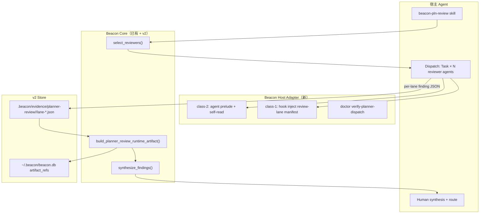

# Research: 宿主 Skill 多代理全面审查（Trellis 对照 + v2 能力草案）

- **outcome**: 调研 Trellis 如何在多宿主上稳定启动 subagent 做排查/实现，并对照 Beacon v1.6 现状与 v2 redesign，提出「宿主开启 skill 多代理全面审查」的可落地能力草案。
- **authority**: support_advisory（非 requirement truth；promote 前须走 `beacon-gen-change` / v2 truth）
- **lake_or_ocean**: lake（聚焦 planner review 多代理 dispatch + artifact，不扩到 implement/QA/release 裁决）
- **truth_refs**:
  - `docs/plans/beacon-v2-redesign.md` §3.2 `planner_review()`、§7 Operator Spine
  - `docs/beacon/v2.0.0/features/beacon-v2-rust-kernel-redesign/truth.md` AC-102
  - `docs/beacon/v1.6.0/features/beacon-pln-review-runtime-multi-agent-v160/truth.md`
  - `docs/beacon/v1.6.0/features/beacon-loop-goal-closed-loop-orchestrator/truth.md` AC-041
- **source_refs**:
  - oss-sync: `agents/agent-skills/Trellis`（upstream: `mindfold-ai/Trellis` @ `d1aa3c0`）
  - `skills/beacon/beacon-pln-review/SKILL.md`
  - `beacon/utils/planner_review_runtime.py`
  - `beacon/commands/planner_review.py`
  - `packages/beacon-loop/src/delivery/review.ts`
- **evidence_refs**:
  - `docs/beacon/v1.6.0/features/beacon-pln-review-runtime-multi-agent-v160/evidence.md`
- **recommended_route**: 本 research 接受后 → v2 truth 增补 AC（host dispatch）或独立 change feature → P2/P3 `beacon-orchestrator` + host adapter
- **user_decision**: pending

---

## 1. 问题陈述

用户需要 **宿主（Cursor / Codex / Claude 等）在加载 `beacon-pln-review` 时，能稳定、可审计地并行/分派多个 reviewer subagent 做全面审查**，而不是：

1. 仅在单 agent 内「换帽子」读 catalog；或  
2. 用 `BEACON_LOOP_*` env 把 `execution_mode` 标成 `parallel_subagent_review`，但 lane 内容仍是 Python 规则模板（v1.6 已 frozen 的 honest fallback）。

v2 plan 已在 goal 链保留 `planner_review()`，truth **AC-102** 要求 artifact 同构 + `artifact_refs` 入库；**尚未定义**「宿主如何真正 dispatch LLM subagent lane」的 adapter 合同。

---

## 2. Trellis 如何「多宿主稳住」subagent（源码事实）

Trellis 是 **项目层工作流基础设施**（`.trellis/`），通过 CLI `trellis init --cursor --codex …` 为 **14 个 AI 平台** 生成适配文件，核心不是「一个 CLI 帮你 spawn 子进程 LLM」，而是 **三层稳定机制**：

### 2.1 单一任务真相 +  per-platform 适配器

| 层 | 路径 | 作用 |
|----|------|------|
| 任务/规范真相 | `.trellis/spec/`、`.trellis/tasks/<id>/` | PRD、implement/check manifest、任务状态 |
| 平台适配 | `.cursor/`、`.codex/`、`.claude/` … | commands、skills、agents、hooks |
| 共享 skill 层 | `.agents/skills/`（Codex 等写入） | agentskills.io 标准，多宿主 last-writer-wins 需字节一致 |

Beacon 类比：MD requirement truth 在 `docs/beacon/<version>/` + `features/<slug>/truth.md`；host skill 在 `.cursor/skills/` 等；**运行态** v2 进 `~/.beacon/beacon.db`（plan §7）。

### 2.2 两类宿主：Push（class-1）vs Pull（class-2）

Trellis 测试与模板明确区分（`shared-hooks.test.ts`、`codex.ts` 注释）：

| 类 | 代表宿主 | subagent 上下文如何进入 |
|----|----------|-------------------------|
| **class-1 push** | Cursor、Claude Code、Kiro 等（有 PreToolUse / agentSpawn） | Hook **`inject-subagent-context.py`** 在 `Task\|Subagent` 调用**之前**注入 `implement.jsonl` / `check.jsonl` 引用的 spec + `prd.md` |
| **class-2 pull** | Codex（无 CollabAgentSpawn PreToolUse）、Pi 等 | **不装** push hook；在 **agent.toml 前导（prelude）** 或 agent 指令里要求 subagent **自行 Read** `Active task: <path>` + jsonl manifest |

Cursor hooks 合同（生成物）：

```json
"preToolUse": [{
  "command": "{{PYTHON_CMD}} .cursor/hooks/inject-subagent-context.py",
  "matcher": "Task|Subagent",
  "timeout": 30
}]
```

Hook 设计哲学（`inject-subagent-context.py` 文件头）：

- Hook **负责注入全部上下文**；subagent 拿到完整材料后自治执行。  
- 每个 agent 类型有专用 manifest：`implement.jsonl`、`check.jsonl`。  
- **不靠 prompt 分段**；行为由代码 + manifest 控制。

### 2.3 Agent 定义 + 递归护栏

每个平台写入 **具名 subagent**（非 generic `generalPurpose`）：

- `.cursor/agents/trellis-implement.md`、`trellis-check.md`、`trellis-research.md`
- `.codex/agents/*.toml`（含 pull-based prelude）

**Recursion guard**（`trellis-implement.md`）：已在 subagent 内则 **禁止再 spawn** implement/check；并行需求 **回报主会话**，由主会话 dispatch。

Reasonix 额外机制：`runAs: subagent` frontmatter → 宿主以 isolated subagent loop 启动。

### 2.4 主会话编排，非 CLI 代跑 LLM

Trellis **4 阶段**（README_CN）：Plan → Implement（`trellis-implement` subagent）→ Verify（`trellis-check`）→ Finish。

- **主会话**（或 slash skill）决定何时 dispatch。  
- **CLI**（`trellis init/update`）只 **物化** hooks/agents/skills，不替代宿主 Task API。  
- 排查/验证：check subagent 读 diff + `check.jsonl` + 跑 lint/test。

### 2.5 会话连续性（「稳住」的另一维）

- `sessionStart` hook → 注入 identity、git、active task、workflow phase。  
- 每条用户消息附带 `<workflow-state>` breadcrumb。  
- `.trellis/.runtime/sessions/` 记录 active task（gitignore）。

Beacon 类比：v2 **Spine + checkpoint**（plan §7、`beacon-loop-state-spine.md` 语义）；v1.6 仍分散 JSON，v2 应收敛到 SQLite。

---

## 3. Beacon v1.6 现状（代码 + 已 frozen truth）

### 3.1 已有：deterministic multi-reviewer artifact

```text
beacon-pln-review skill
  →（可选）beacon planner-review run
  → planner_review_runtime.build_planner_review_runtime_artifact()
  → .beacon/state/planner-review/<feature>/<review_id>.json
```

- **Lane 生成**：`select_reviewers()` + `_lane_result()` **同进程规则模板**，非 LLM subagent。  
- **Synthesis**：`synthesize_findings()` 机器合并。  
- **Parallel 标记**：仅当 `BEACON_LOOP_REVIEW_PARALLEL=1` **且** `BEACON_LOOP_SUBAGENT_RUNTIME=1` 时 `execution_mode=parallel_subagent_review`；否则 mandatory fallback（AC-007 frozen）。

相关代码：

- `beacon/commands/planner_review.py` L39–40  
- `beacon/utils/planner_review_runtime.py` L562–579  
- `packages/beacon-loop/src/delivery/review.ts` subprocess 委托 + `parallel-fixture` 测试桩

### 3.2 已有：implement 线 subagent（非 planner review）

- `beacon implement --mode team` / `codex-subagents` → `subagent_runtime.py` worker spec + tmux/file。  
- `beacon doctor verify-subagent-runtime` / `verify-subagent-delegation` → **就绪检查**，不 dispatch planner lane。

### 3.3 明确缺口（truth + tasks）

| ID | 描述 | 状态 |
|----|------|------|
| v1.6 AC-041 | loop 内 **真并行** review lane + per-lane evidence ref | tasks.md **pending** |
| v1.6 frozen scope | 「不要求本 feature 接入真实外部 LLM worker」 | honest deterministic fallback |
| v2 AC-102 | orchestrator `planner_review()` 同构 artifact + `artifact_refs` | P2 backlog |
| Skill | **不**自动调用 Cursor Task | by design（HARD GATE planner） |

**结论**：v1.6 证明了 **artifact 形状与 fallback 诚实**；**未** 交付宿主 LLM 并行 reviewer dispatch。

---

## 4. v2 redesign 对齐点

来自 `docs/plans/beacon-v2-redesign.md` 与 v2 truth：

| Plan / AC | 与 multi-agent review 的关系 |
|-----------|------------------------------|
| §3.2 `planner_review()` 在 goal 链 | 审查是 delivery 正式阶段，非可选装饰 |
| `AgentBackend` trait（Codex/Claude/ACP/ImplementHarness） | **Orchestrator 侧** agent 迭代；与 **planner reviewer lane** 可共用 backend 抽象但 **角色平面不同** |
| 全局 SQLite + `artifact_refs` | 每个 reviewer lane 的 stdout/JSON 应登记 path + sha256 |
| `beacon spine show` | operator 一条命令看到 review run、lanes、gate |
| AC-102 | 字段同构 + 禁止 fake parallel |
| AC-094 | skill 回归失败 → doctor，禁止静默回退 |

**v2 不应复制 Trellis 的 `.trellis/tasks/` 任务模型**；应保留 Beacon 的 **truth resolver + planner artifact contract**。

---

## 5. 能力草案：「宿主 Skill 多代理全面审查」

### 5.1 命名（working title）

**`beacon-host-planner-review-dispatch`**（或并入 v2 orchestrator 的 `planner_review()` host adapter 子模块）

### 5.2 目标行为

在 operator 于 **Cursor/Codex/Claude** 触发 `beacon-pln-review` 且满足「需要可审计多代理审查」时：

1. **Resolver** 读取 truth/source/evidence refs（已有 `resolve_truth_read_refs`）。  
2. **Lane planner** 调用 `select_reviewers()` 得到 lane 列表（与 v1.6 一致）。  
3. **Dispatch**（新）：按宿主能力 **并行** 启动 **具名 reviewer subagent**（非 host-visible 新 skill），每 lane 输入边界 + refs，输出 **finding JSON**。  
4. **Collect**：主会话或 orchestrator 等待 lanes，写入 per-lane blob + 更新 artifact。  
5. **Synthesis**：复用 `synthesize_findings()`（机器）+ 主 agent 人读 synthesis（skill contract）。  
6. **Persist**：v2 写 `artifact_refs`；v1.6 过渡期仍写 `.beacon/state/planner-review/…json`。

### 5.3 Trellis → Beacon 映射

| Trellis 机制 | Beacon 对应（建议） |
|--------------|---------------------|
| `implement.jsonl` / `check.jsonl` | **`review-lane.jsonl`** 或 lane 段内 `input_refs[]`（machine-readable manifest） |
| `inject-subagent-context.py` PreToolUse | **`beacon-hook-inject-planner-lane.py`**（class-1）或 Cursor rules 等价物 |
| Agent `.md` + recursion guard | **`.cursor/agents/beacon-reviewer-<lane>.md`**（内部，非 public skill）；禁止 spawn 另一 planner reviewer |
| class-2 pull prelude | Codex agent.toml **prelude** + 首行 `Active review: <review_id>` |
| 主会话 dispatch | Skill workflow 第 3.5 步：**显式 Task 并行 N 路**（文档 + eval 测 prompt 合规） |
| `.trellis/workflow.md` phase | **`beacon-pln-review` HARD GATE** + artifact `planner_boundary` |
| 14 平台 init | **`beacon doctor setup-agent-surface --agent cursor\|codex\|claude`** 扩展 **reviewer agent stubs + hooks** |

### 5.4 宿主能力矩阵（建议冻结为 adapter 表）

| Host | agentCapable | Hook push | 默认 dispatch 模式 |
|------|--------------|-----------|-------------------|
| Cursor | yes | PreToolUse `Task\|Subagent` | class-1 hook + Task parallel |
| Claude Code | yes | PreToolUse | class-1 hook + Task |
| Codex | yes | no（class-2） | lane prelude + `$skill` / subagent TOML |
| ACP / 其他 | TBD | TBD | pull + manifest self-read |

**`subagent_runtime_available`** 判定应升级为：

```text
doctor verify-subagent-runtime PASS
AND host adapter registered for current BEACON_AGENT_RUNTIME
AND（class-1: hook installed OR class-2: prelude verified）
```

而非仅 `BEACON_LOOP_SUBAGENT_RUNTIME=1`。

### 5.5 Artifact 扩展（在 v1.6 合同上增量）

保留 v1.6 全部字段；**真 dispatch 时**追加：

```text
reviewer_lanes[].dispatch_mode     # host_task | host_subagent | deterministic_fallback
reviewer_lanes[].host_evidence_ref # per-lane blob path（v2 → artifact_refs）
reviewer_lanes[].started_at / completed_at
reviewer_lanes[].worker_id         # Cursor task id / codex session ref（若可得）
execution_mode                     # parallel_subagent_review 仅当 ≥2 lane 真并行完成
```

**仍禁止**：lane 未独立产出却标 parallel；planner 写 truth/QA/release。

---

## 6. 架构草图



**Orchestrator 路径（v2 P2）**：`goal → planner_review()` 内部调用同一 adapter，而非仅 subprocess `beacon planner-review run` 规则模板。

---

## 7. 与 Beacon 特性结合的硬约束

1. **MD 需求真相唯一**：review finding **不得**写 `truth.md`；改 promise → `beacon-gen-change`。  
2. **Planner HARD GATE**：dispatcher 不得路由 implement/qa/release skill。  
3. **Evidence-first**：每 lane 必须有 blob 或 `no_findings` 记录；Spine 可索引。  
4. **Honest fallback**：宿主无 Task / hook 未装 → `single_process_multi_reviewer` + `fallback_reason`（延续 AC-007）。  
5. **Evaluator 裁决**：research 不替代 QA/release verdict（AGENTS.md / skill preamble）。  
6. **Implement 分轨**：`beacon implement team` worker 协议 **不**与 planner reviewer lane 混用角色平面（context isolation 已有先例）。

---

## 8. 分阶段交付建议

| Phase | 交付 | 依赖 |
|-------|------|------|
| **R0 文档 + eval** | Skill 增补「Host dispatch playbook」；skill eval 测 **是否** parallel Task + **是否** 写 artifact | v1.6 frozen |
| **R1 Cursor class-1** | `setup-agent-surface` 生成 reviewer agent stubs + inject hook；示例 `review-lane.jsonl` | doctor hooks |
| **R1b Codex class-2** | agent.toml prelude + manifest self-read 模板 | codex subagent |
| **R2 收集器** | 主会话/orchestrator 聚合 lane JSON → 喂给 `build_planner_review_runtime_artifact(collect=…)` | planner_review_runtime |
| **R3 v2 AC-102** | Rust orchestrator `planner_review()` + `artifact_refs` | beacon-store |
| **R3 AC-041** | loop `review-artifact.json` per-lane evidence ref 真并行 | closed-loop orchestrator |

---

## 9. Parity / Deferral

| 能力 | Trellis | Beacon v1.6 | 本草案 v2 |
|------|---------|-------------|-----------|
| 多宿主 init | `trellis init --platform` | `beacon doctor setup-agent-surface` | 扩展 dispatch 物化 |
| subagent 上下文注入 | hook / pull | 无（implement team 另轨） | class-1/2 adapter |
| 并行 implement+check | 主会话 dispatch 2 类 agent | implement team only | **reviewer N 路 parallel** |
| 任务 manifest | implement.jsonl | truth resolver refs | review-lane manifest |
| 全局运行态 DB | 无（文件为主） | 分散 JSON | **~/.beacon/beacon.db** |

**建议 defer（需用户显式接受）**：

- 14 宿主全覆盖 → 先 Cursor + Codex + Claude（与 v2 AgentBackend 一致）  
- Research lane 自动 spawn `trellis-research` 级联网子代理 → planner 默认只读 repo refs  
- 自动 fix（Trellis check 自修）→ planner **只审查**，fix 路由 implement

---

## 10. 开放问题（待 user decision）

1. **Public surface**：新能力是否暴露 `beacon planner-review dispatch` CLI，还是 **仅 skill + orchestrator 内部**？  
2. **Lane 并行度上限**：与 `select_reviewers()` 全量激活时 N≈17，是否 cap（如 P0/P1 only 5 lanes）？  
3. **LLM 每 lane 必选 vs 可选**：frozen v1.6 允许 deterministic fallback；v2 是否 **默认** 要求 host dispatch，fallback 仅 CI/无 IDE？  
4. **与 Compound/gstack 关系**：是否复用外部 review skill 作为 **lane worker prompt**，还是 Beacon-internal reviewer catalog only？  
5. **Promote 路径**：独立 feature slug vs 直接扩 v2 `beacon-v2-rust-kernel-redesign` AC-105+？

---

## 11. 参考索引

### Trellis（oss-sync canonical）

- 路径：`/Users/apple/Developer/Personal/oss-sync/agents/agent-skills/Trellis`
- 关键文件：
  - `packages/cli/src/types/ai-tools.ts` — 平台 registry、`agentCapable` / `hasHooks`
  - `packages/cli/src/configurators/cursor.ts` / `codex.ts` — 多宿主物化
  - `packages/cli/src/templates/shared-hooks/inject-subagent-context.py` — class-1 注入
  - `packages/cli/src/templates/cursor/hooks.json` — `Task|Subagent` matcher
  - `packages/cli/src/templates/cursor/agents/trellis-implement.md` — recursion guard

### Beacon

- `skills/beacon/beacon-pln-review/SKILL.md` — workflow 第 3 步 CLI artifact  
- `beacon/utils/planner_review_runtime.py` — lane + synthesis  
- `beacon/utils/subagent_readiness.py` — host runtime 检测  
- `docs/plans/beacon-v2-redesign.md` — orchestrator + SQLite spine  
- `docs/beacon/v2.0.0/features/beacon-v2-rust-kernel-redesign/truth.md` — AC-102  

---

## 12. 建议下一步

1. 用户确认 §10 开放问题（尤其 public CLI vs skill-only）。  
2. 若接受本 research：在 v2 truth 或新 change feature 中增加 **AC-105 Host planner review dispatch**（behavior-level TC + hook/agent 物化）。  
3. 先做 **R0 + R1 Cursor** 垂直切片：3 个 always-on reviewer 真 Task 并行 → lane blob → 现有 `synthesize_findings()` → artifact 验收。
