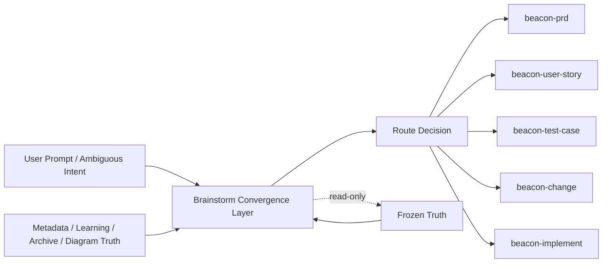
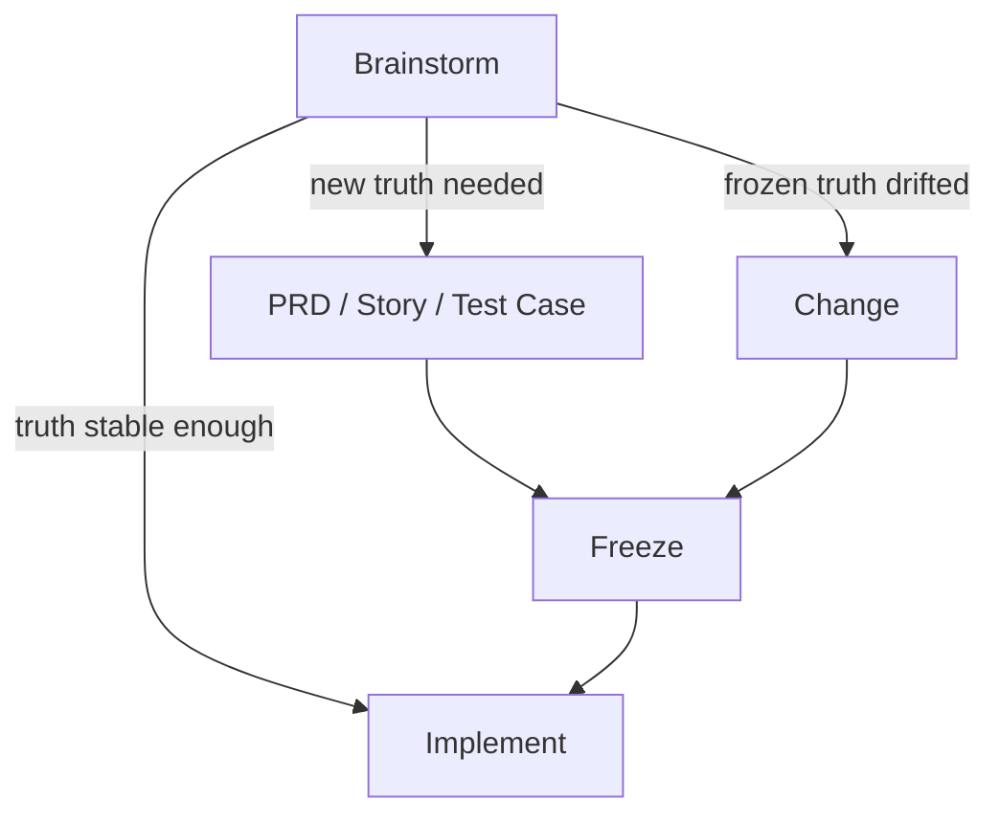

# Beacon Brainstorm Convergence Spec

## 1. 目的

本稿基于以下输入收敛 Beacon Brainstorm 的高置信度定位：

- `docs/beacon/global-boundaries.md`
- `beacon/commands/brainstorm.py`
- `beacon/utils/brainstorm.py`
- 现有 Beacon v2 轻量内核分析

目标不是把 Brainstorm 再做成一个独立生命周期，而是明确：

1. Brainstorm 是否属于 Beacon core kernel
2. Brainstorm 与 `prd / change / freeze` 的关系
3. Brainstorm 如何避免发散成新真相源
4. Brainstorm 如何成为跨 `code / media / copy / novel` 的统一收敛前置层

## 2. 第一性原理结论

### 2.1 用户价值

用户在进入正式冻结前，真正需要的不是“再生成一份文档”，而是：

- 判断当前问题是否足够清晰，值得进入冻结
- 判断当前 scope 是否应扩张、收缩或保持
- 找出冻结真相中的缺口、矛盾、边界、未决项
- 给出最小安全路由：`beacon-prd / beacon-user-story / beacon-test-case / beacon-change / beacon-implement`

所以 Brainstorm 的真实价值不是“发散”，而是：

> 在不污染 frozen truth 的前提下，把不确定问题收敛到最小下一步。

### 2.2 证据约束

从现有 `brainstorm run` 源码可确认：

- 它读取 `docs/beacon/global-boundaries.md`
- 它读取 version materials
- 它可读取 metadata、archive、diagram truth、help payload
- 它拒绝写入 frozen truth 路径

这说明 Brainstorm 当前已经天然具备：

- 只读 truth-sidecar
- route recommender
- convergence pre-layer

### 2.3 闭环约束

全局边界已经明确：

- 不新增新 lifecycle stage
- 不让外部复杂度污染人类主流程
- implement/qa/release 不能反写 requirement truth

所以高置信度结论是：

> Brainstorm 必须保留，但只能是 support-side convergence layer，不能升级成新的主阶段，也不能成为平行真相源。

## 3. Brainstorm 在 v2 中的正式定位

### 3.1 它是不是 core kernel

结论：

- Brainstorm 不是 lifecycle core
- Brainstorm 是 support kernel 的正式组成部分

更准确地说，它属于：

- Learning Plane Kernel
- Support Surface Kernel
- Host-LLM semantic convergence surface

因此：

- 不能删除
- 不能主流程化
- 不能 truth 化

### 3.2 在架构中的位置



## 4. Brainstorm 与 PRD / Change / Freeze 的关系

### 4.1 与 PRD 的关系

Brainstorm 不定义 PRD。  
Brainstorm 只负责回答：

- 当前是否需要新 PRD
- 现有 PRD 是否有 requirement gap
- gap 更适合写到 PRD 还是 user-story/test-case

### 4.2 与 Change 的关系

Brainstorm 不执行 change。  
Brainstorm 只负责判断：

- 当前是否已经触碰 frozen truth
- 是否应进入 `beacon-change`
- scope 变化是否是最小安全 delta

### 4.3 与 Freeze 的关系

Brainstorm 不 freeze。  
Brainstorm 只负责 freeze 之前的语义收敛、freeze 之后的 gap 诊断与 refreeze 路由。

### 4.4 正式关系图



## 5. Brainstorm 的边界规范

### 5.1 必须保留的边界

- read-only against frozen truth
- 不写 `docs/beacon/<version>/prd`
- 不写 `user-story`
- 不写 `qa/test-cases`
- 不写 `prototype`
- 不写 `.machine`
- 不直接执行 implement

### 5.2 必须增加的边界

Beacon v2 应正式补齐：

- Brainstorm 只输出收敛结论，不输出新的“准真相文档”
- Brainstorm 产物必须显式区分：
  - confirmed facts
  - assumptions under test
  - open questions
  - route recommendation
  - confidence level
- Brainstorm 必须有“闭口条件”

## 6. 现有实现的关键问题

### 6.1 双轨实现问题

目前 `brainstorm` 有两条轨：

1. `brainstorm run`
   - 已接近 Beacon 核心风格
   - 读取 truth/materials/metadata
   - 有 route/recommendation/convergence

2. `brainstorm create/list`
   - 仍是旧模板产品文档面
   - 更像 `docs/product/...` 模板生成器

高置信度判断：

- `run` 应保留并升级
- `create/list` 不应继续作为 Beacon 核心 Brainstorm 语义

### 6.2 缺少 typed output contract

当前虽然已有：

- confirmed_facts
- assumptions_under_test
- first_principles_breakdown
- socratic_questions
- converged_recommendation
- recommended_route

但还缺：

- confidence scoring
- contradiction detection
- evidence sufficiency verdict
- convergence closed reason
- domain-agnostic route taxonomy

### 6.3 缺少正式闭口条件

当前容易发生：

- Brainstorm 生成了很多分析
- 但没有明确什么时候应该停止继续 brainstorm

v2 必须定义：

- `brainstorm_closed`
- `supplement_required`
- `change_required`
- `truth_ready`

## 7. Beacon v2 Brainstorm Contract

### 7.1 输出 contract 草案

```json
{
  "schema_version": "2.0",
  "artifact": "beacon_brainstorm_convergence",
  "version": "v1.3.12",
  "mode": "project-evolution",
  "prompt_summary": "",
  "domain": "code",
  "source_truth_refs": [],
  "confirmed_facts": [],
  "assumptions_under_test": [],
  "contradictions": [],
  "open_questions": [],
  "first_principles_breakdown": [],
  "route_candidates": [],
  "recommended_route": "beacon-change",
  "recommended_target_artifact": "prd",
  "confidence": {
    "overall": "high",
    "evidence_sufficiency": "medium",
    "route_confidence": "high"
  },
  "closure_state": "supplement_required",
  "closure_reason": "",
  "next_step_command": "",
  "generated_at": ""
}
```

### 7.2 闭口状态

- `brainstorm_closed`
  - 问题已收敛，无需继续分析
- `supplement_required`
  - 应补充 PRD/story/test-case
- `change_required`
  - 已触碰 frozen truth，需 change/refreeze
- `truth_ready`
  - 当前 truth 足够，可进入 implement

## 8. Brainstorm 作为跨场景统一前置层

### 8.1 为什么它适合跨场景

跨 `code / media / copy / novel` 场景，在冻结前都需要同一类能力：

- 找问题
- 找边界
- 找矛盾
- 找未决
- 决定写到哪个 contract 层

这正是 Brainstorm 的天然职责。

### 8.2 跨场景抽象

Brainstorm 不直接理解“代码”或“小说”，它理解的是：

- problem
- audience
- promise
- boundary
- scenario
- acceptance
- structure

### 8.3 场景映射

#### code

- route to `prd / user-story / test-case / change / implement`

#### media

- route to `topic-prd / audience-story / content-test-case / publish`

#### copy

- route to `messaging-prd / claim-story / copy-acceptance`

#### novel

- route to `world-prd / character-story / chapter-acceptance / outline-freeze`

因此：

> Brainstorm 应成为跨 domain 的统一收敛前置层，而不是只服务代码需求分析。

## 9. 高置信度方案

### 9.1 方案结论

高置信度方案如下：

1. 保留 `brainstorm run`
2. 将 Brainstorm 明确定义为 support kernel 的正式组成部分
3. 不把 Brainstorm 升级为 lifecycle stage
4. 不允许 Brainstorm 写 frozen truth
5. 为 Brainstorm 增加 typed convergence contract
6. 用 Brainstorm 统一承接 code/media/copy/novel 的“冻结前收敛”
7. 将旧 `brainstorm create/list` 降级为 plugin/template surface 或删除

### 9.2 置信度判断

- Brainstorm 作为 support kernel：高
- Brainstorm 不应 truth 化：高
- Brainstorm 不应主流程化：高
- Brainstorm 应跨 domain 化：中高
- Brainstorm 旧模板面应降级：高

原因：

- 这与全局边界完全一致
- 这与当前 `run_beacon_brainstorm()` 的设计方向一致
- 这最能减少未来复杂度膨胀

## 10. 与全局边界的一致性

本方案与 `docs/beacon/global-boundaries.md` 的一致点：

- 不新增公开一级主命令
- 不新增 lifecycle stage
- 复杂度留在机器内部
- implement/qa 仍是唯一执行入口
- requirement truth 仍然唯一
- canonical 单向投影原则不被破坏

## 11. 最终判断

Brainstorm 很重要，但它重要的方式不是“再做成一个大系统”，而是：

> 成为 Beacon 的只读、高约束、高收敛、可跨 domain 复用的语义前置层。

Beacon v2 对 Brainstorm 的正确处理不是扩张，而是：

- 保留其 read-only convergence 能力
- 清理其旧模板分叉
- 类型化其输出 contract
- 把它放回全局边界允许的位置

这是一条高置信度、低架构风险的方案。
