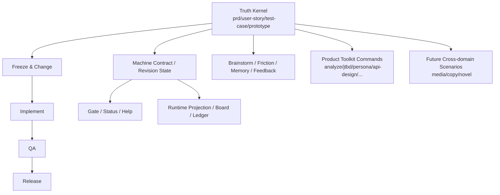
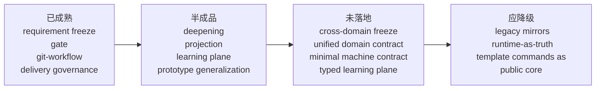
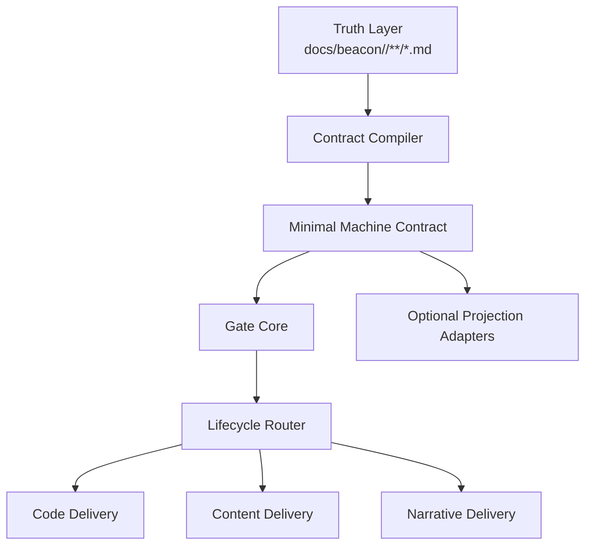

# Beacon 功能版图缺口地图与轻量演进路线

## 1. 目的

本稿基于现有 Beacon 源码、测试、冻结材料与前序减重分析，正式整理：

- Beacon 当前能力版图
- 功能缺口地图
- 哪些能力应保留为内核
- 哪些能力应减重、降级或删除
- 如何在 `requirement freeze` 基础上扩展更多使用场景

本稿遵循以下核心约束：

- 唯一冻结真相源：`docs/beacon/<version>/**/*.md`
- 保留基础 code 开发场景的 requirement freeze、gate、git-workflow、change/freeze/re-freeze
- 保留人类面专业 skill
- 一切派生 machine/runtime/projection 均不得反向定义真相

## 2. 总体判断

Beacon 当前已经不是“没有能力”，而是“能力分布极不均衡”：

- requirement freeze / gate / delivery governance 很强
- runtime/read model/projection 很多
- domain 扩展命令很多
- 但真正闭环、可冻结、可 gate、可 release 的主线仍集中在基础 code 场景

因此 Beacon 现在的核心问题不是“功能太少”，而是：

- 主内核很强
- 外围命令很多
- 跨场景抽象还没成型
- 实现复杂度已经先于产品边界抽象膨胀

## 3. 功能版图分层

### 3.1 现有能力大图

### 3.2 四类能力成熟度

1. 已成熟
2. 半成品
3. 概念存在但未落地
4. 应降级或删除

## 4. 已成熟能力

以下能力构成 Beacon 当前真正的内核：

### 4.1 Requirement Freeze 内核

- `prd -> user-story -> test-case -> prototype -> implement -> qa -> release`
- freeze/reopen/change/re-freeze
- revision baseline hash
- requirement traceability
- acceptance writeback

这是 Beacon 最有产品辨识度的部分，必须保留。

### 4.2 Gate 与 Delivery Governance

- stage gate
- release gate
- requirement completeness gate
- semantic contract gate
- acceptance transaction gate
- git workflow / branch binding
- blocked reason / repair route / next step

这部分已经形成较强的阻断与解释能力，是 Beacon 作为“规范化开发 gate 内核”的关键。

### 4.3 专业 requirement 技能面

- `beacon-prd`
- `beacon-user-story`
- `beacon-test-case`
- `beacon-prototype`
- `beacon-implement`
- `beacon-qa`
- `beacon-release`
- `beacon-help`
- `beacon-status`
- `beacon-doctor`

这些 skill 已经形成了真实可用的人类操作面。

### 4.4 Git 与真实项目治理

- project metadata
- canonical branch binding
- worktree / repo binding
- real-project-validation
- doctor verify / advise / setup-context

这部分是 Beacon 从纯模板工具进化为真实工程治理工具的重要支撑。

## 5. 半成品能力

以下能力已经有结构、有部分实现，但还没有足够收敛。

### 5.1 Requirement Deepening

现状：

- 已经有 `envelope / candidate-ledger / decision-log / completeness / supplement-task / re-freeze-transaction`
- 已经有 host-assisted deepening 思路

问题：

- 默认产物面太多
- 与主 requirement compile、machine sync、change loop 的边界还不干净
- 更像“加法式 state surface”，还不是收敛的 deepening kernel

判断：

- 能力方向对
- 实现方式过重
- 应收敛进 minimal contract 扩展字段，而不是继续加散落文件

### 5.2 Runtime Projection / Board / Ledger

现状：

- status board
- runtime ledger
- sqlite / pocketbase projection
- delivery read model

问题：

- 对观察层很有价值
- 但当前已经部分侵入主路径 gate 心智

判断：

- 应保留为可选观察层
- 不应继续作为 requirement truth 的等价治理面

### 5.3 Brainstorm / Feedback / Friction / Memory

现状：

- 都已有命令和一定流程
- 能做只读分析、摩擦收集、反馈吸收

问题：

- learning plane 还没有真正类型化
- 到 PRD/change/freeze 的正式回写协议还不够统一

判断：

- 方向正确
- 缺统一 typed convergence contract

### 5.4 Prototype / Diagram Truth

现状：

- prototype 已经不是纯静态模板
- 有 design review / route closure / semantic binding / diagram truth 等约束

问题：

- 能力强，但较偏 code product flow
- 尚未抽象为跨 domain 的通用“结构冻结协议”

判断：

- 应保留
- 但要从“前端/页面治理”提升为更通用的“结构图冻结层”

## 6. 概念存在但未落地能力

这是 Beacon 下一阶段最关键的缺口。

### 6.1 非基础 code 场景的正式冻结闭环

目前还没有真正落地以下完整闭环：

- 自媒体选题到发布
- 文案策略到交付
- 小说/长文世界观到章节发布
- 知识产品结构到内容发布

缺失的不是命令，而是正式 contract：

- domain PRD
- domain story
- domain test-case / acceptance
- domain prototype / structure freeze
- domain release

### 6.2 统一 Domain Contract

Beacon 需要一个高于“软件开发”的统一抽象：

- problem
- audience
- promise
- boundary
- scenario
- acceptance
- structure
- delivery artifact

只有抽象到这层，Beacon 才能从“开发规范工具”扩展成“冻结需求对齐内核”。

### 6.3 统一 Minimal Machine Contract

目前缺少单一、可稳定编译、可被 gate 全面消费的 machine contract。

现在的 machine 面太碎：

- story state
- revision state
- acceptance envelope
- runtime projection
- requirement deepening ledger
- PRD mirror
- qa matrix

需要一个统一 compiled contract 来收口。

### 6.4 Skill 层与函数层的硬边界

当前 skill 命令与底层函数常常混杂：

- 语义生成
- 状态同步
- machine repair
- projection rebuild

未来需要更明确：

- skill 只做交互与语义编排
- function 只做 deterministic compile / gate / verify

### 6.5 通用结构图冻结协议

当前 state machine / branch flow / decision priority / route closure 更偏代码产品。

未来需要抽象出通用冻结图谱：

- state machine
- actor flow
- decision tree
- narrative arc
- content structure map

这会是跨自媒体、文案、小说的重要桥梁。

## 7. 应降级或删除的能力

这些不一定要物理删除，但不应再作为主路径一等公民。

### 7.1 多份同义 machine mirror

包括：

- legacy PRD machine mirror
- parallel canonical/compile/pointer mirror
- 重复状态记录

这些会继续拖重架构。

### 7.2 Runtime Projection 作为主路径阻断前提

- sqlite
- pocketbase
- board export
- runtime ledger write success

它们适合做观察层，不适合定义 truth closure。

### 7.3 模板型产品命令的一等公开面

当前 `analyze / jtbd / persona / api-design` 这类能力更多还是模板脚手架，而非 Beacon 冻结内核的一部分。

这些能力未来有两条路：

1. 升级为真正接入 freeze/gate 的 domain module
2. 降为可选 toolkit/plugin，而非 Beacon 主面命令

不应长期保持当前中间态。

### 7.4 过量 Doctor 介入主路径

`doctor` 应回归：

- context repair
- artifact verify
- projection rebuild
- migration support

而不是成为日常主流程的一部分。

## 8. 缺口地图

### 8.1 按类别汇总

### 8.2 按优先级

P0:

- 统一 minimal machine contract
- 将 gate 收敛到 truth + minimal contract
- 降级 runtime projection
- 收敛 doctor sync-materials

P1:

- learning plane typed convergence
- cross-domain freeze contract
- diagram/prototype generalization

P2:

- 媒体/文案/小说 domain module
- plugin 化外围 toolkit 命令

## 9. Beacon 需要如何减重

### 9.1 核心原则

- 只保留一份冻结真相
- 只保留一层最小机器合同
- 只让 gate 依赖最小必要字段
- 将 projection、board、sqlite 全部降为 optional
- 将 domain 扩展建立在同一 freeze kernel 上

### 9.2 重构分层

### 9.3 具体减重动作

1. 合并 machine artifact
2. 废弃 legacy mirror 的主路径依赖
3. 让 `doctor sync-materials` 退化成 `compile-contract`
4. 让 gate 不再默认依赖 runtime sqlite/pocketbase
5. 将分析类模板命令移出主面或升级成 domain contract module
6. 将 brainstorm/feedback/friction/memory 统一成 typed learning plane

## 10. 如何在 requirement freeze 上扩展更多场景

### 10.1 扩展原则

不要把 Beacon 扩展理解为“再加命令”。  
正确做法是把更多场景映射到同一个 freeze kernel。

### 10.2 通用 Freeze Kernel

任何场景都映射成：

- PRD: 要解决的问题与承诺
- Story: 面向角色/受众/章节/读者的目标
- Test Case: 验收场景与失败条件
- Prototype: 结构、流程、状态、章节、段落骨架冻结
- Implement: 真正产出
- QA: 校验一致性、质量与边界
- Release: 发布/交付/归档

### 10.3 场景映射

#### 基础 code

- 产品需求
- 研发实现
- 测试验收
- 发布交付

#### 自媒体

- 选题 PRD
- audience story
- content acceptance case
- outline prototype
- draft implement
- editorial QA
- publish release

#### 文案编辑

- messaging PRD
- audience story
- claim/test case
- copy structure prototype
- copy implement
- brand/compliance QA
- delivery release

#### 小说 / 长文创作

- world/conflict PRD
- character story
- chapter acceptance case
- outline/state prototype
- writing implement
- continuity QA
- publish release

## 11. 产品路线建议

### Phase 1: 内核收敛

- 收敛 machine contract
- 降级 projection
- 精简 doctor
- 维持 Python 主体

### Phase 2: Typed Learning Plane

- unify brainstorm/feedback/friction/memory
- typed supplement / decision / writeback / refreeze

### Phase 3: Cross-domain Freeze Kernel

- 抽象统一 domain contract
- 抽象通用 prototype / structure freeze
- 将 code/media/copy/novel 接到统一内核

### Phase 4: Plugin 化外围能力

- 把模板型分析命令迁出核心
- 核心只保留 freeze/gate/delivery kernel

## 12. 最终结论

Beacon 最值得保留和强化的，不是“很多命令”，而是：

- requirement freeze
- gate judgment
- git-workflow governance
- human skill orchestration
- truth-bound delivery closure

Beacon 当前最大的遗漏点，不是再多做几个命令，而是：

- 没有统一 minimal machine contract
- 没有跨 domain freeze contract
- 没有 typed learning plane
- 没有把外围模板能力收敛成真正的内核或插件

Beacon 下一步正确方向是：

- 先减重
- 再收敛 contract
- 再扩场景

不是继续在现有重型状态面上加功能。
