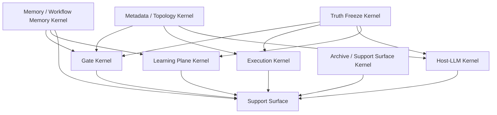
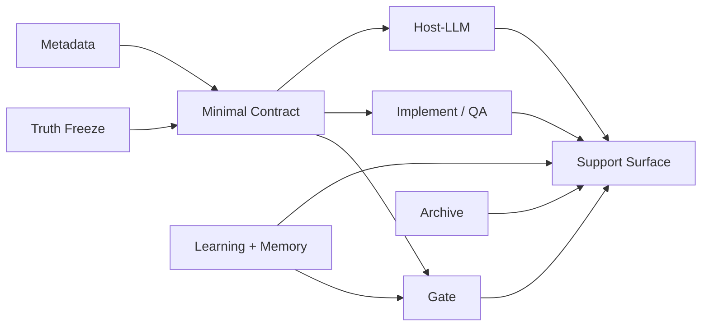

# Beacon Core Kernel Spec

## 1. 目的

本稿不再预设 Beacon 只有若干概念基座，而是直接从源码与冻结边界反推：

- Beacon 当前真实存在的核心基座能力
- 哪些能力属于不可误删的 kernel
- 哪些能力属于强支撑底座
- 哪些能力属于上层派生面

目标不是保留当前所有实现细节，而是识别：

> Beacon 减负后，什么还必须存在，Beacon 才还是 Beacon。

## 2. 核心结论

从源码确认，Beacon 当前至少有 8 类核心基座能力：

1. Truth Freeze Kernel
2. Gate Kernel
3. Execution Kernel
4. Host-LLM Kernel
5. Learning Plane Kernel
6. Metadata / Topology Kernel
7. Memory / Workflow Memory Kernel
8. Archive / Support Surface Kernel

其中：

- 前 5 类是主基座
- 后 3 类是系统级支撑基座

不能简单删除。  
可以减重，但必须保留其核心职责。

## 3. Kernel 总图

## 4. Truth Freeze Kernel

### 4.1 代码与边界证据

- `docs/beacon/<version>/**/*.md`
- `global-boundaries.md`
- `story_state / revision_state / requirement parsing`

### 4.2 核心职责

- 提供唯一冻结真相源
- 固化 `prd -> user-story -> test-case -> prototype -> implement -> qa -> release`
- 支持 freeze / reopen / change / refreeze
- 维持 requirement traceability
- 保证 implementation / qa / release 不能反写 truth

### 4.3 不可误删能力

- 唯一 truth root
- revision 概念
- freeze/re-freeze/change loop
- AC / TC / prototype 与 truth 的绑定
- canonical 单向投影原则

### 4.4 可减重部分

- 多份 mirror 文件
- legacy PRD machine 面
- 不必要的重复 transaction pointer

## 5. Gate Kernel

### 5.1 代码证据

- [beacon/commands/gate.py](/Users/apple/Developer/Personal/products/beacon/beacon/commands/gate.py:1)

### 5.2 核心职责

- 定义 Beacon 的“完成”与“阻断”
- 在 requirement / implement / qa / release 上做统一判定
- 输出结构化 blocked reason、recommended action、next step

### 5.3 不可误删能力

- requirement completeness 判定
- revision / baseline drift 判定
- AC/TC coverage 判定
- git workflow / branch alignment 判定
- acceptance evidence 判定
- semantic contract 判定
- blocked reason + repair route

### 5.4 可减重部分

- 默认不再强依赖 runtime sqlite/pocketbase
- 收敛输入 artifact 数量
- 用 minimal machine contract 替代碎片 machine 面

## 6. Execution Kernel

### 6.1 代码证据

- [beacon/commands/implement.py](/Users/apple/Developer/Personal/products/beacon/beacon/commands/implement.py:1)
- [beacon/commands/qa.py](/Users/apple/Developer/Personal/products/beacon/beacon/commands/qa.py:1)

### 6.2 核心职责

- 维持 `implement` 作为唯一实现入口
- 维持 `qa` 作为唯一验收入口
- 将 truth package 绑定到真实执行与回写

### 6.3 不可误删能力

- implement 单一入口
- qa 单一入口
- implementation plan
- branch / workflow precheck
- writeback 到 revision / acceptance
- mode 不改变 truth，只改变执行形态

### 6.4 可减重部分

- team/ralph 暴露面
- 过量执行归档
- runner 兼容层数量

## 7. Host-LLM Kernel

### 7.1 代码证据

- [beacon/utils/semantic_runtime.py](/Users/apple/Developer/Personal/products/beacon/beacon/utils/semantic_runtime.py:1)
- [beacon/utils/subagent_readiness.py](/Users/apple/Developer/Personal/products/beacon/beacon/utils/subagent_readiness.py:1)

### 7.2 核心职责

- 让 Beacon 优先走宿主原生语义能力
- 管理 host bridge / fallback / prompt boundary
- 判断当前宿主是否支持 native team/subagent/bridge

### 7.3 不可误删能力

- host runtime detection：`codex` / `claude`
- host bridge command / response 协议
- requested/effective/fallback mode
- runtime readiness precheck
- delegation readiness precheck
- prompt boundary / host trace

### 7.4 可减重部分

- 多余 adapter 花样
- 非核心 runtime projection
- 多平台幻想叙事

## 8. Learning Plane Kernel

### 8.1 代码证据

- [beacon/utils/learning_loop.py](/Users/apple/Developer/Personal/products/beacon/beacon/utils/learning_loop.py:1)

### 8.2 核心职责

- 吸收运行中反馈
- 以 policy/program surface 方式约束学习
- 让学习影响 calibration / rewrite / eval，而非越权改 truth

### 8.3 不可误删能力

- learning plane contract
- subject surface / forbidden surface
- keep/discard engine
- benchmark/eval skeleton
- rewrite input
- policy family topics

### 8.4 关键判断

学习面现在还不够类型化，但它已经是基座。  
不能删除，只能收敛成更清晰的 typed learning plane。

## 9. Metadata / Topology Kernel

### 9.1 代码证据

- [beacon/utils/project_metadata.py](/Users/apple/Developer/Personal/products/beacon/beacon/utils/project_metadata.py:1)

### 9.2 核心职责

- 描述项目拓扑
- 绑定版本与分支
- 绑定服务与 repo root
- 为 implement / qa / host-runtime / gate 提供环境真相

### 9.3 不可误删能力

- topology kind
- default execution service
- service bindings
- per-version canonical branch contract
- metadata transaction

### 9.4 为什么它是基座

没有 metadata，Beacon 无法在真实项目里稳定回答：

- 现在在哪个 repo / service 上执行
- 当前版本对应哪条 canonical branch
- 哪个 service 是默认执行面

这不是可选功能，是工程化运行底座。

## 10. Memory / Workflow Memory Kernel

### 10.1 代码证据

- [beacon/utils/memory.py](/Users/apple/Developer/Personal/products/beacon/beacon/utils/memory.py:1)
- [beacon/utils/workflow_memory.py](/Users/apple/Developer/Personal/products/beacon/beacon/utils/workflow_memory.py:1)
- [beacon/utils/debug_feedback.py](/Users/apple/Developer/Personal/products/beacon/beacon/utils/debug_feedback.py:1)

### 10.2 核心职责

- 记录 memory envelope
- 记录 workflow lifecycle
- 记录 debug feedback，并吸收到 memory
- 支撑 help/status/report 的历史感知能力

### 10.3 不可误删能力

- memory envelope 的统一 schema
- lifecycle memory
- workflow transaction journal
- debug feedback canonical event
- feedback -> memory assimilation

### 10.4 关键判断

这部分不是“聊天记忆附属品”，而是 Beacon 的运行记忆基座。  
没有它，Beacon 会退化成每次从零开始的文档工具。

## 11. Archive / Support Surface Kernel

### 11.1 代码证据

- [beacon/utils/archive_governance.py](/Users/apple/Developer/Personal/products/beacon/beacon/utils/archive_governance.py:1)
- [beacon/utils/help_support.py](/Users/apple/Developer/Personal/products/beacon/beacon/utils/help_support.py:1)

### 11.2 核心职责

- 管理 active truth 与 historical truth 的边界
- 将复杂内核投影为人类可消费的 support surface
- 让 help/status/doctor/archive 成为真实导航面

### 11.3 不可误删能力

- archive status
- active vs learnable vs reference-only 边界
- help/status 的 stage-aware navigation
- support surface projection
- minimal HUD / next-step routing

### 11.4 关键判断

这部分不是“锦上添花 UI”，而是 Beacon 让人类能用得动复杂内核的必要外壳。

## 12. 基座与派生层边界

### 12.1 真基座

- Truth Freeze
- Gate
- Execution
- Host-LLM
- Learning Plane
- Metadata / Topology
- Memory / Workflow Memory
- Archive / Support Surface

### 12.2 派生层

- runtime ledger sqlite
- pocketbase projection
- board export
- legacy machine mirrors
- 重复 pointer / transaction 镜像
- 大量模板型产品分析命令

## 13. 减负时的保留原则

### 13.1 可以删的

- 兼容历史的重复镜像
- 过量 runtime projection
- 非核心模板命令的一等主面地位
- 过碎 machine artifact

### 13.2 不能删的

- 唯一冻结真相
- gate 判定能力
- implement/qa 唯一入口
- host-native bridge/fallback 语义
- learning plane contract
- metadata/version/topology binding
- lifecycle memory
- archive/support navigation

## 14. 最小保真形态

如果 Beacon 大幅减重，最低仍必须保留：

## 15. 最终判断

Beacon 不是单一的 requirement 工具，也不是单一的 gate 工具。  
从源码看，它已经是一个：

> 以冻结真相为核心、以 gate 为约束、以 implement/qa 为执行主链、以 host-LLM 为语义引擎、以 metadata/memory/archive/support 为系统底座的 agent-native workflow kernel。

因此，减负的正确做法不是“删到只剩 PRD/TC 模板”，而是：

- 保留 8 类 kernel
- 收缩派生层
- 合并 machine contract
- 降级 projection
- 让外围 domain 命令插件化

只要这 8 类 kernel 仍在，Beacon 就仍然保有自己的核心能力特性。
