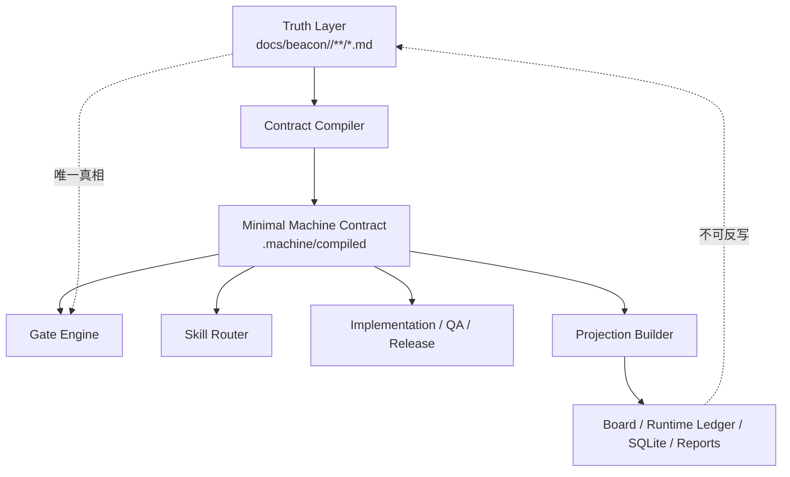
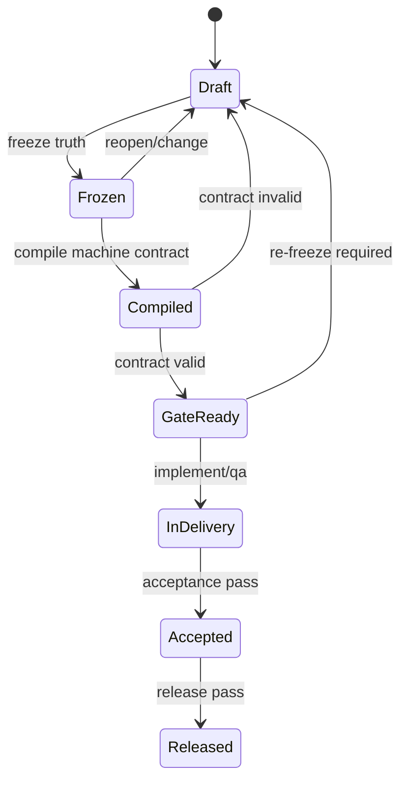
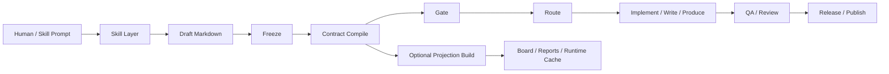

# Beacon 轻量化重构蓝图

## 1. 目的

本稿基于以下冻结边界与源码现状分析，给出 Beacon 的减重重构方向：

- 保留 `docs/beacon/<version>/**/*.md` 作为唯一冻结真相源
- 保留 Beacon 对基础 code 开发的核心 gate 门禁、git-workflow、freeze/change 闭环
- 保留人类面专业 skill 的编排能力
- 支持后续把同一冻结源扩展用于自媒体、文案编辑、小说、知识产品等非基础 code 场景
- 在减重同时保持灵活性、可审计性、以及较高运行性能

当前问题不是 Beacon 不能工作，而是：

- 主路径被过多 machine mirror、runtime projection、legacy compatibility、doctor repair 动作绑死
- requirement compile、machine sync、runtime ledger、board/read model 混成一条链
- gate 直接依赖大量派生产物，导致 token、心智、实现复杂度同步上升

## 2. 核心判断

### 2.1 必须保留的 Beacon 核心

- 冻结唯一真相源：`docs/beacon/<version>/**/*.md`
- 主生命周期：`prd -> user-story -> test-case -> prototype -> implement -> qa -> release`
- 基础 code gate 门禁
- git-workflow 绑定与分支约束
- freeze/change/re-freeze 治理
- 人类面专业 skill
- feature 级 requirement traceability
- 基础 machine contract

### 2.2 应减掉的重量

- 多份同义 machine mirror
- 旧 `.beacon/prd/*.json` 兼容镜像作为主路径依赖
- requirement 主链默认强依赖 sqlite/pocketbase/runtime ledger
- help/status/release 对过多派生产物的强阻断
- `doctor sync-materials` 既做 compile 又做 repair 又做 reconciliation
- requirement deepening 默认生成大批 ledger/state 文件

### 2.3 结论

Beacon 不应继续把“事务性多写”扩展成“多层真相感知系统”。  
正确做法是：

- 只保留一份 human frozen truth
- 只保留一层 minimal machine contract
- 其余一切运行态、看板态、索引态都降级为可重建 projection

## 3. 目标产品形态

Beacon 应收敛为一个轻量 host-runtime agent skill kernel：

- 人类只记住 lifecycle 与 skill 面
- host-runtime LLM 负责生成、比对、深挖、路由
- gate 只消费 frozen truth 与 minimal machine contract
- runtime projection 仅做观察与加速，不定义完成

## 4. 分层蓝图

### 4.1 四层结构

1. Truth Layer
   - 唯一真相：`docs/beacon/<version>/**/*.md`
   - 包含 PRD、User Story、Test Case、Prototype Freeze、Execution Blueprint、Change、Release

2. Contract Layer
   - 最小 machine contract
   - 只保存 gate 必需字段
   - 必须可从 frozen markdown 单向编译

3. Skill Layer
   - `beacon-prd`
   - `beacon-user-story`
   - `beacon-test-case`
   - `beacon-prototype`
   - `beacon-implement`
   - `beacon-qa`
   - `beacon-release`
   - 以及面向非 code 场景的 domain skill

4. Projection Layer
   - status board
   - runtime ledger
   - sqlite / pocketbase
   - report read model
   - analytics cache
   - 全部可删、可重建、不可定义真相

### 4.2 Mermaid 架构图

## 5. 最小 machine contract

建议把 machine 面收敛为一个统一目录，例如：

- `docs/beacon/<version>/.machine/compiled/<feature>.json`

该文件只包含：

- feature slug
- version
- revision id
- baseline hash
- PRD promised surfaces
- user-story AC list
- test-case list
- AC-TC mapping
- prototype required flag
- git workflow binding
- gate-required evidence refs
- completeness verdict
- acceptance verdict

不再默认拆成大量平行文件。

### 5.1 编译原则

- 单向：只能从 frozen markdown 编译到 machine contract
- 幂等：同一输入得到同一输出
- 可审计：保留 `source_hash`、`compiled_at`、`compiler_version`
- 不可反写：machine contract 不能成为人类真相源

## 6. 事务模型重构

### 6.1 旧模型问题

当前事务性双写实际上变成：

- human sink
- machine sink
- runtime sink
- legacy sink
- pointer sink
- board/export sink

这导致“事务成功”的定义过重。

### 6.2 新模型

事务只保留两段：

1. Freeze Commit
   - markdown frozen truth commit
   - compile minimal machine contract

2. Optional Publish
   - rebuild projection
   - update board / sqlite / export

只有第一段属于 gate-required transaction。  
第二段失败只影响观察层，不应阻断 requirement 主链。

### 6.3 Mermaid 状态机

## 7. 职责拆分

### 7.1 Skill 层

Skill 层负责：

- 人类交互
- host-runtime prompt boundary
- 专业语义生成
- 收敛补问
- 将结果写回 markdown 草稿或 change loop

Skill 层不负责：

- 多份 mirror 管理
- sqlite 事务一致性
- 看板投影成功与否

### 7.2 函数调用层

函数层负责稳定、可测、低 token 的 deterministic 能力：

- markdown parse
- contract compile
- gate evaluate
- git workflow verify
- baseline hash
- evidence manifest
- projection rebuild

### 7.3 元信息层

元信息层只保留：

- project topology
- canonical branch
- version binding
- service binding
- feature runtime flags

元信息层不应该再持有平行真相。

### 7.4 实现层

实现层只围绕：

- parser
- compiler
- gate engine
- workflow engine
- projection adapters

其中 projection adapter 完全插件化。

## 8. 基础 code gate 应如何保留

Beacon 减重后，基础 code gate 仍然保留以下核心判断：

- frozen requirement package 是否完整
- revision 是否冻结且未漂移
- AC 是否存在
- TC 是否覆盖 AC
- implement 是否绑定当前 revision
- QA evidence 是否闭环
- git branch / worktree / affected project 是否符合 workflow
- release 是否绑定 acceptance 结果

Gate 不再强依赖：

- legacy PRD mirror
- board ledger 是否同步成功
- sqlite projection 是否成功
- pocketbase 是否成功写入

除非用户显式启用“强化可观察性模式”。

## 9. 跨场景扩展模型

冻结真相源不应只服务基础 code。

可以抽象出统一的 domain package：

- `problem`
- `audience`
- `promise`
- `boundary`
- `acceptance`
- `artifact contract`

### 9.1 基础 code

- PRD / User Story / Test Case / Prototype / Implement / QA / Release

### 9.2 自媒体

- 选题 PRD
- audience story
- content test case
- outline prototype
- draft implement
- review QA
- publish release

### 9.3 文案编辑

- messaging PRD
- audience story
- scenario test case
- copy prototype
- draft implement
- editorial QA
- delivery release

### 9.4 小说 / 长文创作

- world / conflict PRD
- character story
- chapter test case
- outline prototype
- writing implement
- continuity QA
- publish release

因此 Beacon 的核心应是“冻结需求对齐内核”，不是“只服务代码研发的重型治理 CLI”。

## 10. Blueprint 流程图

## 11. Python 是否继续沿用

结论：继续沿用 Python。

原因：

- Beacon 当前主要是 CLI、文档编译、规则校验、文件系统治理，不是 CPU 密集型系统
- Python 对文本处理、CLI 编排、测试驱动、宿主 agent 生态集成最合适
- 当前依赖非常轻，迁移到 Rust/Go 的收益远低于重构架构边界的收益
- 真实性能瓶颈更可能是 prompt/token、文件数量、重复投影、I/O、状态面耦合，而不是 Python 本身

### 11.1 高性能要求下的做法

- 保持 Python 主体
- 将 parser / compiler / gate 纯函数化
- 严控 I/O 次数
- 合并 machine artifact 数量
- 按 feature 增量编译，不全量 sync
- projection 改为 lazy rebuild
- 大对象 read model 改成按需加载
- 若未来出现明确热点，再把局部算子替换为 Rust extension 或 Go sidecar

### 11.2 不建议现在迁移语言

现在如果迁移语言，会把问题从“架构过重”伪装成“运行不够快”。  
实际主问题是边界设计，不是解释器性能。

## 12. 建议的重构阶段

### Phase 1

- 固化唯一真相源原则
- 定义统一 minimal machine contract
- 将 gate 切换到只读 minimal contract

### Phase 2

- 下线 legacy PRD mirror 主路径依赖
- 把 runtime ledger / sqlite / pocketbase 降级为 optional projection
- 把 `doctor sync-materials` 改成 deterministic compile

### Phase 3

- Skill 层抽象为跨 domain 对齐内核
- 把 code/media/copy/novel 都挂到统一 frozen package 模型
- 形成 host-runtime native 的轻量 skill suite

## 13. 最终判断

Beacon 应从“重型多写治理系统”收敛为“冻结真相驱动的轻量对齐内核”。

保留：

- frozen markdown truth
- minimal machine contract
- core gate
- git workflow
- change/freeze governance
- 专业 skill 面

降级：

- runtime projection
- board/read model
- sqlite/pocketbase
- legacy mirrors
- 大量默认 ledger

这条路线既能减 token、减心智、减实现复杂度，也能把 Beacon 从基础 code 扩展到更广泛的知识生产场景。
