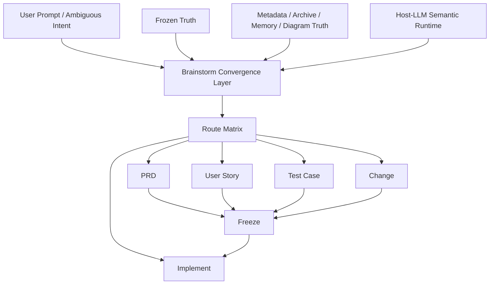
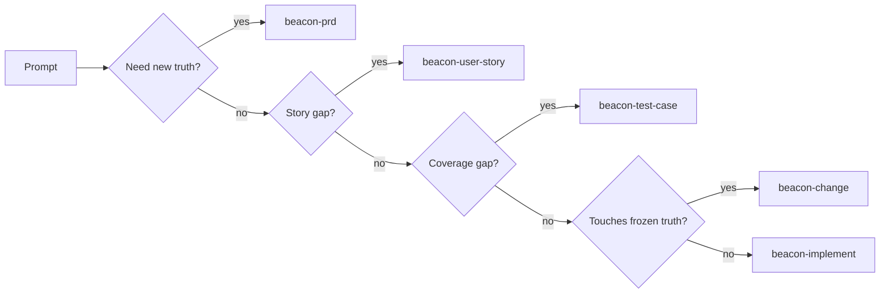
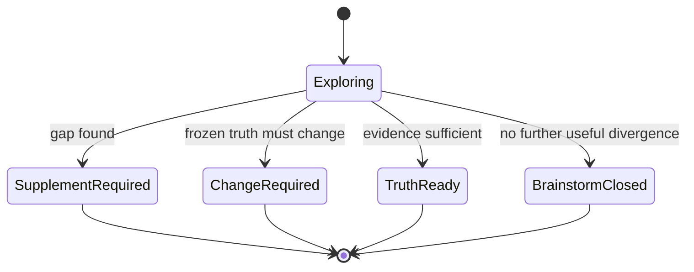

# Beacon v2 Brainstorm Integration Architecture

## 1. 目标

本稿把以下两份方案合并为可执行集成架构：

- Beacon v2 Lightweight Kernel Architecture
- Beacon Brainstorm Convergence Spec

重点补齐三块：

1. Brainstorm 在 Beacon v2 kernel 中的正式位置
2. Brainstorm typed contract 到 `prd / change / user-story / test-case / implement` 的 route matrix
3. Brainstorm 在 `code / media / copy / novel` 的统一映射表

## 2. 结论

高置信度结论如下：

- Brainstorm 不是 lifecycle core
- Brainstorm 是 Beacon v2 `Support Kernel + Learning Plane + Host-LLM semantic convergence surface`
- Brainstorm 必须保持只读，不得成为新真相源
- Brainstorm 的唯一职责是：
  - 从 frozen truth 与上下文中发现 gap
  - 形成最小安全路由
  - 把用户从模糊意图收敛到正式 contract 入口

换句话说：

> Brainstorm 不是“想法生成器”，而是 Beacon 的语义收敛路由器。

## 3. Brainstorm 在 Beacon v2 中的位置

### 3.1 正式位置

它属于：

- Support Kernel
- Learning Plane Kernel
- Host-LLM Kernel 的前置语义层

不属于：

- Lifecycle Core
- Truth Layer
- Contract Compiler

### 3.2 集成架构图



## 4. Brainstorm 输入面

### 4.1 必需输入

- user prompt
- `docs/beacon/global-boundaries.md`
- active version materials

### 4.2 条件输入

- feature truth refs
- project metadata
- archive read model
- help/status payload
- diagram truth
- learning/memory context

### 4.3 禁止输入

- 外部未校验真相被默认为 authoritative
- 运行态 projection 直接覆盖 frozen truth

## 5. Brainstorm 输出 contract

### 5.1 v2 contract

```json
{
  "schema_version": "2.0",
  "artifact": "beacon_brainstorm_convergence",
  "version": "v1.3.12",
  "mode": "project-evolution",
  "domain": "code",
  "prompt_summary": "",
  "source_truth_refs": [],
  "confirmed_facts": [],
  "assumptions_under_test": [],
  "contradictions": [],
  "open_questions": [],
  "first_principles_breakdown": [],
  "route_candidates": [],
  "recommended_route": "",
  "recommended_target_artifact": "",
  "confidence": {
    "overall": "high",
    "evidence_sufficiency": "medium",
    "route_confidence": "high"
  },
  "closure_state": "",
  "closure_reason": "",
  "next_step_command": "",
  "generated_at": ""
}
```

### 5.2 必须新增字段

- `contradictions`
- `confidence`
- `closure_state`
- `closure_reason`
- `recommended_target_artifact`
- `route_candidates`

## 6. Brainstorm Route Matrix

### 6.1 规则

Brainstorm 只输出 route，不直接改 truth。

### 6.2 Route Matrix

| 触发条件 | 推荐路由 | 目标 artifact | 闭口状态 |
|---|---|---|---|
| 用户提出新问题，但当前版本没有对应冻结需求 | `beacon-prd` | `prd` | `supplement_required` |
| PRD 存在，但角色/行为/边界不足 | `beacon-user-story` | `user-story` | `supplement_required` |
| Story 已足够，但验证场景/覆盖不足 | `beacon-test-case` | `test-case` | `supplement_required` |
| 已触碰冻结边界、需要修改既有 truth | `beacon-change` | `change` | `change_required` |
| frozen truth 已完整且无关键矛盾 | `beacon-implement` | `implement` | `truth_ready` |
| 冲突较大、证据不足、问题本身不清晰 | `beacon-brainstorm` | `brainstorm` | `brainstorm_closed` 或继续分析 |

### 6.3 Mermaid Route 图



## 7. Brainstorm 闭口状态机

### 7.1 闭口状态

- `brainstorm_closed`
- `supplement_required`
- `change_required`
- `truth_ready`

### 7.2 状态机图



## 8. Brainstorm 与核心命令关系

### 8.1 关系定义

- 与 `prd/user-story/test-case`：
  - Brainstorm 是上游收敛层
- 与 `change`：
  - Brainstorm 是漂移发现与路由层
- 与 `implement`：
  - Brainstorm 是实现前的 truth sufficiency check
- 与 `qa/release`：
  - Brainstorm 不是执行面，不直接参与 verdict

### 8.2 不允许的关系

- Brainstorm 直接 freeze
- Brainstorm 直接 release
- Brainstorm 直接替代 PRD
- Brainstorm 输出平行 truth package

## 9. 跨场景统一映射表

### 9.1 抽象字段

Brainstorm 只关心：

- problem
- audience
- promise
- boundary
- scenario
- acceptance
- structure

### 9.2 Domain Mapping Matrix

| Domain | PRD 对应 | Story 对应 | Test Case 对应 | Prototype 对应 | Implement 对应 | QA 对应 | Release 对应 |
|---|---|---|---|---|---|---|---|
| code | product requirement | user-story | qa/test-case | wireframe freeze | implementation | qa run | release check |
| media | topic strategy | audience story | content acceptance | outline freeze | draft production | editorial QA | publish |
| copy | messaging strategy | audience/claim story | copy acceptance | copy structure freeze | copy writing | brand/compliance QA | delivery |
| novel | world/conflict brief | character story | chapter acceptance | outline/state freeze | writing | continuity QA | publish |

### 9.3 Brainstorm 在这些场景中的作用

#### code

- 找 requirement gap
- 找 drift
- 决定进入 `prd/story/test-case/change/implement`

#### media

- 找选题是否成立
- 找 audience/promise 是否冲突
- 决定进入 topic PRD 或 content structure 补料

#### copy

- 找 claim 是否模糊
- 找 audience/boundary 是否不清
- 决定进入 messaging PRD 或 acceptance rewrite

#### novel

- 找世界观/人物弧线冲突
- 找章节结构缺口
- 决定进入 world brief / character story / chapter acceptance

## 10. Brainstorm 在 support kernel 中的正式边界

### 10.1 应保留

- `brainstorm run`
- read-only material scan
- first principles breakdown
- socratic questions
- route recommendation
- typed closure state

### 10.2 应移除或降级

- `brainstorm create`
- `brainstorm list`
- 旧 `docs/product/...` 模板式 brainstorm surface

原因：

- 它们不属于 Beacon truth-side convergence 风格
- 它们更像历史遗留的模板命令
- 会让 Brainstorm 同时扮演“模板文档生成器”和“truth-side router”两种角色，导致双轨失真

## 11. 与全局边界的一致性

本集成架构完全符合 `global-boundaries.md`：

- 不新增 lifecycle stage
- 不新增新的公开一级主命令
- 保持 `implement / qa` 唯一执行入口
- 保持复杂度在机器内部
- 保持 frozen truth 唯一

## 12. 实施建议

### Phase A

- 保留 `brainstorm run`
- 文档化 Brainstorm 作为 support kernel 的定位

### Phase B

- 为 `run_beacon_brainstorm()` 增加 typed contract 字段
- 增加 confidence / contradictions / closure_state

### Phase C

- 将 `create/list` 降级为 plugin/template surface
- CLI 主帮助面不再突出它们

### Phase D

- 为 `code/media/copy/novel` 建立统一 domain routing table
- 将 Brainstorm 作为跨 domain 的统一前置收敛器

## 13. 最终判断

Beacon v2 中，Brainstorm 的正确定位不是“发散工具”，而是：

> 基于 frozen truth、global boundaries、metadata、learning 与 host-LLM 的只读语义收敛层。

它的价值在于：

- 不改 truth
- 不替代 truth
- 不变成 truth
- 只把问题收敛到最小安全下一步

这是当前已知信息下置信度最高、同时与全局边界最一致的方案。
