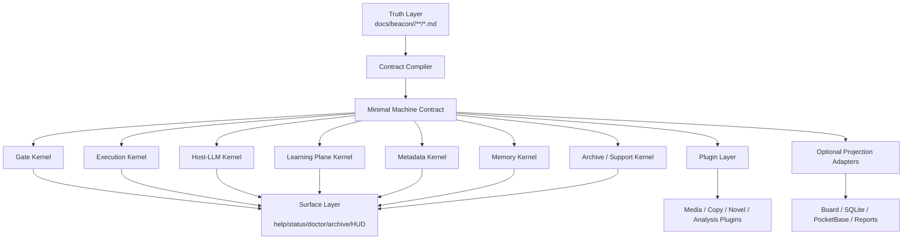
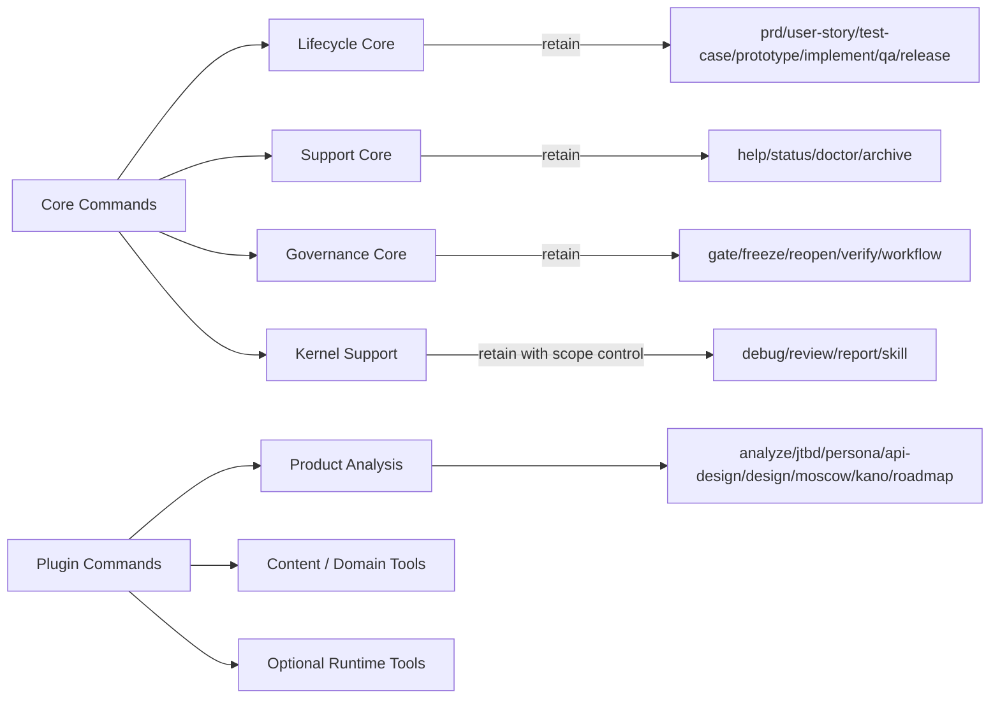
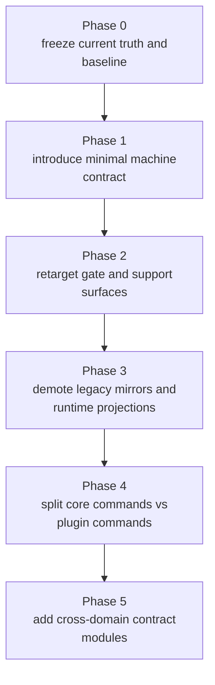

# Beacon v2 Lightweight Kernel Architecture

## 1. 目标

本稿合并以下分析成果：

- Beacon Core Kernel Spec
- Beacon 功能版图缺口地图
- 现有源码中的 truth/gate/implement/host/meta/learning/memory/archive/support 面

形成一版正式的 Beacon v2 轻量内核架构定义，回答四件事：

1. Beacon v2 lightweight kernel architecture
2. minimal machine contract schema
3. 哪些命令保留核心，哪些迁插件
4. 重构迁移阶段图

本架构以“减重不减基座”为原则。

## 2. v2 设计原则

### 2.1 不变原则

- 唯一冻结真相源：`docs/beacon/<version>/**/*.md`
- 人类主流程不变：
  - `prd -> user-story -> test-case -> prototype -> implement -> qa -> release`
- `implement` 仍是唯一实现入口
- `qa` 仍是唯一验收入口
- gate 必须能定义 blocked / pass / next step
- host-native LLM 仍是优先语义执行面

### 2.2 收敛原则

- machine 面只保留一层 minimal contract
- runtime projection 不再默认定义 truth closure
- metadata / learning / memory / archive 保留为基座，但减少重复写入面
- 外围命令插件化，不再和核心生命周期同级膨胀

### 2.3 扩展原则

- Beacon v2 先收敛 kernel，再扩展 domain
- code/media/copy/novel 等场景共用同一 freeze kernel
- 扩展的是 contract，不是先扩展命令数量

## 3. Beacon v2 Kernel Architecture

### 3.1 内核分层

Beacon v2 收敛为五层：

1. Truth Layer
2. Contract Layer
3. Kernel Services Layer
4. Surface Layer
5. Plugin Layer

### 3.2 分层定义

#### Truth Layer

- 唯一真相：`docs/beacon/<version>/**/*.md`
- 包含：
  - PRD
  - User Story
  - Test Case
  - Prototype Freeze
  - Change
  - Release

#### Contract Layer

- 从 Truth Layer 单向编译出的 minimal machine contract
- 是 gate/implement/qa/release 的唯一机器消费入口

#### Kernel Services Layer

- Gate Kernel
- Execution Kernel
- Host-LLM Kernel
- Learning Plane Kernel
- Metadata Kernel
- Memory Kernel
- Archive/Support Kernel

#### Surface Layer

- help
- status
- doctor
- archive
- HUD

#### Plugin Layer

- 产品分析
- 内容策略
- 文案工作流
- 小说工作流
- 外部可选 runtime projection
- 其他 toolkit

### 3.3 Mermaid 架构图



## 4. Beacon v2 核心能力边界

### 4.1 核心必须保留

- Truth Freeze
- Gate
- Implement / QA
- Host-LLM bridge/fallback
- Learning plane contract
- Metadata / topology / version binding
- Workflow memory / debug feedback / memory envelope
- Archive / support navigation

### 4.2 核心可以减重但不能删除

- prototype governance
- requirement deepening
- runtime readiness / delegation readiness
- support read model

### 4.3 不再作为主路径基石

- runtime ledger sqlite 成功与否
- pocketbase projection 成功与否
- legacy PRD mirror
- 多个同义 machine artifact
- 模板型产品命令的一等主面地位

## 5. Minimal Machine Contract Schema

### 5.1 设计目标

Beacon v2 应把现有碎片 machine 面收敛成：

- 单 feature compiled contract
- 单 version manifest

推荐目录：

- `docs/beacon/<version>/.machine/compiled/<feature>.json`
- `docs/beacon/<version>/.machine/compiled/index.json`

### 5.2 单 feature schema 草案

```json
{
  "schema_version": "2.0",
  "contract_kind": "beacon_feature_contract",
  "version": "v1.3.12",
  "feature": "Feature Name",
  "feature_slug": "feature-name",
  "revision": {
    "revision_id": "R3",
    "source_revision_id": "R2",
    "doc_status": "frozen",
    "delivery_status": "implemented",
    "baseline_hash": "sha256:...",
    "frozen_at": "2026-05-06T00:00:00Z"
  },
  "truth_refs": {
    "prd": "docs/beacon/v1.3.12/prd/feature-name.md",
    "user_story": "docs/beacon/v1.3.12/user-story/feature-name.md",
    "test_case": "docs/beacon/v1.3.12/qa/test-cases/feature-name.md",
    "prototype": "docs/beacon/v1.3.12/prototype/feature-name/"
  },
  "requirement": {
    "promised_surfaces": [],
    "acceptance_criteria": [],
    "test_cases": [],
    "ac_tc_mapping": [],
    "completeness_verdict": "ready"
  },
  "execution": {
    "implement_entry": "implement",
    "qa_entry": "qa",
    "implementation_plan_ref": "",
    "git_workflow_ref": "",
    "host_runtime_mode": "host-native"
  },
  "gate": {
    "requirement_gate": "pass",
    "semantic_gate": "pass",
    "prototype_gate": "pass",
    "qa_gate": "pass",
    "release_gate": "blocked",
    "blocked_reason_codes": []
  },
  "acceptance": {
    "status": "pending",
    "accepted_at": "",
    "accepted_by": "",
    "evidence_refs": []
  },
  "metadata": {
    "topology_kind": "single_repo",
    "default_execution_service": "beacon",
    "canonical_branch": "beacon/v1.3.11"
  },
  "learning": {
    "rewrite_input_ref": "",
    "policy_topics": [],
    "open_feedback_refs": []
  },
  "archive": {
    "status": "active",
    "learnable": false
  },
  "compile": {
    "source_hash": "sha256:...",
    "compiled_at": "2026-05-06T00:00:00Z",
    "compiler_version": "beacon-v2"
  }
}
```

### 5.3 v2 schema 约束

- 从 markdown 单向编译
- 幂等
- 不反写 truth
- 不嵌套 runtime projection truth
- gate 不再直接消费 legacy mirror

### 5.4 index schema 草案

```json
{
  "schema_version": "2.0",
  "contract_kind": "beacon_contract_index",
  "version": "v1.3.12",
  "features": [
    {
      "feature_slug": "feature-name",
      "contract_ref": "docs/beacon/v1.3.12/.machine/compiled/feature-name.json",
      "doc_status": "frozen",
      "release_gate": "blocked"
    }
  ],
  "compiled_at": "2026-05-06T00:00:00Z"
}
```

## 6. 核心命令与插件命令边界

### 6.1 保留核心命令

#### Lifecycle Core

- `prd`
- `user-story`
- `test-case`
- `prototype`
- `implement`
- `qa`
- `release`

#### Support Core

- `help`
- `status`
- `doctor`
- `archive`

#### Governance Core

- `gate`
- `freeze`
- `reopen`
- `verify`
- `workflow`

#### Kernel Support

- `debug`
- `review`
- `report`
- `skill`

说明：

- `debug/review/report/skill` 不属于人类极简主流程
- 但属于当前 Beacon kernel 的系统级支撑命令
- v2 可保留为核心附属命令，但不再继续扩张主叙事

### 6.2 降为插件命令

这些命令不应再与 lifecycle core 同级承载产品定位：

- `analyze`
- `jtbd`
- `persona`
- `api-design`
- `design`
- `moscow`
- `kano`
- `roadmap`
- `data-dictionary`
- `ui-spec`

### 6.3 有条件保留为“domain module”

如果未来升级为真正 freeze/gate/release 闭环，则可保留为 domain module：

- `brainstorm`
- `friction-intake`
- `feedback`
- `remember`
- `recall`

它们的前提是：

- 接 typed learning plane
- 接 change/refreeze contract
- 不只产出孤立文档

### 6.4 命令边界图



## 7. Beacon v2 对跨场景扩展的定义

### 7.1 扩展方式

v2 不再先加命令，而是先加 contract。

所有场景都先映射到统一 freeze kernel：

- problem
- audience
- promise
- boundary
- scenario
- acceptance
- structure freeze
- delivery

### 7.2 场景模块

#### code module

- 当前默认主模块

#### media module

- 选题 PRD
- audience story
- content acceptance case
- outline prototype
- draft implement
- editorial QA
- publish release

#### copy module

- messaging PRD
- audience story
- claim/test case
- copy structure prototype
- delivery QA

#### narrative module

- world/conflict PRD
- character story
- chapter acceptance
- outline/state prototype
- continuity QA

这些模块都不应直接进入 core，而是基于 v2 contract compiler 做 domain plugin。

## 8. 重构迁移阶段图

### 8.1 总迁移图



### 8.2 分阶段说明

#### Phase 0

- 冻结当前 version line
- 保持现有行为可验证
- 标记 legacy artifact inventory

#### Phase 1

- 引入 `/.machine/compiled/<feature>.json`
- 从 markdown 编译 unified contract
- 不改变现有命令输出

#### Phase 2

- gate 改为优先读取 unified contract
- help/status/release 优先读取 unified contract
- 保留旧路径兜底

#### Phase 3

- runtime ledger / sqlite / pocketbase 改成 optional projection
- legacy PRD mirror 不再参与主路径 gate
- `doctor sync-materials` 改成 `compile-contract`

#### Phase 4

- 核心命令与插件命令分层
- 模板型产品命令迁移到 plugin surface
- 核心 CLI 帮助面回到极简

#### Phase 5

- 定义 media/copy/novel domain contract
- 接入相同 freeze/gate/release kernel
- 形成 Beacon 的跨场景 requirement alignment 平台

## 9. 迁移风险与护栏

### 9.1 风险

- 迁移时 gate 结果漂移
- 旧 artifact 被过早移除
- support surface 与 core contract 脱节
- plugin/module 再次进入核心叙事

### 9.2 护栏

- 先双读，后单读
- 先 contract compile，后切 gate
- projection 只降级，不立即物理删除
- 所有 plugin 不得反写 core truth

## 10. 最终判断

Beacon v2 的正确方向不是“继续堆命令”，也不是“删到只剩模板工具”。  
正确方向是：

- 保留 truth freeze、gate、implement/qa、host-LLM、learning、meta、memory、archive/support 这些 kernel
- 收敛 machine 面为 minimal contract
- 将 runtime projection 降为可选
- 将产品分析与跨场景工具迁移到 plugin/domain module

最终的 Beacon v2 应该是：

> 一个以冻结真相为核心、以 minimal contract 为机器入口、以 gate 为完成定义、以 host-native LLM 为语义引擎、以 plugin module 扩展更多场景的轻量 workflow kernel。
