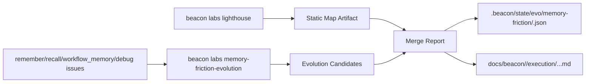

# Beacon v1.3.3 记忆进化与摩擦演进 Toolkit 头暴

**Date**: 2026-04-16  
**Version**: v1.3.3（planning line）  
**Status**: Brainstorm Draft

---

## 1. 目标

在不扩张 Beacon 主工作流（`6+3`）前提下，新增一个可选 Toolkit 方向：

1. `memory-evolution`：把 `remember/recall/workflow_memory` 的历史沉淀转成可执行优化建议
2. `friction-evolution`：把目标项目运行中的摩擦错误（debug feedback / issue）转成能力改进候选
3. 与现有 `beacon-toolkit-lighthouse` 并行，而非替代

---

## 2. 已确认事实（基于当前仓库）

1. 已有隐藏命令面：
   - `beacon lighthouse`（可通过 `labs lighthouse` 暴露）
   - `beacon remember` / `beacon recall`
2. 已有记忆与闭环状态文件：
   - `.beacon/memory/memory-v1.json`
   - `.beacon/memory/workflow-lifecycle.json`
   - `.beacon/state/debug-feedback/*.jsonl`
   - `.beacon/debug/index.json`
   - `.beacon/state/evo/*`
3. 当前项目实测：
   - memory 条目总数 `236`（insight `122`，decision `114`）
   - debug issue 目前已沉淀 `1` 条（`beacon-core--runtime_feedback`）
4. `beacon-toolkit-lighthouse` 已可输出单文件分析到：
   - `.beacon/analysis/*.md`
   - `docs/beacon/<version>/execution/beacon-toolkit-lighthouse-*.md`

---

## 3. 外部参考映射（GenericAgent）

参考：`https://github.com/lsdefine/GenericAgent/blob/main/agent_loop.py`

可借鉴的最小机制（不照搬实现）：

1. `StepOutcome`：每轮输出必须有 `next_prompt / should_exit`
2. `tool_before/after`：工具调用有前后钩子，便于采集摩擦证据
3. `turn_end_callback`：每轮结束统一做收敛决策
4. `max_turns`：防无限循环

对 Beacon 的映射：

1. 每轮产物必须写入 `.beacon/state/evo/memory-friction/*`
2. 每轮都必须有“继续/停止”的结构化判定
3. 每轮都必须可回放（input refs + output refs）

---

## 4. 七维头暴（收敛版）

### 4.1 用户维度

- 核心用户：Beacon 维护者（需要知道“哪里反复卡住、该改什么”）
- 次级用户：目标项目 owner（想看“为何跑不通、下一步改什么”）
- 非目标用户：只想走主链的普通操作者（不应被新 Toolkit 打扰）

### 4.2 场景维度

- 场景 A：版本迭代后，复盘最近 run 的失败/摩擦模式
- 场景 B：目标项目接入 Beacon 后，快速识别高频 friction
- 场景 C：发布前，确认“同类错误是否被真正消减”

### 4.3 业务维度

- 这不是新工作流中心，而是“演进诊断插件”
- KPI 不是“产出更多文档”，而是“同类摩擦复发率下降”

### 4.4 技术维度

- 复用，不重造：
  - 记忆读取：`recall memory`
  - 记忆写回：`remember add`
  - 摩擦来源：`debug_feedback` + `debug/issues`
  - 演进判定：`learning_loop` / `state/evo`
- 并行策略：`lighthouse` 做静态结构图，`memory/friction toolkit` 做动态证据聚类

### 4.5 体验维度

- 输出必须“单结论 + 单下一步”
- 默认给 3 项最高优先候选，不刷屏
- 支持 `--json` 看全量候选评分

### 4.6 价值维度

- 功能价值：把“报错日志”变成“可执行改进 backlog”
- 治理价值：把 debug 反馈和 memory 写回接到同一演进面
- 版本价值：让 v1.3.3 的“轻量核心”仍能持续学习

### 4.7 风险维度

- 风险 1：与现有 `learning_loop` 重叠
- 风险 2：输出建议泛化、不可执行
- 风险 3：误把项目业务错误当 Beacon 产品错误

缓解：

- 先做薄封装：只编排现有数据面，不新增第二套引擎
- 候选必须带 `evidence_refs + recommended_command`
- 增加 `feedback_target` 维度（`beacon-core` vs `project-integration`）

---

## 5. 并行架构（与 Lighthouse）



设计原则：

1. Lighthouse 继续做“结构看清楚”
2. Memory/Friction Toolkit 做“问题为什么复发”
3. 两者在报告层汇合，不互相耦合实现

---

## 6. MVP 命令草案（建议）

保持在可选 analysis 面，不进入主 `6+3`：

1. `beacon labs memory-friction-evolution run --project-root . --version auto --mode both --with-lighthouse --target beacon/utils --json`
2. `beacon labs memory-friction-evolution report --run-id <id>`

参数建议：

- `--mode memory|friction|both`
- `--with-lighthouse`（默认开启）
- `--target <path>`（传给 lighthouse）
- `--max-turns <n>`（参考 GenericAgent 的 max_turns）
- `--writeback`（是否写回 remember）

---

## 7. 最小数据契约（MVP）

```json
{
  "schema_version": "1.0",
  "run_id": "mfe-20260416T000000Z",
  "docs_version": "v1.3.3",
  "mode": "both",
  "inputs": {
    "memory_refs": [],
    "debug_refs": [],
    "lighthouse_ref": ""
  },
  "candidates": [
    {
      "candidate_id": "debug_policy:xxx",
      "category": "debug_policy|rewrite_policy|qa_policy",
      "friction_summary": "",
      "evidence_refs": [],
      "score": 0,
      "recommendation": "keep|review|discard",
      "recommended_command": ""
    }
  ],
  "decision": {
    "next_prompt": "",
    "should_exit": false
  }
}
```

---

## 8. 分阶段落地建议

### Phase 1（最小编排）

1. 新增 `beacon/commands/memory_friction_evolution.py`（hidden + labs）
2. 直接复用：
   - `beacon.utils.memory`
   - `beacon.utils.debug_feedback`
   - `beacon.utils.learning_loop`
   - `beacon.utils.lighthouse`
3. 先产出 JSON + Markdown，不做自动改代码

### Phase 2（写回闭环）

1. 对 `recommendation=keep/review` 的候选支持 `remember add --upsert`
2. 按 `feedback_target` 拆分 `beacon-core` / `project-integration`
3. 支持 `doctor` 提示“高频摩擦候选”

### Phase 3（主流程轻量联动）

1. `help/status` 仅显示“有无高优先 friction 候选 + 单推荐命令”
2. 不在默认输出中展开详情，详情仍在 artifacts

---

## 9. 成功标准（头暴版）

1. 与 `beacon-toolkit-lighthouse` 并行运行稳定，不影响主链
2. 能基于真实 memory/debug 数据给出 Top-N 候选
3. 每个候选都带证据引用和可执行下一步命令
4. 记忆写回复用 `remember/recall` 现有能力，无新 memory silo
5. 普通 `6+3` 用户不被迫学习该 Toolkit

